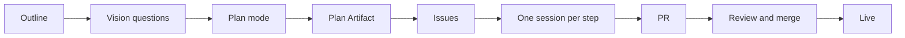

# Product plan

The owner outlines the product. Claude plans it visually, and the desktop app runs the plan.

| # | Step | Do | App feature |
|---|---|---|---|
| 1 | Define | Read the outline and the repo. Ask only product, vision or billing questions: one AskUserQuestion call, at most 4, each with a recommended default. Decide build, security and settings questions yourself from current docs | AskUserQuestion |
| 2 | Split | In plan mode, cut the work into steps. Each step is one PR of at most 200 changed lines, with its test, touching files no other step touches | Plan mode |
| 3 | Show | Publish the plan as an Artifact: a flow diagram, then one table row per step (step, files, depends on, metric it moves). Labels, not paragraphs | Artifacts |
| 4 | File | One issue per step: `gh issue create --type Task`, its body the step's row and the Artifact link | GitHub |
| 5 | Approve | Call ExitPlanMode with the steps and the Artifact link. On approval, start one session per independent step, each on a brief under 150 words | Sessions, worktrees |
| 6 | Build | A worker branches, tests one file at a time, pushes once and opens a PR that says `Closes #<issue>` with a body table. It stops at the open PR | Auto-fix |
| 7 | Merge | The orchestrator reviews each PR with the `reviewer` agent and merges it by the `merging` skill | Reviewer agent |
| 8 | Live | Load the live page in the app's browser. Mark the step done in the Artifact and republish it | Browser, Artifacts |

| Keep usage low | Rule |
|---|---|
| Briefs | A worker starts fresh on its brief, never a fork of the planning conversation |
| Reads | A search across many files goes to `Explore` with `model: "haiku"` |
| Waits | CI, conflicts and review comments come from Auto-fix, never a poll |
| Rounds | At most three review rounds a PR; after that, rethink the step |
