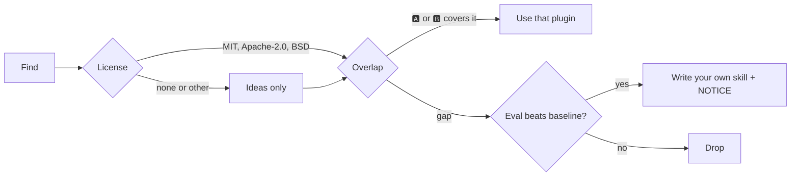

# Scout

Trending skills are worth learning from, not installing blind. Most restate what an Anthropic plugin already does.

| # | Step | Command or rule |
|---|---|---|
| 1 | Find | `gh api -X GET search/repositories -f q='claude code skills stars:>1000' -f sort=stars -f per_page=30`, plus queries for `agent skills` and `claude code plugin`. Keep full_name, stars, created_at, pushed_at and license |
| 2 | Rank | Stars per day since created, pushed in the last 30 days. Show the top 10 as a table |
| 3 | License | `license.spdx_id`: MIT, Apache-2.0 or BSD → adapt in your own words and credit it in NOTICE. None or anything else → ideas only, no text copied |
| 4 | Contents | `gh api repos/<r>/git/trees/HEAD?recursive=1`, list the `SKILL.md` folder names |
| 5 | Overlap | Match each capability against installed plugins (`claude plugin list --json`, the session's skill listing) and the official catalog at `~/.claude/plugins/marketplaces/claude-plugins-official/.claude-plugin/marketplace.json`. 🅰 or 🅱 coverage means use that plugin |
| 6 | Prove | A gap becomes a skill only if `claude plugin eval` shows it beats the no-plugin baseline on real prompts |
| 7 | Report | One table: capability, sources, covered by, verdict (use 🅰, use 🅱, write, drop) |

| Never | Why |
|---|---|
| Install an unreviewed plugin to try it | plugins run code with your privileges (code.claude.com/docs/en/plugins/security) |
| Copy text from a repo with no license | no license means no permission to copy |
| Add a skill that duplicates a 🅰 or 🅱 one | every skill costs always-on tokens in every session |
