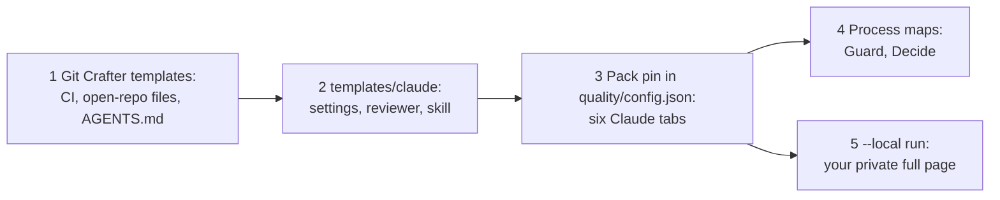

# Claudius

The Claude pack for [Git Crafter](https://github.com/SoulCraft-Org/git-crafter): Claude Code templates, Quality tabs and Process maps for a GitHub repo that agents drive from the Claude desktop app.

[Live Quality and Process pages](https://colorado-startups.github.io/claudius/) · 

Claudius is not an Anthropic product and is not affiliated with Anthropic.

## Quickstart

| # | Do | Where |
|---|---|---|
| 1 | Adopt Git Crafter: CI, open-repo files, `AGENTS.md` and `CLAUDE.md` | Git Crafter `templates/ci/README.md`, `templates/agents/` |
| 2 | Copy the Claude files and set the desktop app | [templates/claude/README.md](templates/claude/README.md) |
| 3 | Add the pack (table below) | `quality/config.json` |
| 4 | Add `{ "use": "guard" }` and `{ "use": "decide" }` to your Process config's `maps` | [maps/README.md](maps/README.md) |
| 5 | Run the one local command for the numbers CI never sees | below |

## What it is

| Part | Is |
| --- | --- |
| Templates | `templates/claude/`: the Claude-only files a repo commits. This repo runs copies of them (`tests/templates.test.mjs`) |
| Pack | 6 tabs: Claude, Claude settings, Claude desktop app, Blockers, Tokens, Instructions. Maps: Guard, Decide |
| Engine | Git Crafter's `actions/pages` and CI standard, pinned by full commit SHA. No engine code lives here |
| Public pages | Built in CI from `quality/public/`. The Quality page shows only metrics read from GitHub and the repo's files. Each metric that needs local files is dropped: not shown, counted or listed. The exceptions are the ones `quality/public-params.json` reads from committed files alone. A tab left with no metric, Tokens and Claude desktop app, is left off; it shows on a `--local` page (Git Crafter v7.0.1 or later). The Process page shows each map step such a metric does not score |
| Private numbers | Usage, cost, transcripts and connectors. Read on your own machine only, never uploaded |
| Licence | Apache-2.0. Source of the moved files: [NOTICE](NOTICE) |

## Layout

| Path | Holds |
| --- | --- |
| `templates/claude/` | the Claude templates; `AGENTS.md`, `CLAUDE.md` and `.claude/` at the root are this repo's own |
| `pack.json` | the six tabs |
| `targets/`, `ideals/`, `maps/` | metric definitions, ideal states, the Guard and Decide maps |
| `collectors/<tab>/`, `fixtures/` | the collectors, their tests and test fixtures |
| `quality/process/config.json` | the Process page: the Guard and Decide maps, named by `use` |
| `quality/public.mjs`, `quality/public-params.json` | write `quality/public/`, the configs CI builds the public pages from. Each metric that needs local files is dropped but the repo-file ones. Each map is written out in full without the steps those metrics score |
| `tests/moved.json` | where each file came from in Git Crafter |
| `tests/engine-tests.sh` | CI: each file matches its source or is listed as edited, then the tests run beside the pinned engine |

## Add the pack

| Step | Do |
| --- | --- |
| 1 | Adopt Git Crafter: its `templates/ci/README.md` |
| 2 | In `quality/config.json`, add `"packs": ["Colorado-Startups/claudius@<40-hex sha>"]`, the commit of the latest [release](https://github.com/Colorado-Startups/claudius/releases) |
| 3 | If `quality/config.json` lists `tabs`, add the pack's ids too (`claude`, `claude-settings`, `desktop-app`, `blockers`, `tokens`, `instructions`): a pack's tabs join only the default list (Git Crafter `quality/CONFIG.md`) |
| 4 | Pass that same file as `actions/pages`' `quality-config`, and name it as the Process config's `quality_config`: only that file's packs are fetched, so a map from the pack is found there alone |
| 5 | `actions/pages` checks the pack out at that SHA and runs its collectors |
| 6 | For a `--local` run, clone the pack at that SHA into `$CODE_OS_PACKS/Colorado-Startups/claudius` (default `.code-os-packs/` in the repo), with no SHA folder (Git Crafter `quality/packs.mjs`) |
| 7 | Moving the pins later: the `bump-pins` skill in `templates/claude/` |

| Pin | Works |
| --- | --- |
| Git Crafter engine up to `d3c15df` (v4.6.4) | No. That engine still ships these tabs, and a pack named like them is a usage error |
| Git Crafter engine from `70ccd19` (v5.0.0), which ships no Claude tab | Yes: the collectors take every engine helper from `lib` (`collectors/lib/engine.mjs`). This repo pins `689a2c2` (v7.0.1) |

## The one local command

| Command | Writes | Uploaded |
| --- | --- | --- |
| `node <git-crafter>/quality/collect.mjs --config quality/config.json --local` | `quality/data/local.json` and `quality/history/`, both in `.gitignore`: the full page, every metric | Never |

## Privacy gate

| Check | Fails when |
| --- | --- |
| [tests/privacy.mjs](tests/privacy.mjs), on every page build | the run is not a CI run, or a local-only metric is in it, read or not. Or a local-only id, home path, email or listed name is in it, or in any file the deploy uploads (quality/public/dist) |
| Names | `PRIVACY_NAMES`, comma separated: the repo's Actions secret in CI, an environment variable on your machine. A finding prints its file and line, never what it matched. With none set, as on a fork's pull request, the name check is skipped and the gate says so |

| Process map | Public steps | Why |
| --- | --- | --- |
| Guard | `change` only | its other four steps read local-only metrics |
| Decide | none, so the public page leaves it out | all four steps read local-only metrics |
