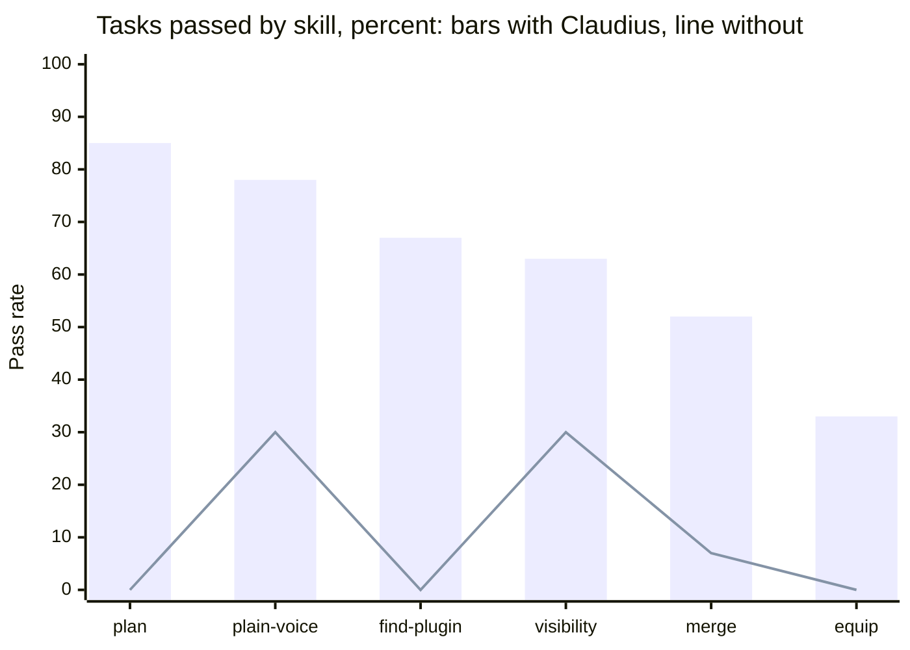
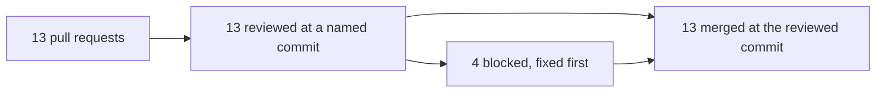

# Claudius Scorecard

Measured 2026-11-15 at plugin 0.3.0; `plan` re-measured and `visibility` measured 2026-11-19 at 0.4.1 · Haiku 5.5, Sonnet 5.5, Opus 5.5 · judged by Sonnet 5.5

| | 🧩 With Claudius | ⬜ Without | 📈 Lift |
|---|---|---|---|
| **Graded tasks Claude got right** | **63%** | 11% | **+52 points**, ± 12 at 95% |

| 📈 Got better | ➖ Same | 📉 Got worse | 🪙 Always-on tokens | ✅ Anthropic's checks |
|---|---|---|---|---|
| **34** of 54 | 20 | **0** | **404** (goal 500) | **12** of 12 |

## 📈 Quality

| Skill | ⬜ Without | 🧩 With | Lift | Haiku | Sonnet | Opus |
|---|---|---|---|---|---|---|
| `plan` | 0% | **85%** | +85 | +100 | +89 | +67 |
| `plain-voice` | 30% | **78%** | +48 | +33 | +67 | +44 |
| `find-plugin` | 0% | **67%** | +67 | +67 | +67 | +67 |
| `visibility` | 30% | **63%** | +33 | +33 | +33 | +33 |
| `merge` | 7% | **52%** | +44 | +22 | +89 | +22 |
| `equip` | 0% | **33%** | +33 | +33 | +33 | +33 |

Lift is in points: the pass rate with Claudius minus the pass rate without it, on the same task and model.

`plan` was re-measured on 2026-11-19 at plugin 0.4.1, three runs per arm. Its grader requires a `Checked:` line that only Claudius writes, so its without arm scores 0. Its figures measure that line.

## 🔀 GitHub

| Measure | Value | Compared with |
|---|---|---|
| Graded merge tasks passed | **52%** with Claudius | 7% without |
| Merges pinned to a review verdict | **13 of 13** | observed, no comparison group |
| Defects blocked and fixed before merge | **4** pull requests | observed, no comparison group |

Observed on two repos on 2026-11-15: `claudius` #68 to #73 and `git-crafter` #134 to #140.

## 🪙 Consumption

| Measure | Value | Reference |
|---|---|---|
| Always-on tokens, six skills | **404** | goal 500 · Claude Code flags a plugin at 2,000 |
| Right skill picked with 102 plugins on | **8 of 8** | skills listed by name only · plugin 0.3.0 |
| Skill listing at that setting | **12,300** tokens | 107,616 with every description shown · plugin 0.3.0 |

| Skill | Always on | When used |
|---|---|---|
| `plan` | ~70 | ~1,000 |
| `merge` | ~70 | ~1,100 |
| `equip` | ~70 | ~990 |
| `visibility` | ~60 | ~770 |
| `find-plugin` | ~60 | ~460 |
| `plain-voice` | ~70 | ~340 |
| **All six** | **404** | |

The rows are Claude Code's rounded estimates (`claude plugin details`, plugin 0.4.1, read 2026-11-19); its own total is 404. The Best practices tab estimates the same listing at 389, by characters ÷ 4.

## ✅ Standards

12 of 12 of Anthropic's published checks at goal

| Check | Now | Goal | Read from |
|---|---|---|---|
| Findings that block a directory submission | 0 | 0 | Best practices tab |
| Findings held for an Anthropic reviewer | 0 | 0 | Best practices tab |
| Directory warnings | 0 | 0 | Best practices tab |
| Directory listing fields missing | 0 | 0 | Best practices tab |
| Skill authoring rules broken | 0 | 0 | Best practices tab |
| Skill files past the size and layout rules | 0 | 0 | Best practices tab |
| Skills that run tools they do not name | 0 | 0 | Best practices tab |
| Largest plugin's always-on tokens (chars ÷ 4) | 389 | 500 | Best practices tab |
| Plugin skills with fewer than three eval cases | 0 | 0 | Best practices tab |
| Plugin skills not shown to beat no plugin | 0 | 0 | Best practices tab |
| Directory portal: blocking findings | 0 | 0 | scan passed at 1d57131 (plugin 0.3.0) |
| Directory portal: policy holds | 0 | 0 | scan passed at 1d57131 (plugin 0.3.0) |

Plugin 0.3.0 passed the directory's scan on 2026-11-15, with warnings only, and is ready to publish. Publishing is requested and waits for an Anthropic reviewer. Nothing is listed yet.

## 🔬 Method

| What | How |
|---|---|
| Tasks | 18, three per skill, in [plugin/evals](plugin/evals) |
| Runs | 252 agent runs: `merge`, `plain-voice`, `plan` and `visibility` tasks 3 per arm, the rest 1 |
| Tool | `claude plugin eval`, each task with the plugin and without it |
| Scores | [quality/evals](quality/evals), one file per model |
| Interval | 1.96 standard errors of the 54 paired differences |
| Token cost | `claude plugin details claudius` and the [Best practices tab](https://colorado-startups.github.io/claudius/#practices) |

| Not shown | Why |
|---|---|
| Time or tokens per task, with and without | not measured yet |
| What people using it think | no survey |
| GitHub figures against a comparison group | none exists; they are observed counts |
| The listing test on other accounts | one account, Opus 5.5 |

## 📚 Built to these rules

| Source (read 2026-11-15) | Rule followed |
|---|---|
| [Anthropic: plugin evals](https://code.claude.com/docs/en/plugin-evals) | show with against without, never a score alone |
| [Anthropic: a statistical approach to model evals](https://www.anthropic.com/research/statistical-approach-to-model-evals) | error bars at 95%, paired differences on the same tasks |
| [Anthropic: measure plugin cost](https://code.claude.com/docs/en/plugins/measure) | always-on tokens, with the 2,000 flag |
| [GitHub: engineering system success playbook](https://github.com/resources/insights/engineering-system-success-playbook) | quality and velocity together |
| [OpenSSF Scorecard](https://github.com/ossf/scorecard) | named checks, each pass or fail |
| [Microsoft: Power BI scorecards](https://learn.microsoft.com/en-us/power-bi/create-reports/service-goals-introduction) | every metric shows a value against a target |
| [Microsoft Research: SPACE](https://www.microsoft.com/en-us/research/publication/the-space-of-developer-productivity-theres-more-to-it-than-you-think/) | never a single metric |
