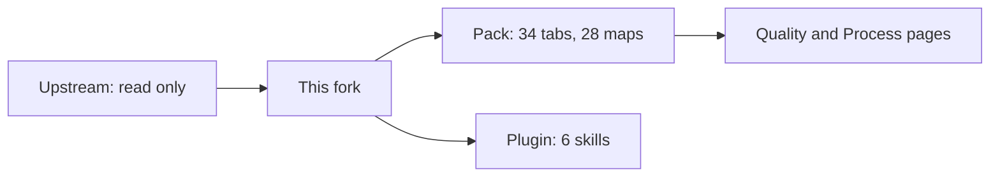

# Claudius (SoulCraft fork) spec

| Field | Value |
|---|---|
| Status | Draft, 2026-11-25. Waits for the owner's answer on the open choices |
| Repo | `Soul-Craft/claudius`, public, a fork of Colorado-Startups/claudius, Apache-2.0 |
| Written from | [README](README.md), [AGENTS.md](AGENTS.md), [SCORECARD](SCORECARD.md), `pack.json` and the open issues. No goal here is new |
| Tracks | #72 |

## Purpose

The Claude pack for Git Crafter: Claude Code templates, Quality tabs and Process maps for a GitHub repo that agents drive from the Claude desktop app. This fork carries the SoulCraft changes, chiefly the Code Project tabs and maps.

## Goals

| Goal | Measured by |
|---|---|
| Claude does better with the pack | [Scorecard](SCORECARD.md): 63% of graded tasks passed against 11%, measured 2026-11-15 |
| Always-on tokens stay small | 404 against a goal of 500 (Scorecard) |
| Public pages show only provable data | `tests/privacy.mjs` on every page build |
| The Code Project tab reads real data | A collector for each line (#24, #52, #80, #86) |

## Not goals

| Not | Why |
|---|---|
| An Anthropic product | The README says it is not affiliated |
| Engine code | The engine is Git Crafter's, pinned by commit SHA |

## Parts

| Part | Folder |
|---|---|
| Pack, targets, ideals | `pack.json`, `targets/`, `ideals/` |
| Maps, 28 | `maps/` |
| Collectors and fixtures | `collectors/`, `fixtures/` |
| Claude templates | `templates/claude/` |
| Plugin, 6 skills | `plugin/` |

## Roadmap, from the open issues

| Theme | Issues |
|---|---|
| Collectors for lines with none | #52, #53, #78, #80, #86, #90 |
| Guard hooks in the plugin | #87 |
| Fork's own Quality page | #81, #88 |
| Upstream give-back queue | #73, #75, #76 |

## Open choices

| # | Choice | Recommendation |
|---|---|---|
| 1 | Upstream: send nothing, as the org rule says today. Or send pull requests, as #73 to #76 plan | Send nothing: Colorado-Startups is another company. Close or re-aim the queue |
| 2 | Stay a fork, or detach | Stay: it is 19 ahead and 0 behind, so detaching gains nothing |
| 3 | Brand: keep upstream's guide, or choose SoulCraft's | Keep it until the owner chooses a brand |
| 4 | GOVERNANCE text: keep upstream's, or rewrite | Rewrite once choice 1 is answered |
