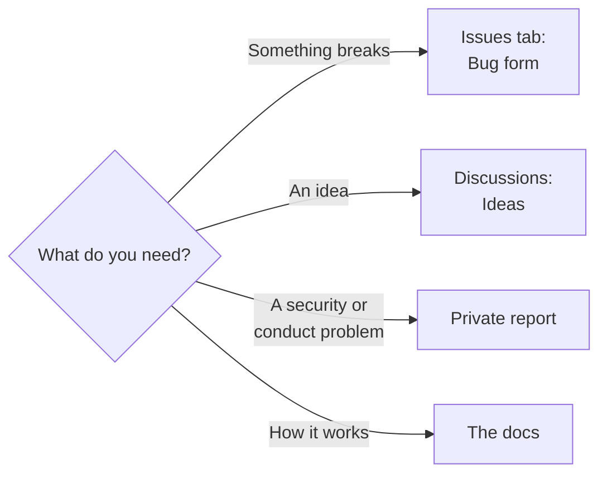

# Support

From Git Crafter `SUPPORT.md`, filled for Claudius.

| Need | Where |
|---|---|
| Report a bug | The Issues tab, **New issue**, the **Bug** form |
| Propose an idea or a feature | [Discussions, Ideas](https://github.com/Colorado-Startups/claudius/discussions/categories/ideas); an accepted idea becomes an issue |
| Ask how something works | [Discussions, Q&A](https://github.com/Colorado-Startups/claudius/discussions/categories/q-a) |
| Report a security problem | [SECURITY.md](SECURITY.md), never a public issue |
| Report conduct | [CODE_OF_CONDUCT.md](CODE_OF_CONDUCT.md) |
| Contribute a change | [CONTRIBUTING.md](CONTRIBUTING.md) |
| Use the templates and maps | [README.md](README.md) |
