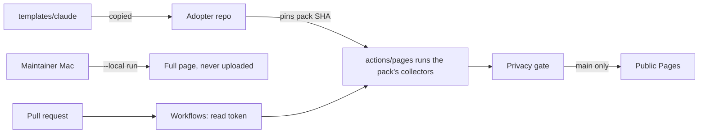

# Threat model

| Read | Covers |
|---|---|
| 2026-11-14 | Every row below, against `main`; [Microsoft SDL](https://www.microsoft.com/en-us/securityengineering/sdl/practices) practice 3. Git Crafter's [THREAT-MODEL.md](https://github.com/SoulCraft-Org/git-crafter/blob/main/THREAT-MODEL.md) covers the engine, guards and sync tool |
| Each PR | Adds a row for a new threat, secret, write scope or collector input |
| Weekly | `security.threat_model_current` reads off past 7 days of grace (`quality/public-params.json` `params_for`) |

| Element | Threat | STRIDE | Control | Gap |
|---|---|---|---|---|
| [collectors/](collectors/) in an adopter's CI | Pack code runs with the adopter's workflow token | Elevation | Pinned by full SHA; the adopter's `pages.yml` grants read scopes only; collectors read files and `gh` data, never write | An adopter who widens the token widens the pack |
| [collectors/](collectors/) on the maintainer's Mac | A local read leaks transcripts, paths or names | Disclosure | Only counts and file names leave a collector (`redact`); a `--local` page is never uploaded (`.gitignore`) | None known |
| [quality/public.mjs](quality/public.mjs), [public-params.json](quality/public-params.json) | A local-only metric reaches the public page | Disclosure | Dropped by `needs`, never by a hand list; `repo_only` metrics read committed files alone | A new collector that ignores `repo_only` |
| [tests/privacy.mjs](tests/privacy.mjs) | A home path, email, private name or local id ships | Disclosure | Required on every page build; reads the run and every uploaded file; `PRIVACY_NAMES` from a secret, masked per name; prints file and line, never the match | Fork PRs get no secret, so the name check skips there |
| [.github/workflows/](.github/workflows/) | PR code gets secrets or writes | Elevation | No `pull_request_target`; read-only default token; deploy only from `main` | None known |
| [.github/workflows/](.github/workflows/) | An action tag moves | Tampering | Full-SHA pins; Dependabot with a 14-day cooldown | None known |
| [templates/claude/.claude/](templates/claude/.claude/) | An adopter's agent reads a key | Disclosure | Deny rules for `.env`, `*.pem`, `*.key`, `secrets/`, `~/.ssh`, `~/.aws`; `claude_settings.deny_coverage` scores them | Deny rules cover reads, not every tool |
| Secrets (`PRIVACY_NAMES`) | A session prints a secret | Disclosure | Set from a file on stdin through the Git Crafter guard route; never on a command line | None known |
