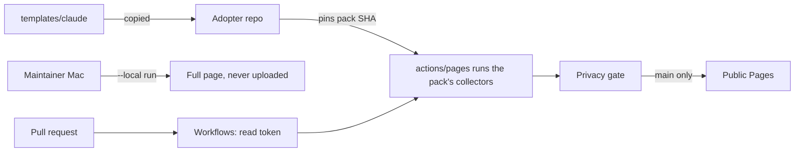

# Threat model

| Read | Covers |
|---|---|
| 2026-11-14 | Every row below, against `main`; [Microsoft SDL](https://www.microsoft.com/en-us/securityengineering/sdl/practices) practice 3. Git Crafter's [THREAT-MODEL.md](https://github.com/SoulCraft-Org/git-crafter/blob/main/THREAT-MODEL.md) covers the engine, guards and sync tool |
| Each PR | Adds a row for a new threat, secret, write scope or collector input |
| Weekly | `security.threat_model_current` reads off past 7 days of grace (`quality/public-params.json` `params_for`) |

| Element | Threat | STRIDE | Control | Gap |
|---|---|---|---|---|
| [collectors/](collectors/) in an adopter's CI | Pack code runs with the adopter's workflow token | Elevation | Pinned by full SHA; the adopter's `pages.yml` grants read scopes only; collectors read files and `gh` data, never write | An adopter who widens the token widens the pack |
| [collectors/](collectors/) on the maintainer's Mac | A local read leaks transcripts, paths or names | Disclosure | Only counts and file names leave a collector (`redact`); a `--local` page is never uploaded (`.gitignore`) | None known |
| [collectors/practices/](collectors/practices/) in CI, a pull request's included | A planted file or eval grader regex stalls the run | Denial of service | Reads files only: `git ls-files`, and no file it reads runs; an `input_match` over 300 characters or with a nested quantifier proves nothing; each regex meets one short string | A slow regex with no nested group still runs, until the job's timeout |
| [quality/public.mjs](quality/public.mjs), [public-params.json](quality/public-params.json) | A local-only metric reaches the public page | Disclosure | Dropped by `needs`, never by a hand list; `repo_only` metrics read committed files alone | A new collector that ignores `repo_only` |
| [tests/privacy.mjs](tests/privacy.mjs) | A home path, email, private name or local id ships | Disclosure | Required on every page build; reads the run and every uploaded file; `PRIVACY_NAMES` from a secret, masked per name; prints file and line, never the match | Fork PRs get no secret, so the name check skips there |
| [.github/workflows/](.github/workflows/) | PR code gets secrets or writes | Elevation | No `pull_request_target`; read-only default token; deploy only from `main` | None known |
| [.github/workflows/](.github/workflows/) | An action tag moves | Tampering | Full-SHA pins; Dependabot with a 14-day cooldown | None known |
| [templates/claude/.claude/](templates/claude/.claude/) | An adopter's agent reads a key | Disclosure | Deny rules for `.env`, `*.pem`, `*.key`, `secrets/`, `~/.ssh`, `~/.aws`; `claude_settings.deny_coverage` scores them | Deny rules cover reads, not every tool |
| [pages.yml](.github/workflows/pages.yml) deploy job | A pull request deploys a page | Tampering | `pages: write` and `id-token: write` sit on the deploy job alone. Its `if` admits a push or a manual run on `main` only. The privacy gate runs before the upload | None known |
| Unread-metrics and score log steps in [pages.yml](.github/workflows/pages.yml) | The build log prints a home path, name or error text | Disclosure | Both run after the privacy gate that checked the run they read, and never fail the build. Each unread reason is cut to 160 characters. The score step prints only ids, statuses, values and goals, which are already on the public page | A reason can hold the first line of a collector's error, and a repo or owner name, which is already public |
| Secrets (`PRIVACY_NAMES`) | A session prints a secret | Disclosure | Set from a file on stdin through the Git Crafter guard route; never on a command line | None known |
