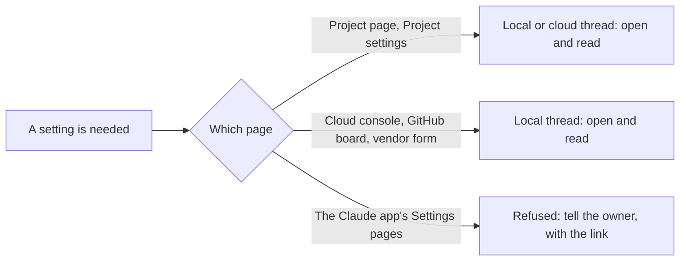

# Blockers: which Claude pages the Chrome tool opens

A thread that needs a Claude setting can learn by trial which pages the Claude in Chrome tool opens. This table records what one check read on 2026-11-25. Re-check a row before relying on it. It sits beside the Blockers tab, which scores the guards a session meets ([ideals/blockers.json](../ideals/blockers.json)).

| Page class | Local session (Mac) | Cloud thread | Do |
|---|---|---|---|
| Project page and Project settings (gear: General, Memory, Environment, Usage, Advanced) | Opens, readable | Opens, readable | Read and set here |
| Usage ring on the Project page (plan, weekly limits) | Opens, readable | Opens, readable | Read it here |
| Claude app Settings pages, such as usage and data privacy | **Refused**: "left to the user" and "not allowed due to safety restrictions" | **Refused** | Give the owner the direct link. Never work around it |
| Claude app Customize and Plugins pages | Not read from a local session | **Refused** | Read plugins and connectors from files and tools instead |
| Cloud provider console pages (billing, workload identity) | Opens, readable | Not tried | Read in a local session |
| GitHub Projects board | Opens, readable | A cloud thread has no GraphQL, so no board API | Read in a local session |
| Vendor sign-up forms | Opens. Fill in full, leave open | Not tried | The owner clicks Submit |

| Rule | Why |
|---|---|
| Do not work around a refusal | A refusal recorded on 2026-11-25 is the last result for that page. The owner decides whether to re-check. The reason was not recorded. No other browser route, no computer use, no page script, no private API |
| Open your own tab and close only that one | Other sessions share the browser |
| Give the owner the exact link, in the main chat | Never send them into a thread or a tab to find it |

Sources: the Claude in Chrome page of the Claude Code docs ([code.claude.com/docs/en/chrome](https://code.claude.com/docs/en/chrome), read 2026-11-25) and the setup check of 2026-11-25, which tried each page class once.
