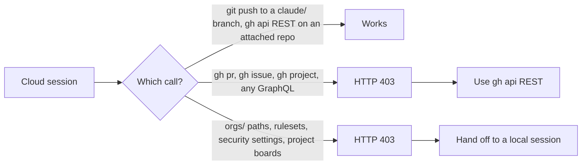

# Cloud sessions and GitHub

A Claude Code cloud session gets a narrower GitHub than your laptop does. This guide says what it can do, what it cannot, and how to hand the rest to a person or a local session. [Back to the Projects quick start](projects-quickstart.md).

## What works and what does not

Observed in Code Project cloud threads on 2026-11-25 and 2026-11-26.

| Call | Cloud session | Do instead |
|---|---|---|
| `git push` to a `claude/` branch of an attached repo | Works | |
| `gh api repos/<owner>/<repo>/...` (issues, comments, pulls, contents) | Works on an attached repo | |
| `gh pr create`, `gh pr view`, `gh issue create`, `gh issue list` | Fails: these call GraphQL | `gh api -X POST repos/<owner>/<repo>/pulls` and `.../issues` |
| `gh project ...` and any GraphQL query | HTTP 403 | A local session, or an issue typed Feature that an auto-add workflow turns into a card |
| `orgs/<owner>/...` paths, rulesets, security toggles, Dependabot and Pages settings | HTTP 403 | A local session signed in as an admin |
| A repo that is not attached to the project | HTTP 403 | Attach it in the project's settings |
| An extension that needs a local install, such as `gh actions-lock` | Not there | A local session |

## Rules that keep a cloud session out of trouble

| Rule | Why |
|---|---|
| Test one read before you plan a write: `gh api repos/<owner>/<repo> --jq .full_name` | A 403 or 404 costs nothing and tells you what the session can reach |
| Put every guard in `CLAUDE.md` or `AGENTS.md`, not in `settings.json` | A cloud session skips a repo's `settings.json` permissions, hooks and env ([Claude Code docs, Projects](https://code.claude.com/docs/en/claude-projects), read 2026-11-25) |
| Write GitHub items one at a time | GitHub documents 80 content writes a minute and 500 an hour for the REST API, shared by every tool on one login |
| On "was submitted too quickly" or a secondary rate limit, stop writing for the time GitHub names | A thread that kept retrying extended the block. One such block on 2026-11-25 lasted more than ten minutes and stopped issue and comment creation |
| Never print or paste a key | A cloud session has no key store. Use the session's own GitHub login |

## Handing work to a local session

Some steps only a local session can do: project boards, admin settings, a sign-in, an extension install. Make the hand-off one line a person can act on.

| Step | Do |
|---|---|
| 1 | File an issue in the repo whose code is at fault. Say what to do, where, and what done looks like |
| 2 | For a feature or an improvement, type it Feature, so the board's auto-add makes the card. See [Project board cards without org access](https://github.com/SoulCraft-Org/git-crafter/blob/main/templates/projects/board-access.md) in Git Crafter |
| 3 | Name the local step in the pull request body, with the exact command |
| 4 | Read the result after the local session runs. Auto-add can miss a card |

## Sources

| Fact | Source |
|---|---|
| GraphQL, `orgs/` paths and boards returned HTTP 403 to a repo-scoped cloud session | Observed in a Code Project, 2026-11-25 and 2026-11-26 |
| `gh pr` and `gh issue` fail because they use GraphQL | Observed in the same threads; the REST routes above worked |
| A cloud session skips `settings.json` permissions, hooks and env | [Claude Code docs, Projects](https://code.claude.com/docs/en/claude-projects), read 2026-11-25 |
| 80 content writes a minute, 500 an hour | GitHub REST API rate limits for content creation, as the docs give them |
