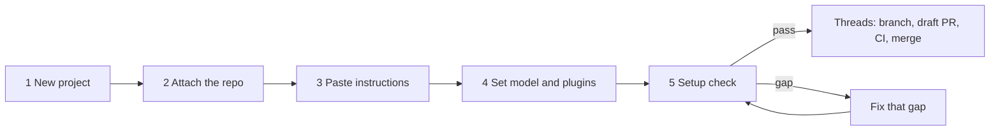

# Open this repo as a Code Project

A Claude Code Project is one conversation that starts cloud threads, each on its own branch and draft PR. Five steps set one up.

| # | Do | Where |
|---|---|---|
| 1 | Create a project in the Claude desktop app, under **Projects**. Plans: Pro, Max, Ultra | claude.ai |
| 2 | Attach the repo and install the Claude GitHub App on it | Project settings, Environment |
| 3 | Paste Git Crafter's instructions file and fill each cell | [instructions.md](https://github.com/SoulCraft-Org/git-crafter/blob/main/templates/projects/instructions.md) |
| 4 | Keep every plugin, skill and connector on. Set the threads model and effort | [All on, app-wide](../templates/claude/README.md#all-on-app-wide) |
| 5 | Send the setup check, which starts no threads | [README.md](https://github.com/SoulCraft-Org/git-crafter/blob/main/templates/projects/README.md) |

| A cloud thread | Loads |
|---|---|
| `CLAUDE.md`, rules, skills, agents, commands from the repo | Yes |
| Hooks, permission rules and `env` from `.claude/settings.json` | No: use a local thread |
| Skills from a plugin | Only when enabled on your claude.ai account |

Limits and cost: [threads.md](https://github.com/SoulCraft-Org/git-crafter/blob/main/templates/projects/threads.md). Source: Claude Code docs, claude-projects, read 2026-11-25.
