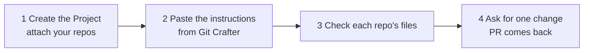

# Open it as a Code Project

A Claude Code Project is a beta feature of the Claude desktop app and claude.ai/code. It needs a Pro, Max or Ultra plan ([Claude Code Projects](https://code.claude.com/docs/en/claude-projects), read 2026-11-25). Each thread is a cloud session on its own branch of an attached repo.

| # | Do | Where |
|---|---|---|
| 1 | Create a Project and attach the one or two repos most tasks touch. Then read one file and push a branch in each repo. An attached repo can fail to connect ([Claude Code Projects](https://code.claude.com/docs/en/claude-projects), read 2026-11-25) | Code tab of the desktop app, or claude.ai/code |
| 2 | Paste Git Crafter's `instructions.md`, filled in, into the Project's instructions | Project settings |
| 3 | Check each attached repo for `AGENTS.md`, a `CLAUDE.md` that imports it, the main rule, a short PR template, an issue form, CI and a valid `.claude/settings.json` | The setup prompt below |
| 4 | Ask for one change. The thread branches and opens a PR when asked | The project chat |

## What a cloud thread loads

| Thread loads | Thread does not load | Do |
|---|---|---|
| Plugins, skills and connectors enabled on your claude.ai account | Plugins and MCP servers installed on your machine | Enable each at [claude.ai/customize/plugins](https://claude.ai/customize/plugins) or [claude.ai/customize/connectors](https://claude.ai/customize/connectors), or run the thread as a Remote Control session |

Source: [Claude Code Projects](https://code.claude.com/docs/en/claude-projects), "Get skills, plugins, connectors, and tools into threads", read 2026-11-25.

## Instructions and the setup check

Git Crafter holds them, so they live in one place: [templates/projects](https://github.com/SoulCraft-Org/git-crafter/tree/main/templates/projects). Its `instructions.md` is the text to paste, and its README holds the first-message setup check and the smoke test. The [Code Project template](../templates/claude/code-project/README.md) adds the Claude-only parts.

## Setup prompt

Paste this as the first message of the first thread. Each line is one step the thread can check off.

| # | The prompt says |
|---|---|
| 1 | Read `CLAUDE.md` and `AGENTS.md` first |
| 2 | Keep `AGENTS.md` as the lean source, and have `CLAUDE.md` import it with `@AGENTS.md` |
| 3 | Add `.claude/settings.json`: allow this repo's own test and lint commands, and deny reads of secrets |
| 4 | Keep the repo's CI. Add Git Crafter's `ci.yml` only when the repo has none |
| 5 | Apply Git Crafter's `setup.json` rows, and require the CI check in a ruleset. A cloud thread cannot write these settings, so it files each as an issue for a local thread ([limits](../templates/claude/code-project/README.md#limits)) |
| 6 | Open a draft pull request. Never print a key value. Ask before spending money |

## What it costs

| Cost | Rule |
|---|---|
| Fixed context | The instructions and each repo's `CLAUDE.md` load in every thread. Move long procedures into skills |
| Idle threads | A thread revived after an hour reads its whole context again, so a fresh thread is cheaper |
| Reviews | Local `/code-review` first. Per-push reviews multiply cost |

The same files work in OpenCode Desktop, which reads `AGENTS.md`.
