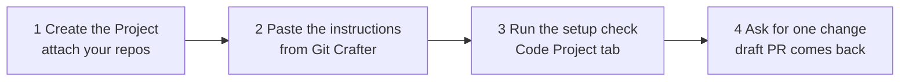

# Open it as a Code Project

A Claude Code Project is in public beta on the Pro, Max and Ultra plans, and you use it at claude.ai/code or in the Code tab of the desktop app ([Claude Code Projects](https://code.claude.com/docs/en/claude-projects), read 2026-11-26). Each thread is usually a cloud session, which works on its own branch of an attached repo.

| # | Do | Where |
|---|---|---|
| 1 | Create a Project and attach the one or two repos most tasks touch. An idle project does not use your plan | claude.ai/code, or the Code tab of the desktop app |
| 2 | Paste Git Crafter's `instructions.md`, filled in, into the Project's instructions | Project settings, Memory, Project instructions |
| 3 | Check each attached repo against the setup check: `AGENTS.md`, a `CLAUDE.md` that imports it, a PR template, an issue form, CI and a valid `.claude/settings.json` | `targets/code-project.json` and the Code Project tab |
| 4 | Ask for one change. The thread branches, pushes after each step and opens a draft PR | The project chat |

## Instructions and the setup check

Git Crafter holds them, so they live in one place: [templates/projects](https://github.com/SoulCraft-Org/git-crafter/tree/main/templates/projects). Its `instructions.md` is the text to paste, and its README holds the first-message setup check and the smoke test. This repo adds the check of each attached repo's own files, as the Code Project tab.

## What it costs

| Cost | Rule |
|---|---|
| Fixed context | The project instructions and each repo's `CLAUDE.md` load in every thread. A multi-step procedure belongs in a skill, not in `CLAUDE.md` ([Claude Code memory](https://code.claude.com/docs/en/memory), read 2026-11-26) |
| Idle threads | On Pro, Max and Ultra within plan limits, a thread idle for more than an hour reads its whole conversation again, so a fresh thread is cheaper for new work ([Claude Code Projects](https://code.claude.com/docs/en/claude-projects#see-and-reduce-a-projects-usage), read 2026-11-26) |

OpenCode reads `AGENTS.md` too ([OpenCode rules](https://opencode.ai/docs/rules), read 2026-11-26).
