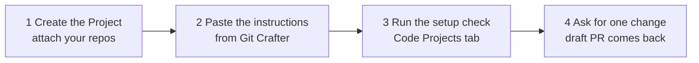

# Open it as a Code Project

A Claude Code Project is a beta feature of the Claude desktop app and claude.ai/code. It needs a Pro, Max or Ultra plan ([Claude Code Projects](https://code.claude.com/docs/en/claude-projects), read 2026-11-25). Each thread is a cloud session on its own branch of an attached repo.

| # | Do | Where |
|---|---|---|
| 1 | Create a Project and attach the one or two repos most tasks touch. Idle projects cost nothing | Code tab of the desktop app, or claude.ai/code |
| 2 | Paste Git Crafter's `instructions.md`, filled in, into the Project's instructions | Project settings |
| 3 | Check each attached repo against the setup check: `AGENTS.md`, a `CLAUDE.md` that imports it, the main rule, a short PR template, an issue form, CI, valid `.claude/settings.json` | `targets/projects.json` and the Code Projects tab |
| 4 | Ask for one change. The thread branches, pushes after each step and opens a draft PR | The project chat |

## Instructions and the setup check

Git Crafter holds them, so they live in one place: [templates/projects](https://github.com/SoulCraft-Org/git-crafter/tree/main/templates/projects). Its `instructions.md` is the text to paste, and its README holds the first-message setup check and the smoke test. This repo adds the check of each attached repo's own files, as the Code Projects tab.

## What it costs

| Cost | Rule |
|---|---|
| Fixed context | The instructions and each repo's `CLAUDE.md` load in every thread. Move long procedures into skills |
| Idle threads | A thread revived after an hour reads its whole context again, so a fresh thread is cheaper |
| Reviews | Local `/code-review` first. Per-push reviews multiply cost |

The same files work in OpenCode Desktop, which reads `AGENTS.md`.
