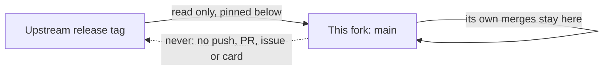

# Upstream: the pinned Claudius release

This fork follows `Colorado-Startups/claudius`, another company's public repo. A thread here reads it and pins a release. It never pushes, opens a pull request, files an issue or adds a card there. The fork's own merges stay in the fork.

| Pin | Value |
|---|---|
| Upstream | `Colorado-Startups/claudius` |
| Pinned release tag | `v1.2.0` |
| Commit | `31476068e317cedfdcb62bf392f5b51c7254dd04` |
| Committed | 2026-11-19 |
| Plugin version at the tag | 0.4.3 |
| Tabs in `pack.json` at the tag | 8 (this fork holds 34) |
| Upstream default branch head, read 2026-11-25 | `34ece50363ebd375617eb84316967d4a76bfe190` |
| Read | 2026-11-25, with `git ls-remote --tags` and a depth-1 fetch of the tag, no write access |

| To move the pin | Do |
|---|---|
| 1 | List upstream's tags: `git ls-remote --tags https://github.com/Colorado-Startups/claudius`; for an annotated tag, take the commit from its `^{}` line |
| 2 | Take the newest release tag and its commit. Read the commit's date and `pack.json` with a depth-1 fetch of that tag |
| 3 | Change the pin rows above in a pull request here, with the date read |

A repo that pins this pack takes the fork's commit, not upstream's, until the fork's Code Project pages reach a release ([README](../README.md#add-the-pack)).
