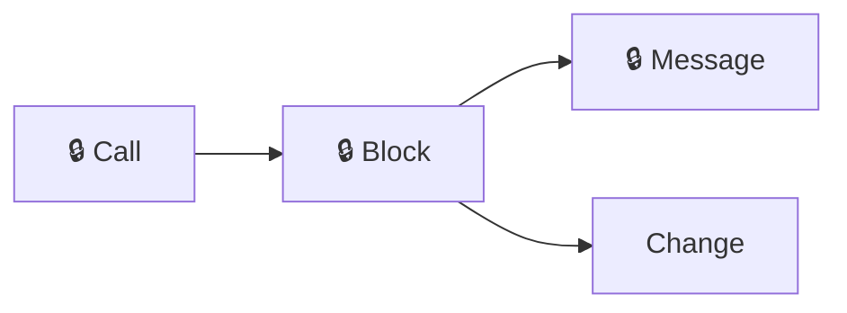
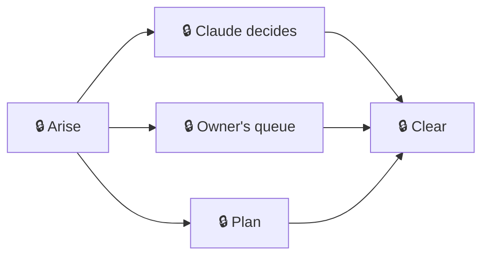
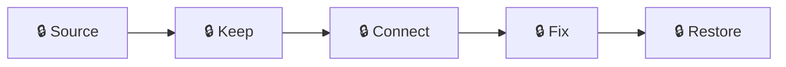
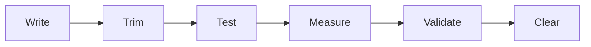
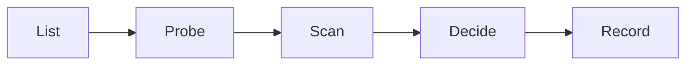

# Process maps

Five maps for an agent-driven repo, each step held to one metric. Use them on your Process page with `{ "use": "guard" }`, `{ "use": "decide" }`, `{ "use": "equip" }`, `{ "use": "publish" }` and `{ "use": "visibility" }` once the pack is in your `quality/config.json` `packs` ([README](../README.md#quickstart)). Steps marked 🔒 read the machine that runs the sessions, so they show only on a `--local` page.

## Guard: a tool call, through the guards, to run or blocked

| Step | Ideal | Metric |
|---|---|---|
| Call | Auto mode and deny rules stop one-way doors; their refusals, and the hooks' blocks, are the count | `blockers.guard_blocks_per_100_calls` |
| Block | A block names its fix, so the session moves on in seconds | `blockers.latest_block_seconds` |
| Message | The rule and the fix, nothing more | `blockers.latest_block_tokens` |
| Change | A rule change lands with one regression case | `blockers.enforcement_reverts` (public) |

## Decide: a question or blocker, to Claude's call or the owner's queue

| Step | Ideal | Metric |
|---|---|---|
| Arise | Surfaces once with its fix named | `blockers.costly` |
| Claude decides | Decides within its delegation, records reason and reversal in the PR | `blockers.latest_block_tokens` |
| Owner's queue | Only questions and human steps reach the owner | `claude_settings.prompts_per_100_calls` |
| Plan | Checked once before it is shown, so the owner approves it as first shown | `desktop_app.plans_first_pass` |
| Clear | Each blocker that costs more than it helps is fixed or removed by PR | `blockers.costly` |

## Equip: every capability on, app-wide, and put to work

The rule every step serves: [All on, app-wide](../templates/claude/README.md#all-on-app-wide).

| Step | Ideal | Metric |
|---|---|---|
| Source | 🅰 official marketplaces or 🅱 Anthropic's reviewed directory, official equivalents beside custom copies, which stay on; anything else named | `desktop_app.plugins_untrusted` |
| Keep | A listing over budget is fixed by `skillListingBudgetFraction`, never by turning one off; no setting turns a plugin, skill or connector off | `desktop_app.off_switches` |
| Connect | Every listed connector connected before the first prompt | `desktop_app.connectors_pending` |
| Fix | A connector that fails or needs a sign-in is repaired or signed in | `desktop_app.connectors_broken` |
| Restore | An install left off is turned back on; only a record whose project folder is gone is removed | `desktop_app.plugins_stale` |

| Tier | Marketplace name | Rule |
|---|---|---|
| 🅰 Anthropic | `claude-plugins-official`, `knowledge-work-plugins`, `claude-for-legal`, `claude-for-financial-services`, `life-sciences` … | ✅ prefer |
| 🅱 Reviewed | Anthropic's directory on claude.ai (`anthropic-plugin-directory` in the desktop app) | ✅ allow |
| 🅲 Community | `claude-community` | ⚠️ no 🅰/🅱 equivalent only |
| 🅳 Third-party | everything else | ❌ add the official one beside it, or name a reason in `kept_plugins`; it stays on |

Tiers follow [plugin security](https://code.claude.com/docs/en/plugins/security) (read 2026-11-14): Claude Code accepts the official and community names only from `github.com/anthropics/`.

## Publish: a plugin or skill, from its first SKILL.md to Anthropic's directory

| Step | Ideal | Metric |
|---|---|---|
| Write | Names and descriptions follow Anthropic's authoring rules: third person, saying when | `practices.skill_rules` |
| Trim | Always-on names and descriptions stay short | `practices.listing_tokens` |
| Test | Three eval cases per skill prove it fired | `practices.skills_under_three_evals` |
| Measure | Each skill beats no plugin on Haiku, Sonnet and Opus | `practices.skills_without_lift` |
| Validate | The developer portal finds nothing that blocks or stops validation | `practices.directory_blocks` |
| Clear | Nothing is held for a reviewer | `practices.directory_holds` |

Every Publish step reads the repo's committed files, so all six show on the public page. The rules, one row each with its doc, are in [`collectors/practices/practices-rules.mjs`](../collectors/practices/practices-rules.mjs), from Anthropic's [plugin pre-submission checklist](https://claude.com/docs/plugins/pre-submission-checklist) and [skill authoring best practices](https://platform.claude.com/docs/en/agents-and-tools/agent-skills/best-practices) (both read 2026-11-15). Eval reports are `claude plugin eval` `aggregate-result.json` files, one per model, at `quality/evals/<plugin>.haiku.json`, `.sonnet.json` and `.opus.json` (`params.eval_reports` on [`targets/practices.json`](../targets/practices.json)).

## Visibility: every repo of an org, from one audit run to public or private

| Step | Ideal | Metric |
|---|---|---|
| List | One run lists every repo with its visibility and archived flag | `visibility.audit_seconds` |
| Probe | A private repo's Pages site is private and does not load signed out | `visibility.private_public_pages` |
| Scan | Public history carries only noreply or org author emails, on every branch | `visibility.personal_author_emails` |
| Decide | A repo stays public only with secret scanning and push protection on | `visibility.public_without_secret_scanning` |
| Record | One collect run on the Quality page, a tenth of the token's hourly requests | `visibility.requests` |

Probe and Decide need an admin token: in CI without `ADMIN_READ_TOKEN` they read not measured, never 0. The [`visibility`](../plugin/skills/visibility/SKILL.md) skill runs the same audit in a session.

Source of truth: [`guard.json`](guard.json), [`decide.json`](decide.json), [`equip.json`](equip.json), [`publish.json`](publish.json), [`visibility.json`](visibility.json).
