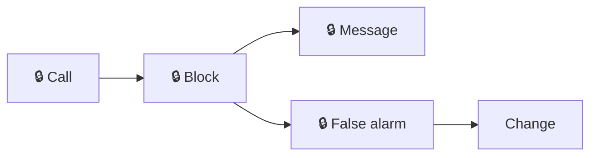
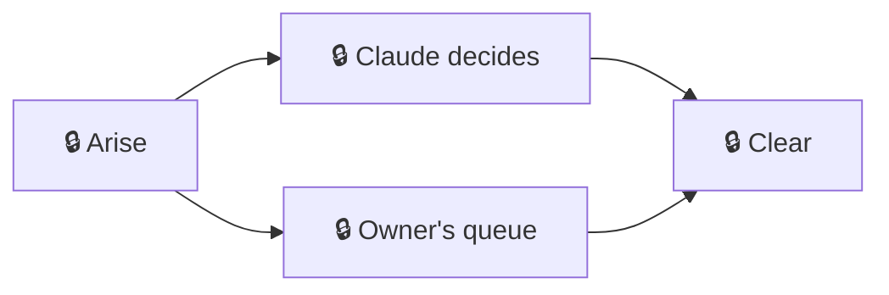
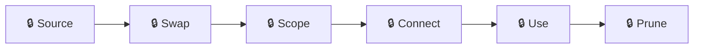
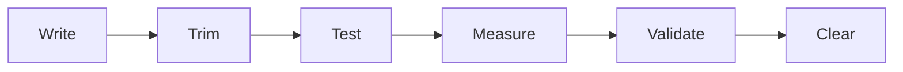

# Process maps

Four maps for an agent-driven repo, each step held to one metric. Use them on your Process page with `{ "use": "guard" }`, `{ "use": "decide" }`, `{ "use": "equip" }` and `{ "use": "publish" }` once the pack is in your `quality/config.json` `packs` ([README](../README.md#quickstart)). Steps marked 🔒 read the machine that runs the sessions, so they show only on a `--local` page.

## Guard: a tool call, through the guards, to run or blocked

| Step | Ideal | Metric |
|---|---|---|
| Call | Auto mode and deny rules stop one-way doors; with no guard log, their refusals are the count | `blockers.guard_blocks_per_100_calls` |
| Block | A block names its fix, so the session moves on in seconds | `blockers.latest_block_seconds` |
| Message | The rule and the fix, nothing more | `blockers.latest_block_tokens` |
| False alarm | A block on a safe command becomes a guard test | `blockers.guard_false_alarm_share` |
| Change | A rule change lands with one regression case | `blockers.enforcement_reverts` (public) |

## Decide: a question or blocker, to Claude's call or the owner's queue

| Step | Ideal | Metric |
|---|---|---|
| Arise | Surfaces once with its fix named | `blockers.costly` |
| Claude decides | Decides within its delegation, records reason and reversal in the PR | `blockers.latest_block_tokens` |
| Owner's queue | Only questions and human steps reach the owner | `claude_settings.prompts_per_100_calls` |
| Clear | Each false block becomes a guard fix by PR | `blockers.guard_false_alarm_share` |

## Equip: a capability, from Anthropic's plugins to a lean session

| Step | Ideal | Metric |
|---|---|---|
| Source | 🅰 official marketplaces or 🅱 Anthropic's reviewed directory; anything else named | `desktop_app.plugins_untrusted` |
| Swap | A custom skill, agent, hook or plugin gives way to Anthropic's | `desktop_app.plugins_replaceable` |
| Scope | Domain plugins on in the repos that use them | `desktop_app.listing_tokens` |
| Connect | Every listed connector signed in before the first prompt | `desktop_app.connectors_pending` |
| Use | An Anthropic or reviewed plugin that goes unused is put to work in the project that needs it, not dropped | `desktop_app.plugins_unused` |
| Prune | Turned-off, orphaned, delisted, unmaintained installs uninstalled | `desktop_app.plugins_stale` |

| Tier | Marketplace name | Rule |
|---|---|---|
| 🅰 Anthropic | `claude-plugins-official`, `knowledge-work-plugins`, `claude-for-legal`, `claude-for-financial-services`, `life-sciences` … | ✅ prefer |
| 🅱 Reviewed | Anthropic's directory on claude.ai (`anthropic-plugin-directory` in the desktop app) | ✅ allow |
| 🅲 Community | `claude-community` | ⚠️ no 🅰/🅱 equivalent only |
| 🅳 Third-party | everything else | ❌ swap, or name a reason in `kept_plugins` |

Tiers follow [plugin security](https://code.claude.com/docs/en/plugins/security) (read 2026-11-14): Claude Code accepts the official and community names only from `github.com/anthropics/`. Equivalents: [`collectors/desktop-app/anthropic-equivalents.json`](../collectors/desktop-app/anthropic-equivalents.json).

## Publish: a plugin or skill, from its first SKILL.md to Anthropic's directory

| Step | Ideal | Metric |
|---|---|---|
| Write | Names and descriptions follow Anthropic's authoring rules: third person, saying when | `practices.skill_rules` |
| Trim | Always-on names and descriptions stay short | `practices.listing_tokens` |
| Test | Three eval cases per skill prove it fired | `practices.skills_under_three_evals` |
| Measure | Each skill beats no plugin on Haiku, Sonnet and Opus | `practices.skills_without_lift` |
| Validate | The developer portal finds nothing that blocks or stops validation | `practices.directory_blocks` |
| Clear | Nothing is held for a reviewer | `practices.directory_holds` |

Every Publish step reads the repo's committed files, so all six show on the public page. The rules, one row each with its doc, are in [`collectors/practices/practices-rules.mjs`](../collectors/practices/practices-rules.mjs), from Anthropic's [plugin pre-submission checklist](https://claude.com/docs/plugins/pre-submission-checklist) and [skill authoring best practices](https://platform.claude.com/docs/en/agents-and-tools/agent-skills/best-practices) (both read 2026-11-15). Eval reports are `claude plugin eval` `aggregate-result.json` files, one per model, at `quality/evals/<plugin>.haiku.json`, `.sonnet.json` and `.opus.json` (`params.eval_reports` on [`targets/practices.json`](../targets/practices.json)).

Source of truth: [`guard.json`](guard.json), [`decide.json`](decide.json), [`equip.json`](equip.json), [`publish.json`](publish.json).
