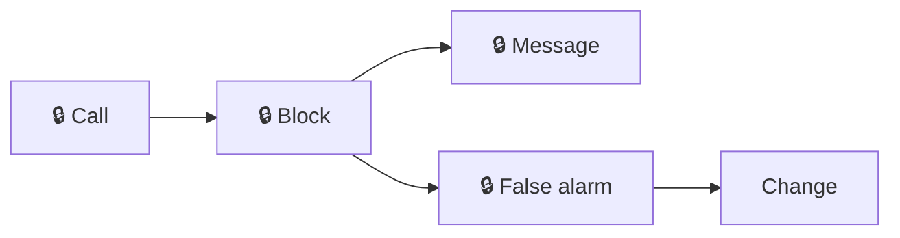
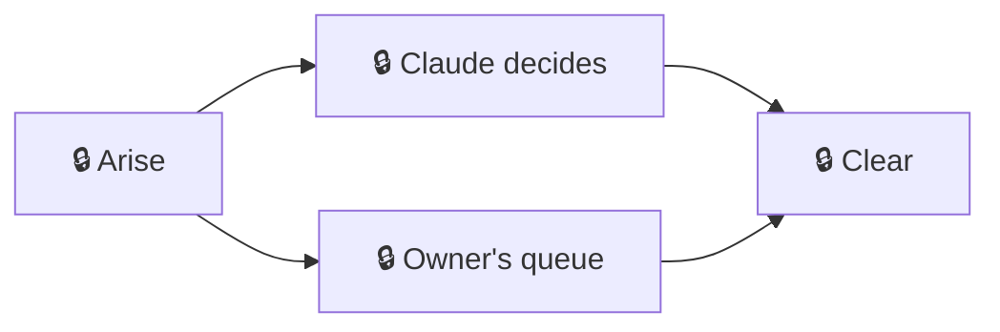

# Process maps

Two maps for an agent-driven repo, each step held to one metric. Use them on your Process page with `{ "use": "guard" }` and `{ "use": "decide" }` once the pack is in your `quality/config.json` `packs` ([README](../README.md#quickstart)). Steps marked 🔒 read the machine that runs the sessions, so they show only on a `--local` page.

## Guard: a tool call, through the guards, to run or blocked

| Step | Ideal | Metric |
|---|---|---|
| Call | Deny rules and hooks block only one-way-door commands | `blockers.guard_blocks_per_100_calls` |
| Block | A block names its fix, so the session moves on in seconds | `blockers.latest_block_seconds` |
| Message | The rule and the fix, nothing more | `blockers.latest_block_tokens` |
| False alarm | A block on a safe command becomes a guard test | `blockers.guard_false_alarm_share` |
| Change | A guard fix lands with one regression case | `blockers.enforcement_reverts` (public) |

## Decide: a question or blocker, to Claude's call or the owner's queue

| Step | Ideal | Metric |
|---|---|---|
| Arise | Surfaces once with its fix named | `blockers.costly` |
| Claude decides | Decides within its delegation, records reason and reversal in the PR | `blockers.latest_block_tokens` |
| Owner's queue | Only questions and human steps reach the owner | `claude_settings.prompts_per_100_calls` |
| Clear | Each false block becomes a guard fix by PR | `blockers.guard_false_alarm_share` |

Source of truth: [`guard.json`](guard.json), [`decide.json`](decide.json).
