# Process maps

Twenty-four maps for an agent-driven repo (twelve process maps, the ten [page maps](#page-maps-one-per-page) and the two [cross-page maps](#brief-and-runtime-two-maps-that-span-several-pages)), each step held to one metric. Use them on your Process page with `{ "use": "guard" }`, `{ "use": "decide" }`, `{ "use": "equip" }`, `{ "use": "publish" }`, `{ "use": "visibility" }`, `{ "use": "project" }`, `{ "use": "ship" }`, `{ "use": "environment" }`, `{ "use": "remember" }`, `{ "use": "setup" }`, `{ "use": "memory" }` and `{ "use": "schedule" }`, then the ten page maps `context`, `setup-check`, `scheduled-task`, `local-thread`, `pr-flow`, `connectors`, `plugins`, `skills`, `subagents` and `hooks`, and the two cross-page maps `brief` and `runtime`, the same way, once the pack is in your `quality/config.json` `packs` ([README](../README.md#quickstart)). Steps marked 🔒 read the machine that runs the sessions, so they show only on a `--local` page.

## Guard: a tool call, through the guards, to run or blocked

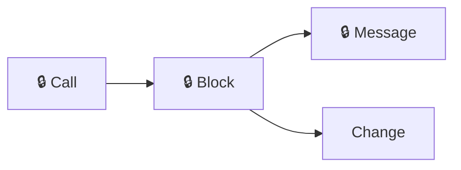

| Step | Ideal | Metric |
|---|---|---|
| Call | Auto mode and deny rules stop one-way doors; their refusals, and the hooks' blocks, are the count | `blockers.guard_blocks_per_100_calls` |
| Block | A block names its fix, so the session moves on in seconds | `blockers.latest_block_seconds` |
| Message | The rule and the fix, nothing more | `blockers.latest_block_tokens` |
| Change | A rule change lands with one regression case | `blockers.enforcement_reverts` (public) |

## Decide: a question or blocker, to Claude's call or the owner's queue

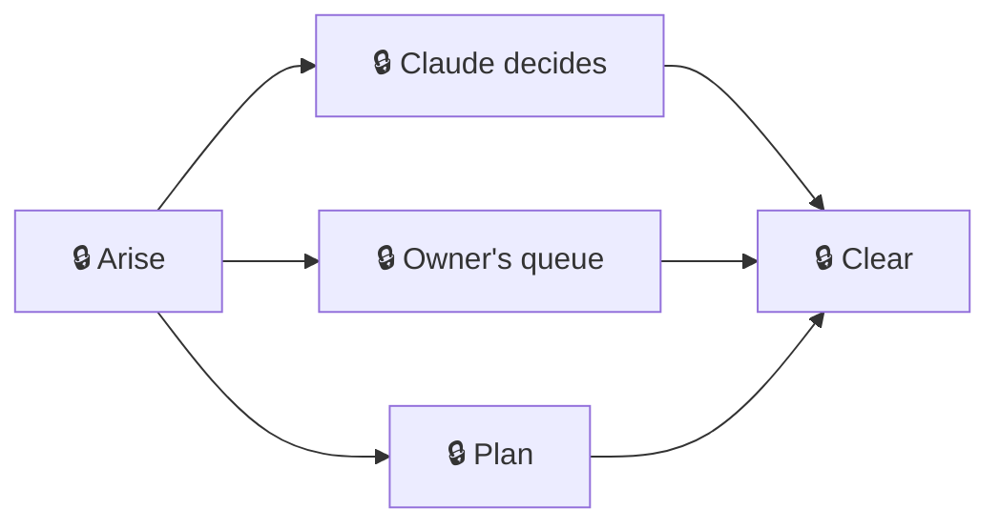

| Step | Ideal | Metric |
|---|---|---|
| Arise | Surfaces once with its fix named | `blockers.costly` |
| Claude decides | Decides within its delegation, records reason and reversal in the PR | `blockers.latest_block_tokens` |
| Owner's queue | Only questions and human steps reach the owner | `claude_settings.prompts_per_100_calls` |
| Plan | Checked once before it is shown, so the owner approves it as first shown | `desktop_app.plans_first_pass` |
| Clear | Each blocker that costs more than it helps is fixed or removed by PR | `blockers.costly` |

## Equip: every capability on, app-wide, and put to work

The rule every step serves: [All on, app-wide](../templates/claude/README.md#all-on-app-wide).

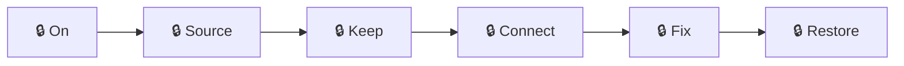

| Step | Ideal | Metric |
|---|---|---|
| On | No setting turns a plugin, skill or connector off; a session ignores what it does not need | `desktop_app.off_switches` |
| Source | 🅰 official marketplaces or 🅱 Anthropic's reviewed directory, official equivalents beside custom copies, which stay on; anything else named | `desktop_app.plugins_untrusted` |
| Keep | A listing over budget is fixed by `skillListingBudgetFraction`, never by turning one off | `desktop_app.listing_tokens` |
| Connect | Every listed connector connected before the first prompt | `desktop_app.connectors_pending` |
| Fix | A connector that fails or needs a sign-in is repaired or signed in | `desktop_app.connectors_broken` |
| Restore | An install left off is turned back on; only a record whose project folder is gone is removed | `desktop_app.plugins_stale` |

| Tier | Marketplace name | Rule |
|---|---|---|
| 🅰 Anthropic | `claude-plugins-official`, `knowledge-work-plugins`, `claude-for-legal`, `claude-for-financial-services`, `life-sciences` … | ✅ prefer |
| 🅱 Reviewed | Anthropic's directory on claude.ai (`anthropic-plugin-directory` in the desktop app) | ✅ allow |
| 🅲 Community | `claude-community` | ⚠️ no 🅰/🅱 equivalent only |
| 🅳 Third-party | everything else | ❌ add the official one beside it, or name a reason in `kept_plugins`; it stays on |

Tiers follow [plugin security](https://code.claude.com/docs/en/plugins/security) (read 2026-11-14): Claude Code accepts the official and community names only from `github.com/anthropics/`.

## Publish: a plugin or skill, from its first SKILL.md to Anthropic's directory

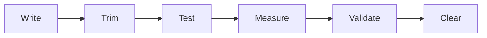

| Step | Ideal | Metric |
|---|---|---|
| Write | Names and descriptions follow Anthropic's authoring rules: third person, saying when | `practices.skill_rules` |
| Trim | Always-on names and descriptions stay short | `practices.listing_tokens` |
| Test | Three eval cases per skill prove it fired | `practices.skills_under_three_evals` |
| Measure | Each skill beats no plugin on Haiku, Sonnet and Opus | `practices.skills_without_lift` |
| Validate | The developer portal finds nothing that blocks or stops validation | `practices.directory_blocks` |
| Clear | Nothing is held for a reviewer | `practices.directory_holds` |

Every Publish step reads the repo's committed files, so all six show on the public page. The rules, one row each with its doc, are in [`collectors/practices/practices-rules.mjs`](../collectors/practices/practices-rules.mjs), from Anthropic's [plugin pre-submission checklist](https://claude.com/docs/plugins/pre-submission-checklist) and [skill authoring best practices](https://platform.claude.com/docs/en/agents-and-tools/agent-skills/best-practices) (both read 2026-11-15). Eval reports are `claude plugin eval` `aggregate-result.json` files, one per model, at `quality/evals/<plugin>.haiku.json`, `.sonnet.json` and `.opus.json` (`params.eval_reports` on [`targets/practices.json`](../targets/practices.json)).

## Visibility: every repo of an org, from one audit run to public or private

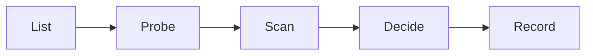

| Step | Ideal | Metric |
|---|---|---|
| List | One run lists every repo with its visibility and archived flag | `visibility.audit_seconds` |
| Probe | A private repo's Pages site is private and does not load signed out | `visibility.private_public_pages` |
| Scan | Public history carries only noreply or org author emails, on every branch | `visibility.personal_author_emails` |
| Decide | A repo stays public only with secret scanning and push protection on | `visibility.public_without_secret_scanning` |
| Record | One collect run on the Quality page, a tenth of the token's hourly requests | `visibility.requests` |

Probe and Decide need an admin token: in CI without `ADMIN_READ_TOKEN` they read not measured, never 0. The [`visibility`](../plugin/skills/visibility/SKILL.md) skill runs the same audit in a session.

## Project: a task from the project chat to a merged pull request

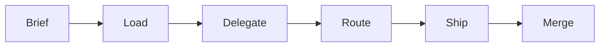

| Step | Ideal | Metric |
|---|---|---|
| Brief | Each guard is said in a file a cloud thread reads | `code_project.guard_rules_missing` |
| Load | Each instruction file stays under 200 lines | `code_project.instruction_lines` |
| Delegate | A read-only subagent lists only reading tools | `code_project.agents_unsafe` |
| Route | Each subagent names its model | `code_project.agents_without_model` |
| Ship | The draft pull request opens within 10 minutes of the first commit | `code_project.draft_pr_minutes` |
| Merge | A green pull request merges within a day | `code_project.ready_to_merge_hours` |

Every step reads repo files or the last 30 days of merged `claude/` pull requests, so all six show on the public page. A repo with no merged `claude/` pull request, or no agent files, reads not measured, never 0. Set it up with the [Code Project template](../templates/claude/code-project/README.md).

## Ship: a ready repo, through a tracked and reviewed thread, to a merged pull request

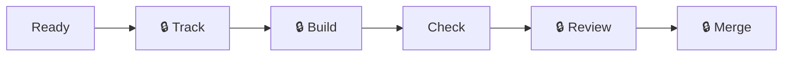

| Step | Ideal | Metric |
|---|---|---|
| Ready | AGENTS.md, a CLAUDE.md that imports it, templates, CI and settings are in place | `code_project.setup_missing` |
| Track | Each piece of work is an issue or card, and its pull request is merged, not closed | `claude.pr_merge_share` |
| Build | A thread idle past the one hour cache is replaced, not revived | `code_project.idle_revivals` |
| Check | The pull request opens as a draft and CI runs before a person reads it | `code_project.draft_first_share` |
| Review | A reviewer that did not write the change reads it at its head commit | `claude.escaped_bugs_per_10_prs` |
| Merge | A green, reviewed pull request squash merges, each costing fewer tokens | `code_project.tokens_per_merged_pr` |

## Environment: a thread's machine, from the cloud environment to a local session

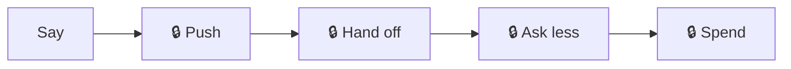

| Step | Ideal | Metric |
|---|---|---|
| Say | A thread reads its GitHub route, where network and variables live, and when work goes local | `code_project.cloud_rules_missing` |
| Push | A push reaches GitHub in seconds | `blockers.git_push_seconds` |
| Hand off | A local or Remote Control session is archived when its task ends | `desktop_app.sub_sessions_closed` |
| Ask less | A session runs without stopping for approval | `claude_settings.prompts_per_100_calls` |
| Spend | The fullest plan window stays under its goal | `tokens.plan_used` |

## Remember: a fact or recurring job, from the files a thread reads to a scheduled task

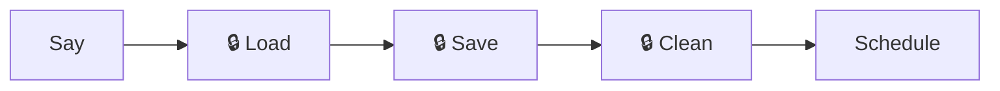

| Step | Ideal | Metric |
|---|---|---|
| Say | Each rule about memory and tracking sits in a file a thread loads | `code_project.memory_rules_missing` |
| Load | The largest file every session loads stays under 200 lines | `instructions.lines_before_action` |
| Save | The memory index head stays short | `instructions.memory_index_tokens` |
| Clean | A rule, skill or agent no recent session used is put to work or fixed, never turned off or removed | `instructions.unused` |
| Schedule | Each recurring job is a named scheduled task | `code_project.tasks_missing` |

## Which part of a Code Project each map covers

Each part is a group on the Code Project tab. The engine's tab parts table holds at most eight rows, so related parts share a group: plugins and skills with connectors, and the project with its settings.

| Part (tab group) | Map |
|---|---|
| Project and settings | Ship (Ready), Project |
| Coordinator and threads | Decide, Project |
| Cloud environment and Mac | Environment |
| Plugins, skills, connectors | Equip |
| Memory and instructions | Remember, Project |
| Scheduled tasks | Remember (Schedule) |
| PR auto-fix | Ship (Check) |
| Shipping and merging | Ship |

Source of truth: [`guard.json`](guard.json), [`decide.json`](decide.json), [`equip.json`](equip.json), [`publish.json`](publish.json), [`visibility.json`](visibility.json), [`project.json`](project.json), [`ship.json`](ship.json), [`environment.json`](environment.json), [`remember.json`](remember.json), [`setup.json`](setup.json), [`memory.json`](memory.json), [`schedule.json`](schedule.json).

## Code Project page maps: Setup, Memory and Schedule

Each lane scores one tab or feature of a Claude Code Project. A map holds six steps at most, so 18 lanes fit in three maps. The Usage tab has no lane in these maps. Every lane reads local files, so the public page leaves all three maps out.

| Map | Lanes |
|---|---|
| `setup` | General, Environment, Network access, Network secrets, Setup script, Work locally |
| `memory` | Conversation, Context, Memory, Extensions, Connectors, Plugins |
| `schedule` | Threads, Scheduled tasks, Hooks, Subagents, Pull request auto fix, Skills |

## Brief and Runtime: two maps that span several pages

A page has one map, so these two score the readings that cut across pages. Brief follows the owner's question to a thread that needs no second question. Runtime follows a thread's files, environment and settings to its scheduled runs and token spread.

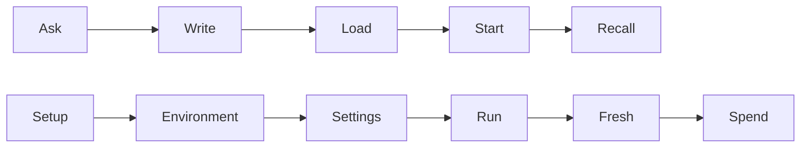

| Map | Step | Ideal | Metric |
|---|---|---|---|
| `brief` | Ask | A question for the owner goes out as one decision card | `cp_conversation.card_share` |
| `brief` | Write | The brief says the guards a thread cannot skip | `code_project.guard_rules_missing` |
| `brief` | Load | The memory index adds few tokens to a thread at start | `cp_memory.start_tokens` |
| `brief` | Start | A thread starts within minutes of the owner's message | `cp_conversation.minutes_to_thread` |
| `brief` | Recall | A thread never asks what memory or the brief already says | `cp_memory.repeat_questions` |
| `runtime` | Setup | Every file a cloud thread needs is in the repo | `code_project.setup_missing` |
| `runtime` | Environment | The environment holds every host and variable the project needs | `cp_environment.environment_gaps` |
| `runtime` | Settings | Every project setting matches the plan | `cp_general.settings_gaps` |
| `runtime` | Run | The latest run of every scheduled task ends without an error | `cp_scheduled_tasks.task_failures` |
| `runtime` | Fresh | Some scheduled task has run within the week | `cp_scheduled_tasks.hours_since_last_run` |
| `runtime` | Spend | No single thread spends most of the project's tokens | `cp_threads.largest_thread_token_share` |

Five of these readings (`environment_gaps`, `settings_gaps`, `task_failures`, `hours_since_last_run` and `largest_thread_token_share`) read small record files that the machine holding the setting saves under `quality/data/` ([`code-project-records.mjs`](../collectors/code-project/code-project-records.mjs), params on `cp_general.settings_gaps` in [`code-project-tabs.json`](../targets/code-project-tabs.json)). A missing, undated or old record is not measured, never 0, and the public page leaves these readings out.

## Page maps: one per page

Each page of a Code Project has a map of its own, six steps at most, scoring Quality, Speed and Consumption. The index of all 13 pages, with their tabs and metrics, is [`page-index.json`](../templates/claude/code-project/page-index.json); the kit to add one is [`page/`](../templates/claude/code-project/page/README.md).

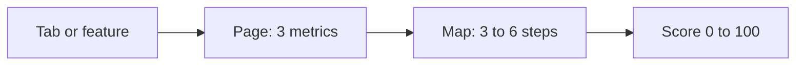

| Page | Map | New or reused |
|---|---|---|
| 🛰️ Overview and threads | `project` | Reused |
| 📎 Context | `context` | New |
| ⚙️ General and Advanced | `decide` | Reused |
| 🧠 Memory | `guard` | Reused |
| 🌩️ Environment | `setup-check` | New |
| ⏰ Scheduled tasks | `scheduled-task` | New |
| 💻 Threads on your computer | `local-thread` | New |
| 🔀 Pull requests and auto-fix | `pr-flow` | New |
| 🔌 Connectors | `connectors` | New |
| 🧩 Plugins | `plugins` | New |
| 📚 Skills | `skills` | New |
| 🤖 Subagents | `subagents` | New |
| 🪝 Hooks | `hooks` | New |

Steps that read local files show only on a `--local` page. A step on `code_project.*` or `practices.*` reads repo files, so it also shows on the public page.
