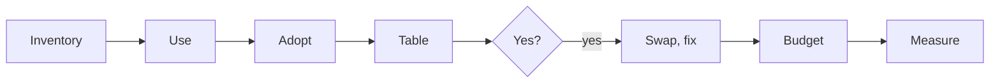

# Equip

> **All on, account-wide.** One Claude desktop app runs many sessions across every repo and project of the account, and runs Claude Code too. Every plugin, skill, connector, agent and tool the owner added stays on for the app as a whole, because other sessions need them. One session may leave one unused, or turn one off for itself only. Never turn one off where other sessions feel it: `~/.claude/settings.json`, a repo's settings, uninstalling, disconnecting, or the Code tab connector switch (it also sets the default for every new session). That needs the owner's ask for that one, by name.

Every enabled plugin adds its skill and agent descriptions and server instructions to every session. Put each one to work. Swap only what an official plugin now covers, after a yes.

Requires the Claude Code CLI (`claude plugin`).

No `claude` (no shell tool, or `command -v claude` finds nothing), as in chat or Cowork without the tool: give the step 4 table as a checklist for Customize > Plugins, one row per plugin the person names, filled with what they told you and `?` where use is unknown, for them to click through. Change nothing yourself.

| Tier | Marketplace name | Rule |
|---|---|---|
| 🅰 Anthropic | `claude-plugins-official`, `knowledge-work-plugins`, `claude-for-legal`, `claude-for-financial-services`, `life-sciences` | prefer, keep on |
| 🅱 Reviewed | Anthropic's directory on claude.ai (`anthropic-plugin-directory` in the desktop app manifest) | allow, keep on |
| 🅲 Community | `claude-community` | only with no 🅰 or 🅱 equivalent |
| 🅳 Third-party or user-built | anything else | swap for an official listing, or keep with a named reason |

Tiers are enforced by name: Claude Code accepts the official and community names only from `github.com/anthropics/` (code.claude.com/docs/en/plugins/security).

| # | Step | Do |
|---|---|---|
| 1 | Inventory | `claude plugin list --json` for Claude Code installs; the desktop app's own plugins show in the session's skill listing and as `<name>@synced` |
| 2 | Use | Count calls by plugin over the account's recent sessions (Skill, Agent and `mcp__plugin_<name>_` tool calls in `~/.claude/projects`). `/plugin` Installed shows "Not used recently" after 14 days and 10 sessions |
| 3 | Adopt | For each unused 🅰 or 🅱 plugin, name the task and the project it fits, and keep it on. Say what it is for |
| 4 | Show | One table: plugin, tier, use in the last 30 days, action (use, swap, fix), tokens. Steps 5 and 6 act on a row only after the person says yes |
| 5 | Swap | A 🅳 plugin with an official listing: `claude plugin install <name>@claude-plugins-official`, then uninstall the old copy; the capability stays, so nothing is lost |
| 6 | Fix | A plugin or connector that fails to load or waits for a sign-in: name the repair or the sign-in step for the owner. It stays on meanwhile |
| 7 | Orphans | Uninstall only install records whose project folder is gone (`--scope project` must run inside that folder). No plugin goes away |
| 8 | Budget | If `/doctor` or `/skill-doctor` says skill descriptions are dropped, `skillListingBudgetFraction` raises the listing budget, at a token cost on every turn. Offer it; never set it unasked |
| 9 | Measure | `claude plugin details <name>` for each plugin's always-on tokens; `/context` or `/usage`; in a Claudius repo, the Claude desktop app tab. Report the cost; save tokens elsewhere (batched reviews, fresh sessions), never by turning one off |

| Never | Why |
|---|---|
| Turn off, disable, uninstall, scope to one repo or disconnect a plugin, skill or connector the owner added, to save tokens or for being unused | the desktop app serves every repo and project; each was added for a reason (the owner, 2026-11-19) |
| Set `syncClaudeAiPlugins` to `false`, or turn a connector off in the Code tab | it removes them from every session at once |
| Change the account's default permission mode | it's the owner's choice |
| Open files that hold keys to inspect servers | `claude mcp list` and `/mcp` show what is needed |
