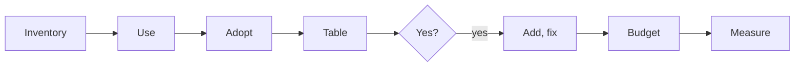

# Equip

**Outcome:** Claudius sets up the Claude desktop app as an autonomous, agentic system: you give the objective and the vision, and Claude plans, builds, reviews and merges on its own, asking you only about vision, billing, a one-way change or a step the platform forces.

Every plugin, skill, connector and agent stays on for the whole desktop app; a session only skips loading what it doesn't need ([All on, app-wide](https://github.com/Colorado-Startups/claudius/blob/main/templates/claude/README.md#all-on-app-wide)). Put each one to work.

Requires the Claude Code CLI (`claude plugin`).

No `claude` (no shell tool, or `command -v claude` finds nothing), as in chat or Cowork without the tool: give the step 4 table as a checklist for Customize > Plugins, one row per plugin the person names, filled with what they told you and `?` where use is unknown, for them to click through. Change nothing yourself.

| Tier | Marketplace name | Rule |
|---|---|---|
| 🅰 Anthropic | `claude-plugins-official`, `knowledge-work-plugins`, `claude-for-legal`, `claude-for-financial-services`, `life-sciences` | prefer, keep on |
| 🅱 Reviewed | Anthropic's directory on claude.ai (`anthropic-plugin-directory` in the desktop app manifest) | allow, keep on |
| 🅲 Community | `claude-community` | add only with no 🅰 or 🅱 equivalent; keep on |
| 🅳 Third-party or user-built | anything else | add the official listing beside it, or name a reason; keep on |

Tiers are enforced by name: Claude Code accepts the official and community names only from `github.com/anthropics/` (code.claude.com/docs/en/plugins/security).

| # | Step | Do |
|---|---|---|
| 1 | Inventory | `claude plugin list --json` for Claude Code installs; the desktop app's own plugins show in the session's skill listing and as `<name>@synced`. A connector can also bring skills (Skills over MCP); check where your session lists them |
| 2 | Use | Count calls by plugin over the account's recent sessions (Skill, Agent and `mcp__plugin_<name>_` tool calls in `~/.claude/projects`). `/plugin` Installed shows "Not used recently" after 14 days and 10 sessions |
| 3 | Adopt | For each unused plugin, name the task and the project it fits, and keep it on. Say what it is for |
| 4 | Show | One table: plugin, tier, use in the last 30 days, action (use, add, fix), tokens. Steps 5 to 7 act on a row only after the person says yes |
| 5 | Add | A 🅳 plugin or custom piece with an official equivalent: `claude plugin install <name>@claude-plugins-official` and put it to work. The old copy stays on |
| 6 | Fix | A plugin or connector that fails to load or waits for a sign-in: name the repair or the sign-in step for the owner. A connector whose skills are missing on a Team plan waits for an admin to enable Skills over MCP: name that step. The plugin or connector stays on meanwhile |
| 7 | Restore | An install left turned off is turned back on. A project install record whose folder is gone loads in no session; only that record is removed (`--scope project` runs inside that folder) |
| 8 | Budget | If `/doctor` or `/skill-doctor` says skill descriptions are dropped, `skillListingBudgetFraction` raises the listing budget, at a token cost on every turn. Offer it; never set it unasked |
| 9 | Measure | `claude plugin details <name>` for each plugin's always-on tokens; `/context` or `/usage`; in a Claudius repo, the Claude desktop app tab. Report the cost; save tokens elsewhere (batched reviews, fresh sessions), never by turning one off |

| Never | Why |
|---|---|
| Turn off, disable, uninstall, scope to one repo or disconnect a plugin, skill, connector or agent, in settings, the Code tab connector switch or `syncClaudeAiPlugins` | [All on, app-wide](https://github.com/Colorado-Startups/claudius/blob/main/templates/claude/README.md#all-on-app-wide): other sessions need it |
| Change the account's default permission mode | it's the owner's choice |
| Open files that hold keys to inspect servers | `claude mcp list` and `/mcp` show what is needed |
