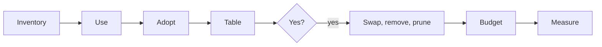

# Equip

Every enabled plugin adds its skill and agent descriptions and server instructions to every session. Keep what Anthropic builds or reviews and put it to work. Swap or remove only what an official plugin now covers, or what is dead.

Requires the Claude Code CLI (`claude plugin`).

No `claude` (no shell tool, or `command -v claude` finds nothing), as in chat or Cowork without the tool: give the step 4 table as a checklist for Customize > Plugins, one row per plugin the person names, filled with what they told you and `?` where use is unknown, for them to click through. Change nothing yourself.

| Tier | Marketplace name | Rule |
|---|---|---|
| 🅰 Anthropic | `claude-plugins-official`, `knowledge-work-plugins`, `claude-for-legal`, `claude-for-financial-services`, `life-sciences` | prefer, keep on |
| 🅱 Reviewed | Anthropic's directory on claude.ai (`anthropic-plugin-directory` in the desktop app manifest) | allow, keep on |
| 🅲 Community | `claude-community` | only with no 🅰 or 🅱 equivalent |
| 🅳 Third-party or user-built | anything else | swap for an official listing, or keep with a named reason |

Tiers are enforced by name: Claude Code accepts the official and community names only from `github.com/anthropics/` (code.claude.com/docs/en/plugins/security).

| # | Step | Do |
|---|---|---|
| 1 | Inventory | `claude plugin list --json` for Claude Code installs; the desktop app's own plugins show in the session's skill listing and as `<name>@synced` |
| 2 | Use | Count calls by plugin over the account's recent sessions (Skill, Agent and `mcp__plugin_<name>_` tool calls in `~/.claude/projects`). `/plugin` Installed shows "Not used recently" after 14 days and 10 sessions |
| 3 | Adopt | For each unused 🅰 or 🅱 plugin, name the task and the project it fits, and keep it on. Say what it is for |
| 4 | Show | One table: plugin, tier, use in the last 30 days, action (use, swap, remove, prune), tokens. Steps 5 to 8 act on a row only after the person says yes: a yes comes before any disable, uninstall or settings edit |
| 5 | Swap | A 🅳 plugin with an official listing: `claude plugin install <name>@claude-plugins-official`, then uninstall the old one; remove its marketplace only if no other plugin from it stays |
| 6 | Remove | A 🅳 or 🅲 plugin that is unused and has no official equivalent: `claude plugin disable <name>@synced` for desktop plugins (undo: `claude plugin enable <name>@synced`), else uninstall |
| 7 | Prune | Uninstall install records that are turned off, or whose project folder is gone (`--scope project` must run inside that folder). Scope a plugin to one repo (`enabledPlugins` in that repo's `.claude/settings.json`) only if the person asks for a leaner project |
| 8 | Connectors | Desktop sessions get claude.ai connectors in-process, and no Claude Code setting reaches them. Disconnecting one at claude.ai/customize/connectors also removes it from chat and Cowork, so that's the owner's call |
| 9 | Budget | If `/doctor` or `/skill-doctor` says skill descriptions are dropped, `skillListingBudgetFraction` raises the listing budget, at a token cost on every turn. Offer it; never set it unasked |
| 10 | Measure | `claude plugin details <name>` for each plugin's always-on tokens; `/context` or `/usage` before and after; in a Claudius repo, the Claude desktop app tab |

| Never | Why |
|---|---|
| Turn off an Anthropic or reviewed plugin for being unused, unless the person asks | it is put to work in the project that needs it |
| Change the account's default permission mode | it's the owner's choice |
| Remove a 🅳 plugin used in the last 30 days without an official equivalent | measured use beats a guess |
| Open files that hold keys to inspect servers | `claude mcp list` and `/mcp` show what is needed |
