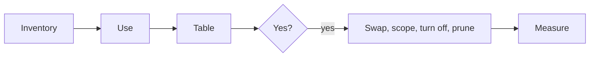

# Equip

Every enabled plugin adds its skill and agent descriptions and server instructions to every session. Keep only what this account uses, from sources Anthropic runs or reviews.

Requires the Claude Code CLI (`claude plugin`).

No `claude` (no shell tool, or `command -v claude` finds nothing), as in chat or Cowork without the tool: give the step 3 table as a checklist for Customize > Plugins, one row per plugin the person names, filled with what they told you and `?` where use is unknown, for them to click through. Change nothing yourself.

| Tier | Marketplace name | Rule |
|---|---|---|
| 🅰 Anthropic | `claude-plugins-official`, `knowledge-work-plugins`, `claude-for-legal`, `claude-for-financial-services`, `life-sciences` | prefer |
| 🅱 Reviewed | Anthropic's directory on claude.ai (`anthropic-plugin-directory` in the desktop app manifest) | allow |
| 🅲 Community | `claude-community` | only with no 🅰 or 🅱 equivalent |
| 🅳 Third-party | anything else | swap for an official listing, or keep with a named reason |

Tiers are enforced by name: Claude Code accepts the official and community names only from `github.com/anthropics/` (code.claude.com/docs/en/plugins/security).

| # | Step | Do |
|---|---|---|
| 1 | Inventory | `claude plugin list --json` for Claude Code installs; the desktop app's own plugins show in the session's skill listing and as `<name>@synced` |
| 2 | Use | Count calls by plugin over the account's recent sessions (Skill, Agent and `mcp__plugin_<name>_` tool calls in `~/.claude/projects`). `/plugin` Installed shows "Not used recently" after 14 days and 10 sessions |
| 3 | Show | One table: plugin, use in the last 30 days, action (keep, swap, scope, turn off, prune), tokens saved. Steps 4 to 7 act on a row only after the person says yes: a yes comes before any disable, uninstall or settings edit |
| 4 | Swap | A 🅳 plugin with an official listing: `claude plugin install <name>@claude-plugins-official`, then uninstall the old one; remove its marketplace only if no other plugin from it stays |
| 5 | Scope | A plugin only some repos need: off at user level, on in that repo's `.claude/settings.json` (`enabledPlugins`, plus `extraKnownMarketplaces` for its marketplace) |
| 6 | Turn off | Unused desktop plugins: `claude plugin disable <name>@synced`. Undo: `claude plugin enable <name>@synced` |
| 7 | Prune | Uninstall install records that are turned off, or whose project folder is gone (`--scope project` must run inside that folder) |
| 8 | Connectors | Desktop sessions get claude.ai connectors in-process, and no Claude Code setting reaches them. Disconnecting one at claude.ai/customize/connectors also removes it from chat and Cowork, so that's the owner's call |
| 9 | Measure | `claude plugin details <name>` for each plugin's always-on tokens; `/context` or `/usage` before and after; in a Claudius repo, the Claude desktop app tab |

| Never | Why |
|---|---|
| Change the account's default permission mode | it's the owner's choice |
| Turn off a plugin used in the last 30 days | measured use beats a guess |
| Open files that hold keys to inspect servers | `claude mcp list` and `/mcp` show what is needed |
