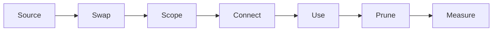

# Equip

Every enabled plugin's skills, agents and server instructions are resent on every turn. Keep only what this account uses, from sources Anthropic runs or reviews.

| Tier | Marketplace name | Rule |
|---|---|---|
| 🅰 Anthropic | `claude-plugins-official`, `knowledge-work-plugins`, `claude-for-legal`, `claude-for-financial-services`, `life-sciences` | prefer |
| 🅱 Reviewed | Anthropic's directory on claude.ai (`anthropic-plugin-directory` in the desktop app manifest) | allow |
| 🅲 Community | `claude-community` | only with no 🅰 or 🅱 equivalent |
| 🅳 Third-party | anything else | swap for an official listing, or keep with a named reason |

Tiers are enforced by name: Claude Code accepts the official and community names only from `github.com/anthropics/` (code.claude.com/docs/en/plugins/security).

| # | Step | Do |
|---|---|---|
| 1 | Inventory | `claude plugin list --json` for Claude Code installs; the desktop app's own plugins show in the session's skill listing and as `<name>@synced` |
| 2 | Use | Count calls by plugin over the account's recent sessions (Skill, Agent and `mcp__plugin_<name>_` tool calls in `~/.claude/projects`). `/plugin` Installed shows "Not used recently" after 14 days and 10 sessions |
| 3 | Swap | A 🅳 plugin with an official listing: `claude plugin install <name>@claude-plugins-official`, then uninstall the old one and remove its marketplace |
| 4 | Scope | A plugin only some repos need: off at user level, on in that repo's `.claude/settings.json` (`enabledPlugins`, plus `extraKnownMarketplaces` for its marketplace) |
| 5 | Turn off | Unused desktop plugins: `claude plugin disable <name>@synced`. Undo: `claude plugin enable <name>@synced` |
| 6 | Prune | Uninstall install records that are turned off, or whose project folder is gone (`--scope project` must run inside that folder) |
| 7 | Connectors | Desktop sessions get claude.ai connectors in-process, and no Claude Code setting reaches them. Disconnecting one at claude.ai/customize/connectors also removes it from chat and Cowork, so that's the owner's call |
| 8 | Measure | `claude plugin details <name>` for each plugin's always-on tokens; `/context` or `/usage` before and after; in a Claudius repo, the Claude desktop app tab |

| Never | Why |
|---|---|
| Change the account's default permission mode | it's the owner's choice |
| Turn off a plugin used in the last 30 days | measured use beats a guess |
| Read `~/.claude.json` or credential files to inspect servers | they can hold keys; use `claude mcp list` and `/mcp` |
