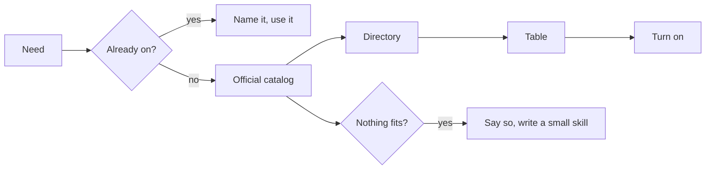

# Find plugin

**Outcome:** Claudius sets up the Claude desktop app as an autonomous, agentic system: you give the objective and the vision, and Claude plans, builds, reviews and merges on its own, asking you only about vision, billing, a one-way change or a step the platform forces.

Answer "is there a plugin, skill or connector for X?" with what Anthropic builds or reviews, before anything else.

Requires the Claude Code CLI (`claude plugin`) only to turn a pick on. The answer needs no CLI.

No shell or file tool, as in chat or Cowork without the tool: answer from the session's skill listing and connector tool names, and say the catalog file could not be read.

| # | Step | Do |
|---|---|---|
| 1 | On now | Check the session's skill listing and connector tool names. If one fits, name it and use it |
| 2 | Catalog | Search `~/.claude/plugins/marketplaces/claude-plugins-official/.claude-plugin/marketplace.json` by keyword in name and description; read name, description and author |
| 3 | Directory | Then Customize > Plugins > Discover and Customize > Connectors on claude.ai, or `/plugin directory` in Claude Code |
| 4 | Answer | One table: need, pick, tier, turn on with, sign-in needed. Then turn on a 🅰 or 🅱 pick with the CLI, since installing is reversible. A sign-in the platform forces is one exact line for the owner |
| 5 | Nothing fits | Say so plainly. Write a small skill with `skill-creator`. A community repo is the last resort, named with its license and the reason |

| Tier | Means |
|---|---|
| 🅰 | Anthropic-built |
| 🅱 | Anthropic-reviewed |

| Turn on with | When |
|---|---|
| `claude plugin install <name>@claude-plugins-official` | Claude Code |
| Customize page, then the plugin or connector's toggle | claude.ai, chat, Cowork |

| Never | Why |
|---|---|
| Install a 🅲 or 🅳 pick | a plugin runs code on this machine: name it with its license, source and the reason, and write a small skill with `skill-creator` instead |
| Put an unreviewed source ahead of an official one | the owner's rule: Anthropic first |
