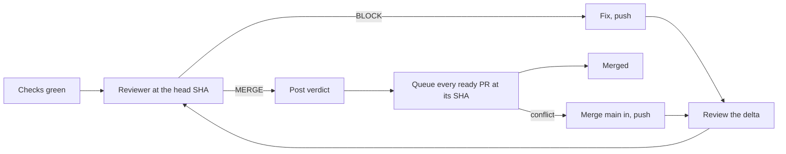

# Merge

One review per PR, pinned to a commit, so what merges is what was reviewed. A review-only request gets the verdict in chat.

Requires `gh` signed in (`gh auth status`) and `pr-review-toolkit` from `claude-plugins-official` (`claude plugin install pr-review-toolkit@claude-plugins-official`).

No `gh` (no shell tool, or `command -v gh` finds nothing), as in chat or Cowork without the tool: give the steps below with the exact commands for the person to run at the head SHA. Review any pasted diff in the two passes of step 3 and reply `MERGE <sha>` or `BLOCK <sha>` with fixes as file, problem, replacement. After a fix, review only the delta from the blocked SHA and give a new verdict for the new head. Leave posting and merging to the person.

| # | Step | Command or rule |
|---|---|---|
| 1 | Wait once | `gh pr checks N --watch --interval 60`, in the background. Never a tight poll |
| 2 | Pick the reviewer | `pr-review-toolkit:code-reviewer` as a fresh subagent. Model: Haiku for docs, data and code under about 200 lines; Sonnet for settings, workflows, permissions, rules or anything larger |
| 3 | Brief | The PR number, head SHA (`gh pr view N --json headRefOid -q .headRefOid`) and intent in a few lines; the reviewer reads `gh pr diff N`. Two passes: mechanical (it does what it says, every check passed), then judgment (what breaks). Reply in at most 120 words: `MERGE <sha>` or `BLOCK <sha>` plus fixes as file, problem, replacement |
| 4 | Fix | On BLOCK, fix on the branch and push. Send the same reviewer only the delta from the reviewed SHA |
| 5 | Verdict | Post and merge only after the person's yes, unless they asked to merge. Post a PR comment whose first line is exactly `Review: MERGE at <40-hex sha>` (`BLOCK` in place of `MERGE` for a blocked commit). One account that authors and merges leaves no GitHub review, so this line is the record |
| 6 | Queue | Queue every PR with a MERGE verdict at once, each at the literal SHA that passed: `gh api graphql -f query='mutation($id:ID!,$sha:GitObjectID!){enqueuePullRequest(input:{pullRequestId:$id,expectedHeadOid:$sha}){mergeQueueEntry{position}}}' -F id=<PR node id> -F sha=<sha>`. The node id is `gh pr view N --json id -q .id` |
| 7 | No queue yet | Set one up (table below). Until then, `gh pr merge N --squash --match-head-commit <sha>`, one PR at a time, in a method the repo allows (`gh api repos/{owner}/{repo}`) |
| 8 | Conflict | A PR the queue drops for a conflict goes back: merge `main` into its branch, resolve each hunk, push, review the delta (step 4) and queue the new head |
| 9 | After | If the merge deploys, load the live page once |

## In a cloud thread

A Claude Code Project cloud thread refuses GraphQL with HTTP 403 (observed 2026-11-25), so `gh pr checks`, `gh pr view`, `gh pr diff`, `gh pr merge` and the queue mutation fail. Use the REST form of each step.

| Step | REST form |
|---|---|
| 1 Checks | `gh api repos/{owner}/{repo}/commits/<sha>/check-runs`, and `gh api repos/{owner}/{repo}/commits/<sha>/status` for a status that a local run posts |
| 3 Head SHA | `gh api repos/{owner}/{repo}/pulls/N --jq .head.sha` |
| 3 Diff | `gh api -H 'Accept: application/vnd.github.diff' repos/{owner}/{repo}/pulls/N` |
| 5 Verdict | `gh api repos/{owner}/{repo}/issues/N/comments -f body=...` |
| 6 and 7 Merge | `gh api -X PUT repos/{owner}/{repo}/pulls/N/merge -f merge_method=squash -f sha=<sha>`, one pull request at a time, because the queue is GraphQL only |

A merge returned 5xx, then 405 `Merge already in progress` for about 8 minutes, then 200 (observed 2026-11-25). Retry once a minute. A REST branch delete returned 403 (observed 2026-11-25), so leave it to the repo's delete-on-merge setting.

| Repo setup | Rule |
|---|---|
| Ruleset on `main` | A merge queue: squash, only non-failing PRs grouped (`ALLGREEN`), up to 5 built and merged together |
| Up to date | No "require branches to be up to date" rule: the queue tests each PR on the latest `main` ([managing a merge queue](https://docs.github.com/en/repositories/configuring-branches-and-merges-in-your-repository/configuring-pull-request-merges/managing-a-merge-queue), read 2026-11-18) |
| Branch-name rulesets | Allow the queue's `gh-readonly-queue/*` branches, or the queue fails at once |

On 2026-11-18 one repo switched from serial merges to this queue. Eight PRs merged in one queue pass of about 10 minutes; each had taken about 10 minutes serially, since every merge re-ran the other PRs' CI. Only PRs that touched the same file came back with a conflict.

| Measure | Where |
|---|---|
| All green to merge | The `all green to merge` part of `lead_time.hours` (goal: 24 h for the whole lead time) |
| One queue pass | Goal: every ready PR merged in one pass, minutes from the first queue entry to the last merge. No collector reads it yet |

| Never | Why |
|---|---|
| `--auto` or `--admin` | merges something other than the reviewed commit, or skips the rules |
| Queueing without `expectedHeadOid` | the queue could merge a commit pushed after the review |
| A fourth review round | three rounds without MERGE means the step needs rethinking |
| Push to `main` or force-push | the reviewed history is the record |
