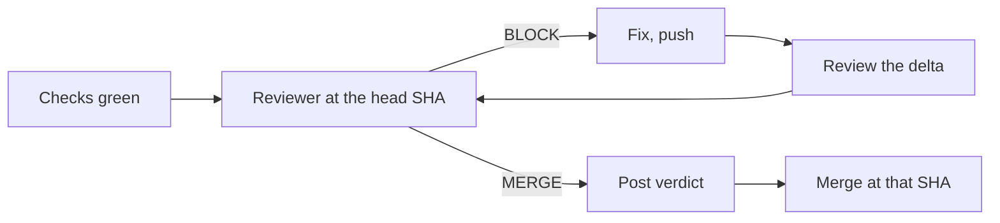

# Merge

One review per PR, pinned to a commit, so what merges is what was reviewed.

Requires `gh` signed in (`gh auth status`) and `pr-review-toolkit` from `claude-plugins-official` (`claude plugin install pr-review-toolkit@claude-plugins-official`).

No `gh` (no shell tool, or `command -v gh` finds nothing), as in chat or Cowork without the tool: ask the person to paste the diff. Review it in the two passes of step 3, give `MERGE <sha>` or `BLOCK <sha>` with fixes, and leave the merge to them.

| # | Step | Command or rule |
|---|---|---|
| 1 | Wait once | `gh pr checks N --watch --interval 60`, in the background. Never a tight poll |
| 2 | Pick the reviewer | `pr-review-toolkit:code-reviewer` as a fresh subagent. Model: Haiku for docs, data and code under about 200 lines; Sonnet for settings, workflows, permissions, rules or anything larger |
| 3 | Brief | The PR number, head SHA (`gh pr view N --json headRefOid -q .headRefOid`) and intent in a few lines; the reviewer reads `gh pr diff N`. Two passes: mechanical (it does what it says, every check passed), then judgment (what breaks). Reply in at most 120 words: `MERGE <sha>` or `BLOCK <sha>` plus fixes as file, problem, replacement |
| 4 | Fix | On BLOCK, fix on the branch and push. Send the same reviewer only the delta from the reviewed SHA |
| 5 | Verdict | Post a PR comment whose first line is exactly `Review: MERGE at <40-hex sha>` (`BLOCK` in place of `MERGE` for a blocked commit). One account that authors and merges leaves no GitHub review, so this line is the record |
| 6 | Merge | `gh pr merge N --squash --match-head-commit <sha>` with the literal SHA that passed. Use a method the repo allows (`gh api repos/{owner}/{repo}`) |
| 7 | After | If the merge deploys, load the live page once |

| Never | Why |
|---|---|
| `--auto` or `--admin` | merges something other than the reviewed commit, or skips the rules |
| A fourth review round | three rounds without MERGE means the step needs rethinking |
| Push to `main` or force-push | the reviewed history is the record |
