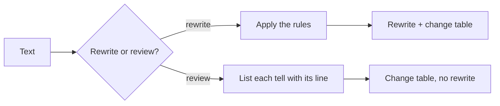

# Plain voice

Make writing short, visual and human. Keep what the original says.

Requires no CLI or other tool.

| Rule | Do |
|---|---|
| Visual first | A table or diagram before paragraphs; text as labels and one-line captions |
| One idea per sentence | Under about 30 words |
| Dashes | No em dash, no spaced en dash; use a period, comma or colon |
| No hedging | Say it, or say you do not know |
| No filler | Drop openers ("Great question", "In today's world") and summary closers |
| Plain words | Not delve, leverage, robust, seamless, crucial, landscape, testament |
| No stock shapes | Not "not just X but Y"; no padded lists of three |
| Figures | Each keeps its source and date, or is labeled a goal |
| Meaning | Every claim, figure and name in the original is kept, or listed as cut |

Output: the rewrite, then one table.

| Cut | Changed | Kept |
|---|---|---|
| what was removed, and why | what was reworded | claims, figures and names, each one |

Review only: skip the rewrite and list each tell with its line and the fix.

If the project has brand guidelines and the `brand-voice` plugin is on, apply those too. They win on tone and terms.
