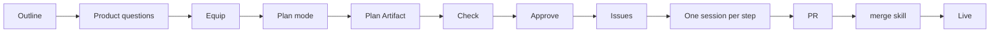

# Plan

The owner outlines the product. Claude plans it visually, and the desktop app runs the plan.

Requires `gh` signed in (`gh auth status`), and the desktop app's Code tab for sessions and Artifacts.

When `mattpocock-skills` (from `claude-plugins-official`) is installed, its `to-spec` writes the PRD and its `to-tickets` files the issues in place of steps 4 and 6 as written; otherwise follow the steps as written.

No `gh` (no shell tool, or `command -v gh` finds nothing), as in chat or Cowork without the tool: skip the `gh` and session steps, and never say issues were filed or sessions started. Give the step 4 table in the reply, then one brief per independent step for the person to paste into a session.

| # | Step | Do | Tool |
|---|---|---|---|
| 1 | Define | Read the outline and the repo. Ask only product, vision or billing questions: one AskUserQuestion call, at most 4, each with a recommended default. No AskUserQuestion, or no answer: plan on the defaults and list them above the plan; never stop at the questions. Decide engineering, security and settings questions yourself from current docs | AskUserQuestion |
| 2 | Equip | Map: list the session's skills (the listing), plugins (`claude plugin list --json`) and connectors (tool search by area). Pick: each step names its skill, plugin or connector, with a one-line reason; this feeds the Equipped check. Load on use: a step invokes its picks when it runs (Skill tool, tool search `select:`), and nothing else loads. Add mid-task: a step that needs more searches, loads it and adds a row | Skill listing, `claude plugin list`, tool search |
| 3 | Split | In plan mode, cut the work into steps. Each step is one PR of at most 200 changed lines, with its test, touching files no other step touches. If superpowers is installed, its `writing-plans` is the method for design and step-by-step plans | Plan mode |
| 4 | Show | Publish the plan as an Artifact: a flow diagram, then one row per step (step, issue title, files, test, runs with or after, metric it moves). Labels, not paragraphs | Artifacts |
| 5 | Approve | Run the Check table once; if it fixed anything, republish the Artifact. Then ExitPlanMode with the `Checked:` line, the steps and the Artifact link. On a yes, file the issues (step 6), then start one session per independent step on a brief under 150 words; steps that share files run in order | Sessions, worktrees |
| 6 | File | After the yes, one issue per step: `gh issue create`, its body the step's row and the Artifact link. Add `--type Task` only when `gh api orgs/<owner>/issue-types` lists Task; a 404 or no Task means plain. Then add each issue to the owner's project board with `gh project item-add <number> --owner <owner> --url <issue url>`, Status Todo (`gh project item-edit`). Use the board where the repo's owner keeps one (`gh project list --owner <owner>`). None, or `gh` lacks the `project` scope: skip quietly and say so in the plan | `gh` |
| 7 | Build | A worker branches, tests, pushes once, and opens a PR that says `Closes #<issue>` with a table body. It stops at the open PR. A bug found mid-work gets its issue (`gh issue create --label bug`, in the repo at fault) before its fix. An idea or follow-up gets a card (`gh project item-create`). Both when found, never at the end | Auto-fix, `gh` |
| 8 | Merge | The orchestrator reviews and merges each PR with the `merge` skill | pr-review-toolkit |
| 9 | Live | Load the live page in the app's browser. Mark the step done in the Artifact and republish it | Browser, Artifacts |

| Check once, before Approve | Passes when |
|---|---|
| True | Every file, command and setting the plan names was read this session. Doc facts come from the live page |
| Whole | Every part of the ask has a step. Every step has its test |
| Small | Nothing beyond the ask. Where the repo has a Quality page, each step names the metric it moves |
| Equipped | Each step names the skill, plugin or connector it uses. A missing one is listed to add |
| Owner | Only product and billing items wait for the owner, each with a default |
| Tracked | Every step has an issue and a card (filed on the yes), and every bug found has an issue. With no board, the issue alone passes and the plan says so |

Fix what fails. Then put one line above the plan, each row marked ✅ for a pass or ❌ for a fail: `Checked: True ✅ · Whole ✅ · Small ✅ · Equipped ✅ · Owner ✅ · Tracked ✅ · Changed: <what the check fixed>`. A row that still fails after the pass keeps its ❌, with the reason in that line. One pass, never a loop. The check runs for any plan in plan mode, even one with no issues or sessions to follow. When the owner says "check", run the same table.

| Keep usage low | Rule |
|---|---|
| Briefs | A worker starts fresh on its brief, not a fork of the planning conversation. The brief names the picked skills to use first, limits what the worker does, and never limits which plugins, skills or connectors it reaches ([All on, app-wide](https://github.com/Colorado-Startups/claudius/blob/main/templates/claude/README.md#all-on-app-wide)) |
| Reads | A search across many files goes to `Explore` with `model: "haiku"` |
| Waits | CI, conflicts and review comments come from Auto-fix, never a poll |
| Rounds | At most three review rounds a PR; after that, rethink the step |
