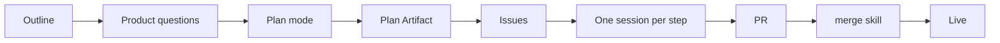

# Plan

The owner outlines the product. Claude plans it visually, and the desktop app runs the plan.

Requires `gh` signed in (`gh auth status`), and the desktop app's Code tab for sessions and Artifacts.

No `gh` (no shell tool, or `command -v gh` finds nothing), as in chat or Cowork without the tool: ask the step 1 questions in chat and skip the `gh` and session steps. Write the plan as a table (step, files, depends on, metric it moves) and list each session brief for the person to start.

| # | Step | Do | Tool |
|---|---|---|---|
| 1 | Define | Read the outline and the repo. Ask only product, vision or billing questions: one AskUserQuestion call, at most 4, each with a recommended default. Decide engineering, security and settings questions yourself from current docs | AskUserQuestion |
| 2 | Split | In plan mode, cut the work into steps. Each step is one PR of at most 200 changed lines, with its test, touching files no other step touches. If superpowers is installed, its `writing-plans` is the method for design and step-by-step plans | Plan mode |
| 3 | Show | Publish the plan as an Artifact: a flow diagram, then one row per step (step, files, depends on, metric it moves). Labels, not paragraphs | Artifacts |
| 4 | File | One issue per step: `gh issue create`, its body the step's row and the Artifact link. Add `--type Task` only when `gh api orgs/<owner>/issue-types` lists Task; a 404 or no Task means plain | `gh` |
| 5 | Approve | ExitPlanMode with the steps and the Artifact link. On approval, start one session per independent step on a brief under 150 words; steps that share files run in order | Sessions, worktrees |
| 6 | Build | A worker branches, tests, pushes once, and opens a PR that says `Closes #<issue>` with a table body. It stops at the open PR | Auto-fix |
| 7 | Merge | The orchestrator reviews and merges each PR with the `merge` skill | pr-review-toolkit |
| 8 | Live | Load the live page in the app's browser. Mark the step done in the Artifact and republish it | Browser, Artifacts |

| Keep usage low | Rule |
|---|---|
| Briefs | A worker starts fresh on its brief, not a fork of the planning conversation |
| Reads | A search across many files goes to `Explore` with `model: "haiku"` |
| Waits | CI, conflicts and review comments come from Auto-fix, never a poll |
| Rounds | At most three review rounds a PR; after that, rethink the step |
