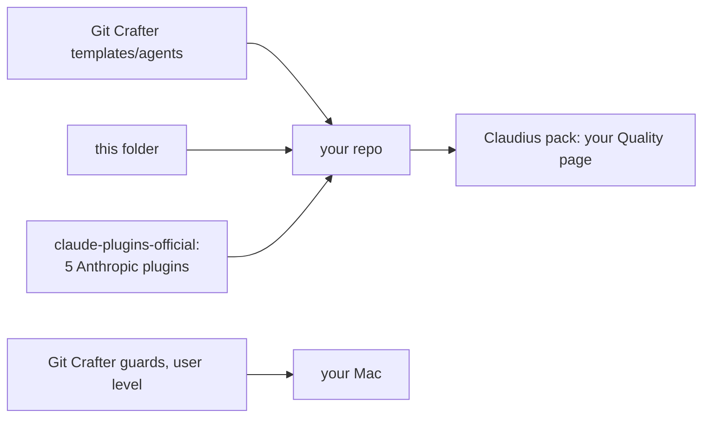
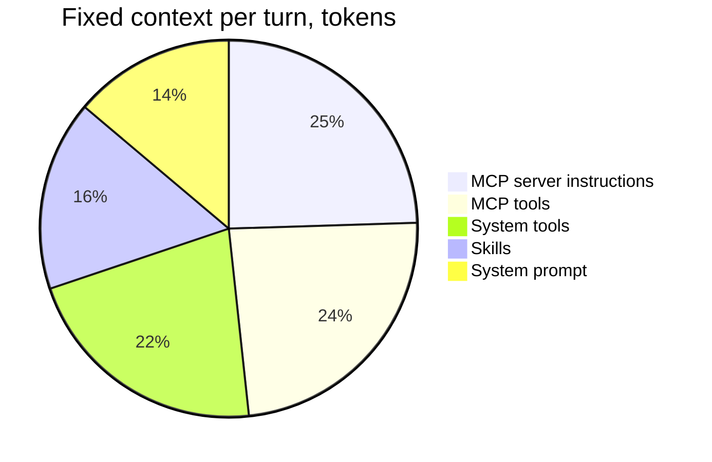
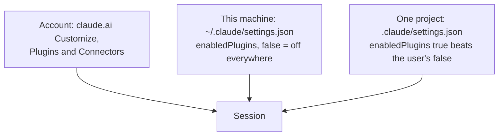
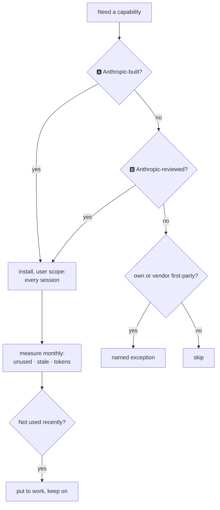

# Claude templates

The Claude-only files for a GitHub repo that Claude Code agents drive from the Claude desktop app. The files every agent reads (`AGENTS.md`, `CLAUDE.md`) come from Git Crafter [`templates/agents`](https://github.com/SoulCraft-Org/git-crafter/tree/main/templates/agents).

## All on, app-wide

The owner's rule (2026-11-19). One desktop app serves every repo and project, so what one session turns off, every session loses. Every other file in this repo links here.

| Level | Rule |
|---|---|
| The Claude desktop app as a whole | Every plugin, skill, connector, agent, tool, app, template, process map and design stays on, for every Cowork and Code session. Never turn one off app-wide: not in `~/.claude/settings.json` or a repo's settings, not by uninstalling or disconnecting, not with the Code tab connector switch (it also sets the default for new sessions), not with `syncClaudeAiPlugins: false` or `disableClaudeAiConnectors` |
| One session | May simply not use what it doesn't need, so it spends no tokens on it. That holds for that session only |
| Sub-sessions: side sessions and subagents | Get the full suite, not the parent's subset; each ignores what it doesn't need. A brief may limit what a worker does (never merge), never which plugins, skills or connectors it can reach |

| How | Works by |
|---|---|
| A session ignores | Not loading it, never turning it off: connector tool schemas stay deferred until a session loads one, and a skill's body loads only when invoked ([MCP](https://code.claude.com/docs/en/mcp), [skills](https://code.claude.com/docs/en/skills)) |
| A session picks | The plan maps the session's skills, plugins and connectors and picks one per step. Each step loads its picks on use, and nothing is hidden. A skill body loads only when invoked. Connector tool schemas stay deferred behind tool search, so keep `ENABLE_TOOL_SEARCH` at its default. A skill missing from the listing stays reachable through the Skill tool ([skills](https://code.claude.com/docs/en/skills), [MCP](https://code.claude.com/docs/en/mcp), [sub-agents](https://code.claude.com/docs/en/sub-agents), read 2026-11-23) |
| A sub-session gets the full suite | A side session starts as a new session with everything on, and a subagent inherits every tool unless its definition lists them ([sub-agents](https://code.claude.com/docs/en/sub-agents)). So a brief names the task, never a tool list |

## Files



| Copy to your repo root | Read by | Does |
|---|---|---|
| `.claude/settings.json` | Claude Code, every session | Turns on 5 Anthropic plugins ([Plugins](#plugins)). Denies reads of `.env`, keys and `~/.ssh` (`claude_settings.deny_coverage` scores it). Denies the one-way doors `rm -rf ~`, `git push --force`, `git reset --hard` in their common spellings |
| The `claudius` plugin (enabled by `.claude/settings.json`) | Claude, every session | `plan`: outline to a visual plan Artifact, one issue per PR, one session per step. `merge`: review at the head SHA, then merge only that commit. `equip`: every plugin on and put to work ([All on, app-wide](#all-on-app-wide)). `find-plugin`: Anthropic-first plugin finder. `plain-voice`: plain, tell-free writing. Source: [plugin/](../../plugin/) |
| `.claude/skills/bump-pins/SKILL.md` | Claude, on demand | Moves the engine and pack pins to their latest tags |
| `code-project/` | Claude Code Projects | Memory seeds, a read-only subagent, scheduled tasks and where a guard must live. [Code Project template](code-project/README.md) |
| `guides/` | People and Claude Code | Claude API credits and keyless CI, Code Projects facts, one MCP server for the desktop app. [Claude guides](guides/README.md) |
| `REVIEW.md` | Code Review service only | Review rules. Needs a Team or Enterprise plan; billed per review |

The deny list is a backstop, not a full blocklist. Claude Code's built-in check already prompts before `rm -rf ~`, bypass mode included (code.claude.com/docs/en/permission-modes); the rules name only the home folder itself, since `*` is a wildcard and `~/*` would match every path under home. Deny rules block in every mode, bypass included, but a Bash rule matches the command text, so `/bin/rm` or `bash -c '...'` gets past it.

## Steps

| # | Do | Who |
|---|---|---|
| 1 | Copy Git Crafter `templates/agents/AGENTS.md` and `CLAUDE.md`; fill the `<...>` cells | Claude |
| 2 | Copy this folder's files; skip `REVIEW.md` without Code Review. Install the plugins once per machine, at user scope ([Plugins](#plugins)) | Claude |
| 3 | Desktop app settings (table below) | owner, once |
| 4 | Install Git Crafter's guards and `merging` skill user-level: `tools/claude_os_sync.py`. Each guard's header gives its hook entry for `~/.claude/settings.json` | Claude |
| 5 | Optional `@claude` in CI: Git Crafter `templates/ci/claude-review.yml`. It reads `CLAUDE_CODE_OAUTH_TOKEN`, made by `claude setup-token` on a Pro, Max, Ultra, Team or Enterprise plan. Never an API key | owner: the token |
| 6 | Add the Claudius pack for the Quality page: the [root README](../../README.md). Its Best practices tab scores your plugin and skills against Anthropic's directory checks and authoring rules, in CI too | Claude |

No hooks sit in the repo's `settings.json`: a hook that points at a guard the machine lacks fails every call.

## Desktop app (Code tab)

| Setting or check | Set | Why |
|---|---|---|
| Permission mode (prompt box) | Auto, never bypass | Auto: a classifier checks each action before it runs, so a build runs without prompts. Bypass turns off prompts and safety checks. Deny rules hold in both. A committed settings file cannot set it: use the selector or `~/.claude/settings.json` |
| Worktree (prompt box row) | on | Parallel sessions never share a checkout |
| Branch prefix | `claude/` | Matches Git Crafter's branch rule |
| Auto-archive after PR merge or close | on | Done sessions leave the sidebar |
| Auto-fix (a PR's ⋮ menu) | on per PR | The app wakes the session on CI failures and review comments. Needs `gh` signed in |
| Merge when ready | off | It turns on GitHub auto-merge; merges go through the `merging` skill's verdict |
| Output style | Default | Explanatory and Learning add Insights to replies, and Learning stops for you to write code |
| Effort | medium | Git Crafter `skills/merging/orchestrating.md`: Opus at medium runs sessions |
| Plugins, skills, connectors and agents | **all on** | [All on, app-wide](#all-on-app-wide). Their cost per turn is in the chart below; `desktop_app.listing_tokens` reports it |
| `/plugin`, Installed tab: **Not used recently** | monthly: put each one listed to work; keep it on | Listed after 14 days and 10 sessions unused |
| `/skill-doctor` | monthly | Skills in the listing never invoked, with each one's context cost. Keep them on |
| `/doctor` | monthly | Lists skills, MCP servers and plugins you did not use. Keep them on; fix only the ones that fail |
| `/usage` | weekly | Share of usage per skill, subagent, plugin and MCP server (Pro, Max, Ultra, Team, Enterprise) |

Run the four checks in a terminal session in the repo (`claude`): it reads the same settings files as the app.

What one turn carries before any message, in an example session with many plugins on (the app's `get_usage` context categories, read 2026-11-14). The MCP and skill slices are the cost of keeping every plugin and connector on:



## Whole app and one project

Three layers decide what a session loads. A plugin turned off in user settings is off in every folder, so none is ever turned off there ([All on, app-wide](#all-on-app-wide)). A project's `true` beats the user's `false`.



| Piece | Loads at start | Loads when needed |
|---|---|---|
| Connector tools | name list only, by default | the tool's schema, when a task calls it |
| Skill bodies | no | when the skill is used |
| Skill descriptions | yes, up to a listing budget of 1% of the context window; past it, the least-used skills' descriptions are dropped (`skillListingBudgetFraction` raises it, at a token cost per turn) | no |
| Plugins | their skill descriptions and server instructions | their skill bodies and tools |

| Scope | Belongs there |
|---|---|
| Account (Customize pages) | every plugin and connector you added, on and signed in once |
| This machine (`~/.claude/settings.json`) | every plugin on; never `false`, which turns it off in every folder |
| One project (`.claude/settings.json`) | the plugins that project needs, set `true`, so an unused Anthropic plugin is put to work there, not dropped |

Sources: code.claude.com/docs/en/skills, /plugins/loading and /mcp, read 2026-11-15.

### Decided for you

| Question | Decision | Evidence (one account, 2026-11-15) | Change it when |
|---|---|---|---|
| Raise the skill listing budget so every description shows? | No. Keep the 1% default | 102 plugins, 1,081 skills: about 98% list by name only at the default, and the listing costs 12.3k tokens. On 8 requests aimed at plugins never used before, Opus 5.5 picked the right skill 8 of 8 from names alone. Showing every description in full would cost about 108k tokens a turn | a skill you expect is not picked: name it in that project's `CLAUDE.md` first, then try `skillListingBudgetFraction` at `0.02` |
| Turn connector tools off to save context? | No | 556.8k tokens of connector tools exist and 4.2k load at start; the rest load on demand | never: [All on, app-wide](#all-on-app-wide) |

## Plugins

Prefer what Anthropic builds or reviews. A marketplace's name sets its tier, and Claude Code accepts the official and community names only from `github.com/anthropics/`, so the tier can be checked.

| Tier | Where | Rule |
|---|---|---|
| 🅰 Anthropic-built | `claude-plugins-official` entries by Anthropic · the other official-tier marketplaces (`knowledge-work-plugins`, `claude-for-legal`, `claude-for-financial-services`, `life-sciences`, …) | ✅ prefer |
| 🅱 Anthropic-reviewed | partner entries Anthropic lists in `claude-plugins-official` · Anthropic's directory on claude.ai, each version reviewed before it is published | ✅ allow |
| 🅲 Community | `claude-community`, `claude-plugins-community`, `healthcare`: submitted to Anthropic, nearly every entry pinned to a commit | ⚠️ only with no 🅰 or 🅱 equivalent |
| 🅳 Third-party or custom | any other marketplace, `@skills-dir`, `~/.claude/skills`, hand-written hooks | ❌ add the 🅰 or 🅱 equivalent when one exists, else a named exception; it stays on |



| The template turns on (`@claude-plugins-official`, author Anthropic) | For | Covers |
|---|---|---|
| `feature-dev` | explore, design and build a feature | custom build skills |
| `code-review` | `/code-review` on a pull request | |
| `pr-review-toolkit` | review agents: `code-reviewer`, `silent-failure-hunter`, `pr-test-analyzer`, … | the old `.claude/agents/reviewer.md` |
| `session-report` | an HTML report of tokens, cache, subagents and skills from your transcripts | hand-written usage scripts |
| `claude-md-management` | audit and update `CLAUDE.md` | |

The committed `enabledPlugins` turns them on but does not download them. Once per machine, in your shell, at user scope so every session has them:

```bash
for p in feature-dev code-review pr-review-toolkit session-report claude-md-management; do claude plugin install "$p@claude-plugins-official" --scope user; done
```

| `/plugin` Errors tab says | Do |
|---|---|
| `Plugin "<name>" is enabled in project settings but isn't installed here` | `claude plugin install <name>@claude-plugins-official --scope user` once on this machine, then `/reload-plugins` |

On a machine that has never run an interactive `claude`, add the marketplace first: `claude plugin marketplace add anthropics/claude-plugins-official`. Cloud sessions load none of these.

| Cost check | Shows |
|---|---|
| `claude plugin details <name>`, in your shell | `Always-on`: tokens the plugin adds to every session, and the skill or agent that adds most |
| `/plugin`, a plugin's details | **Context cost**: `Every turn` and `When invoked`, for official-marketplace plugins; `Every turn` is highlighted from 2,000 tokens |

Sources: code.claude.com/docs/en/desktop, /permission-modes, /settings, /output-styles, /memory, /code-review-customize, /github-actions, read 2026-11-13; /permissions, /skills, /plugins/security, /plugins/anthropic-marketplaces, /plugins/install, /plugins/loading, /plugins/measure, /plugins/publish, read 2026-11-14.
