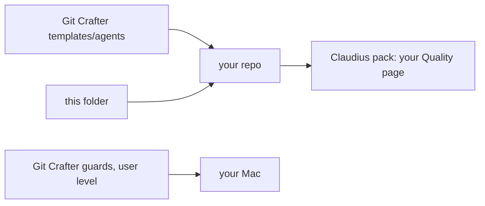

# Claude templates

The Claude-only files for a GitHub repo that Claude Code agents drive from the Claude desktop app. The files every agent reads (`AGENTS.md`, `CLAUDE.md`) come from Git Crafter [`templates/agents`](https://github.com/SoulCraft-Org/git-crafter/tree/main/templates/agents).

## Files

| Copy to your repo root | Read by | Does |
|---|---|---|
| `.claude/settings.json` | Claude Code, every session | Denies reads of `.env`, keys and `~/.ssh` (`claude_settings.deny_coverage` scores it) |
| `.claude/agents/reviewer.md` | the `merging` skill's reviews | One reviewer per PR, a 120-word MERGE or BLOCK verdict. Copied from Git Crafter `.claude/agents/reviewer.md` |
| `.claude/skills/product-plan/SKILL.md` | Claude, when the owner outlines a product | Outline to a visual plan Artifact, one issue per PR, one session per step |
| `.claude/skills/bump-pins/SKILL.md` | Claude, on demand | Moves the engine and pack pins to their latest tags |
| `REVIEW.md` | Code Review service only | Review rules. Needs a Team or Enterprise plan; billed per review |

## Steps

| # | Do | Who |
|---|---|---|
| 1 | Copy Git Crafter `templates/agents/AGENTS.md` and `CLAUDE.md`; fill the `<...>` cells | Claude |
| 2 | Copy this folder's files; skip `REVIEW.md` without Code Review | Claude |
| 3 | Desktop app settings (table below) | owner, once |
| 4 | Install Git Crafter's guards and `merging` skill user-level: `tools/claude_os_sync.py`. Each guard's header gives its hook entry for `~/.claude/settings.json` | Claude |
| 5 | Optional `@claude` in CI: Git Crafter `templates/ci/claude-review.yml`. It reads `CLAUDE_CODE_OAUTH_TOKEN`, made by `claude setup-token` on a Pro, Max, Ultra, Team or Enterprise plan. Never an API key | owner: the token |
| 6 | Add the Claudius pack for the Quality page: the [root README](../../README.md) | Claude |

No hooks sit in the repo's `settings.json`: a hook that points at a guard the machine lacks fails every call.

## Desktop app (Code tab)

| Setting | Set | Why |
|---|---|---|
| Permission mode (prompt box) | Auto | A classifier checks each action, so a build runs without prompts. A committed settings file cannot set it: use the selector or `~/.claude/settings.json` |
| Worktree (prompt box row) | on | Parallel sessions never share a checkout |
| Branch prefix | `claude/` | Matches Git Crafter's branch rule |
| Auto-archive after PR merge or close | on | Done sessions leave the sidebar |
| Auto-fix (a PR's ⋮ menu) | on per PR | The app wakes the session on CI failures and review comments. Needs `gh` signed in |
| Merge when ready | off | It turns on GitHub auto-merge; merges go through the `merging` skill's verdict |
| Output style | Default | Explanatory and Learning add Insights to replies, and Learning stops for you to write code |
| Effort | medium | Git Crafter `skills/merging/orchestrating.md`: Opus at medium runs sessions |

Sources: code.claude.com/docs/en/desktop, /permission-modes, /settings, /output-styles, /memory, /code-review-customize, /github-actions, read 2026-11-13.
