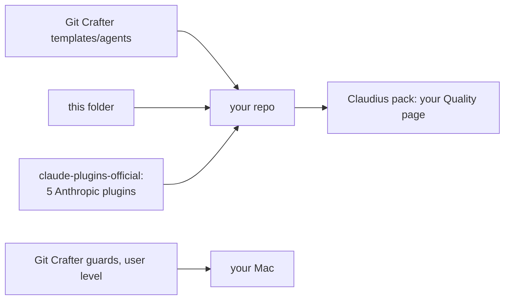
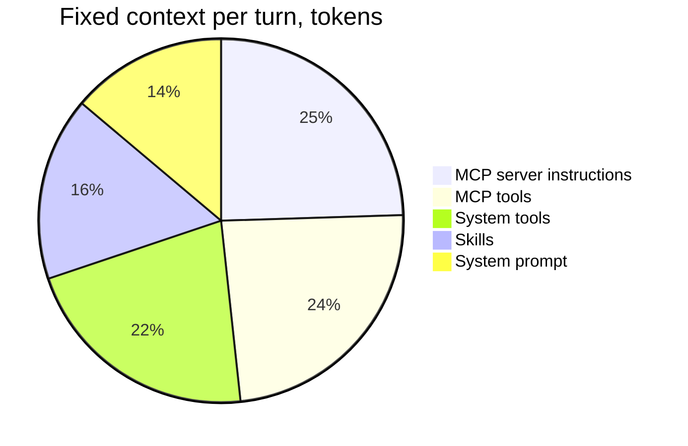
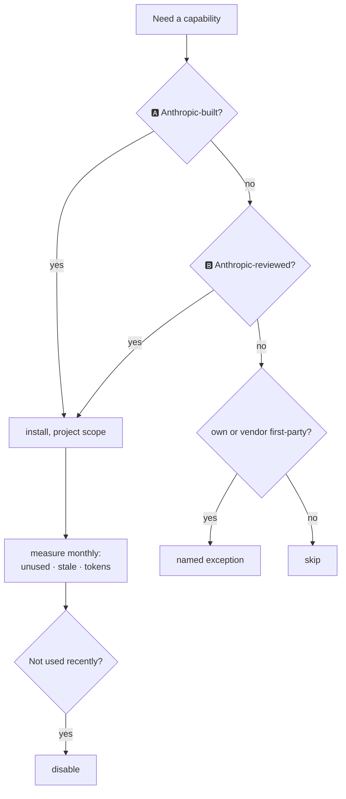

# Claude templates

The Claude-only files for a GitHub repo that Claude Code agents drive from the Claude desktop app. The files every agent reads (`AGENTS.md`, `CLAUDE.md`) come from Git Crafter [`templates/agents`](https://github.com/SoulCraft-Org/git-crafter/tree/main/templates/agents).



## Files

| Copy to your repo root | Read by | Does |
|---|---|---|
| `.claude/settings.json` | Claude Code, every session | Turns on 5 Anthropic plugins ([Plugins](#plugins)). Denies reads of `.env`, keys and `~/.ssh` (`claude_settings.deny_coverage` scores it). Denies the one-way doors `rm -rf ~`, `git push --force`, `git reset --hard`. A deny rule stops the form Claude usually writes, not every spelling; Auto mode checks the rest |
| `.claude/skills/product-plan/SKILL.md` | Claude, when the owner outlines a product | Outline to a visual plan Artifact, one issue per PR, one session per step |
| `.claude/skills/bump-pins/SKILL.md` | Claude, on demand | Moves the engine and pack pins to their latest tags |
| `REVIEW.md` | Code Review service only | Review rules. Needs a Team or Enterprise plan; billed per review |

## Steps

| # | Do | Who |
|---|---|---|
| 1 | Copy Git Crafter `templates/agents/AGENTS.md` and `CLAUDE.md`; fill the `<...>` cells | Claude |
| 2 | Copy this folder's files; skip `REVIEW.md` without Code Review. Install the plugins once per clone ([Plugins](#plugins)) | Claude |
| 3 | Desktop app settings (table below) | owner, once |
| 4 | Install Git Crafter's guards and `merging` skill user-level: `tools/claude_os_sync.py`. Each guard's header gives its hook entry for `~/.claude/settings.json` | Claude |
| 5 | Optional `@claude` in CI: Git Crafter `templates/ci/claude-review.yml`. It reads `CLAUDE_CODE_OAUTH_TOKEN`, made by `claude setup-token` on a Pro, Max, Ultra, Team or Enterprise plan. Never an API key | owner: the token |
| 6 | Add the Claudius pack for the Quality page: the [root README](../../README.md) | Claude |

No hooks sit in the repo's `settings.json`: a hook that points at a guard the machine lacks fails every call.

## Desktop app (Code tab)

| Setting or check | Set | Why |
|---|---|---|
| Permission mode (prompt box) | Auto, never bypass | Auto: a classifier checks each action before it runs, so a build runs without prompts. Bypass turns off prompts and safety checks. Deny rules hold in both. A committed settings file cannot set it: use the selector or `~/.claude/settings.json` |
| Worktree (prompt box row) | on | Parallel sessions never share a checkout |
| Branch prefix | `claude/` | Matches Git Crafter's branch rule |
| Auto-archive after PR merge or close | on | Done sessions leave the sidebar |
| Auto-fix (a PR's ⋮ menu) | on per PR | The app wakes the session on CI failures and review comments. Needs `gh` signed in |
| Merge when ready | off | It turns on GitHub auto-merge; merges go through the `merging` skill's verdict |
| Output style | Default | Explanatory and Learning add Insights to replies, and Learning stops for you to write code |
| Effort | medium | Git Crafter `skills/merging/orchestrating.md`: Opus at medium runs sessions |
| Plugins and connectors | only the ones the repo calls | Each one's tools, skills and instructions go out again on every turn (chart below). `desktop_app.plugins_unused`, `connectors_unused` and `listing_tokens` score it |
| Domain plugins (legal, finance, sales, design) | per repo: `enabledPlugins` in that repo's `.claude/settings.json`; off in `~/.claude/settings.json` | They load only where that work happens |
| `syncClaudeAiPlugins` | `false` in `~/.claude/settings.json`, when claude.ai plugins you never use in Code load | Stops your claude.ai account's plugins loading in Code. A repo file cannot set it; to drop one plugin there, `"<name>@synced": false` |
| `/plugin`, Installed tab: **Not used recently** | monthly: disable each one listed | Listed after 14 days and 10 sessions unused |
| `/skill-doctor` | monthly | Skills in the listing never invoked, with each one's context cost |
| `/doctor` | monthly | Recommends disabling skills, MCP servers and plugins you did not use |
| `/usage` | weekly | Share of usage per skill, subagent, plugin and MCP server (Pro, Max, Ultra, Team, Enterprise) |

Run the four checks in a terminal session in the repo (`claude`): it reads the same settings files as the app.

What one turn carries before any message, in an example session with many plugins on (the app's `get_usage` context categories, read 2026-11-14). The MCP and skill slices shrink as unused plugins come off:



## Plugins

Prefer what Anthropic builds or reviews. A marketplace's name sets its tier, and Claude Code accepts the official and community names only from `github.com/anthropics/`, so the tier can be checked.

| Tier | Where | Rule |
|---|---|---|
| 🅰 Anthropic-built | `claude-plugins-official` entries by Anthropic · the other official-tier marketplaces (`knowledge-work-plugins`, `claude-for-legal`, `claude-for-financial-services`, `life-sciences`, …) | ✅ prefer |
| 🅱 Anthropic-reviewed | partner entries Anthropic lists in `claude-plugins-official` · Anthropic's directory on claude.ai, each version reviewed before it is published | ✅ allow |
| 🅲 Community | `claude-community`, `claude-plugins-community`, `healthcare`: submitted to Anthropic, nearly every entry pinned to a commit | ⚠️ only with no 🅰 or 🅱 equivalent |
| 🅳 Third-party or custom | any other marketplace, `@skills-dir`, `~/.claude/skills`, hand-written hooks | ❌ replace when a 🅰 or 🅱 equivalent exists; else a named exception |



| The template turns on (`@claude-plugins-official`, author Anthropic) | For | Replaces |
|---|---|---|
| `feature-dev` | explore, design and build a feature | custom build skills |
| `code-review` | `/code-review` on a pull request | |
| `pr-review-toolkit` | review agents: `code-reviewer`, `silent-failure-hunter`, `pr-test-analyzer`, … | the old `.claude/agents/reviewer.md` |
| `session-report` | an HTML report of tokens, cache, subagents and skills from your transcripts | hand-written usage scripts |
| `claude-md-management` | audit and update `CLAUDE.md` | |

The committed `enabledPlugins` turns them on but does not download them. Once per clone, in your shell:

```bash
for p in feature-dev code-review pr-review-toolkit session-report claude-md-management; do claude plugin install "$p@claude-plugins-official" --scope project; done
```

On a machine that has never run an interactive `claude`, add the marketplace first: `claude plugin marketplace add anthropics/claude-plugins-official`. Cloud sessions load none of these.

| Cost check | Shows |
|---|---|
| `claude plugin details <name>`, in your shell | `Always-on`: tokens the plugin adds to every session, and the skill or agent that adds most |
| `/plugin`, a plugin's details | **Context cost**: `Every turn` and `When invoked`, for official-marketplace plugins; `Every turn` is highlighted from 2,000 tokens |

Sources: code.claude.com/docs/en/desktop, /permission-modes, /settings, /output-styles, /memory, /code-review-customize, /github-actions, read 2026-11-13; /permissions, /skills, /plugins/security, /plugins/anthropic-marketplaces, /plugins/install, /plugins/loading, /plugins/measure, /plugins/publish, read 2026-11-14.
