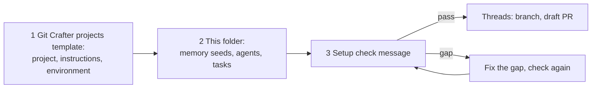

# Code Project template

Set up a Claude Code Project (a coordinating conversation plus the cloud threads it starts) so each thread ships a pull request and nothing a repo relies on is skipped. The project, instructions and environment steps live in Git Crafter [`templates/projects`](https://github.com/SoulCraft-Org/git-crafter/tree/main/templates/projects). This folder adds the Claude-only parts and links, not copies, the rest.

## Quick start

| # | Do | Who |
|---|---|---|
| 1 | Follow Git Crafter [`templates/projects/README.md`](https://github.com/SoulCraft-Org/git-crafter/blob/main/templates/projects/README.md) steps 1 to 4 | Claude, then owner for keys |
| 2 | Copy `agents/` to `.claude/agents/` in each attached repo. Paste the [memory seeds](#memory-seeds) into the first message. Create the [scheduled tasks](#scheduled-tasks) | Claude |
| 3 | Send the setup check from Git Crafter [`templates/projects/README.md`](https://github.com/SoulCraft-Org/git-crafter/blob/main/templates/projects/README.md#steps) | owner |

## Pages

Each page scores one Project tab or feature on Quality, Speed and Consumption. [`page-index.json`](page-index.json) lists the pages, their tabs, metric ids and process map. Each metric's label and goal is in `targets/code-project-*.json`. The [page kit](page/README.md) adds a page.

| View | How |
|---|---|
| Scored | The pack builds the pages into the Quality site, as with any other tab |
| At a glance, no engine | Serve the repo root and open [`pages.html`](pages.html). Dots stay grey until a `readings.json` beside it fills them: `{"<metric id>": {"value": "92%", "met": true}}`. Keep readings in the project's private repo, never here |

## Where a guard lives

A cloud thread skips a repo's `.claude/settings.json` permission rules, hooks and `env`, and its `.mcp.json` servers. A guard that must hold in every thread goes where the thread reads it.

| Guard | Put it in | Why |
|---|---|---|
| Never merge, never push to the default branch | Project instructions and the repo's GitHub ruleset | The instruction steers the thread. The ruleset refuses the push |
| Never print or commit a key | Project instructions, `CLAUDE.md`, secret scanning with push protection | Deny rules in `settings.json` do not run in a cloud thread |
| Tests before merge | The required CI check | A thread cannot skip a check GitHub enforces |
| Network and variables | The cloud environment | `env` in `settings.json` is not applied |
| Deny list and hooks | Keep them in `.claude/settings.json` for local threads and Remote Control sessions | They are a backstop there, not a cloud guard |

## Memory seeds

Project memory is files that every cloud thread reads at start, kept on in claude.ai settings. Ask Claude once to save each seed as its own short note.

| Note | Says |
|---|---|
| Run location | Where long runs go: this computer, GitHub, or the cloud, and when |
| Billing decisions | What is bought, what is free, and the rule for new spend. Names only, no account ids |
| Repo map | Which repos are attached, which are added when needed, and any dot-named repo worked in a Remote Control session |
| Tracking | A bug, quick fix or error is an issue. A feature or improvement is a card. Both are recorded, finished or open ([tracking](https://github.com/SoulCraft-Org/git-crafter/blob/main/templates/projects/tracking.md)) |

## Subagents

Cloud threads load a repo's `.claude/agents/`. The explorer reads and reports, so side work stays out of the thread's context. For review, use the `pr-review-toolkit` agents ([templates/claude/README.md](../README.md#plugins)) instead of a copy here.

| File | Model | Does |
|---|---|---|
| [`agents/explorer.md`](agents/explorer.md) | Haiku | Finds files and answers where a thing is defined, read only |

## Scheduled tasks

These tasks are suggestions to set up as scheduled tasks. A task ignores the connectors it does not need and leaves them on ([All on, app-wide](../README.md#all-on-app-wide)).

| Task | When | Does |
|---|---|---|
| Dependency and CI digest | Weekly | Lists open Dependabot PRs and failing checks, one table |
| Quality read | Weekly | Reads each Quality page, lists the three biggest misses |
| Pin check | Monthly | Runs `bump-pins`, opens a PR if a pin moved |

## Limits

| Limit | Value | Do |
|---|---|---|
| Plans | Pro, Max or Ultra. Not Team or Enterprise | Check **Projects** shows in the sidebar |
| New threads | 500 a day | One thread per task |
| Cache | One hour | A fresh thread for new work |
| Local thread memory | A thread on your computer starts with the project's instructions, not its memory files. Connecting the folder through Remote Control needs Claude Code v2.1.280 or later ([Projects](https://code.claude.com/docs/en/claude-projects), read 2026-11-25) | Put the rules it needs in `CLAUDE.md` or `AGENTS.md` |
| Attached repo access | An attached repo can still fail to connect ([Projects](https://code.claude.com/docs/en/claude-projects), read 2026-11-25) | Read a file and push a branch in each repo first. Record a failing repo as untested, and work it from a local thread |
| Repo named with a dot | Such a repo, `.github` for one, makes the thread skip the skills, agents and commands of its repositories ([Projects](https://code.claude.com/docs/en/claude-projects), read 2026-11-25) | Run that thread as a Remote Control session, or enable the skills for your claude.ai account |
| Merge from a cloud thread | `gh pr merge` and the queue calls use GraphQL, and a cloud thread may be unable to run them | If one fails there, hand the merge off to a local thread or Remote Control session. It merges by the merge skill's step 6 (queue at the reviewed SHA, `expectedHeadOid`) or step 7 where the repo has no queue. The [merge skill](../../../plugin/skills/merge/SKILL.md#in-a-cloud-thread) has the steps |

## Sources

Read 2026-11-26: [Projects](https://code.claude.com/docs/en/claude-projects) for the Overview pane, the Context tab and the 16,000 character instructions cap, and [Cloud environments](https://code.claude.com/docs/en/cloud-environments) for the setup script's 5 minute cache window. Read 2026-11-25: [Projects](https://code.claude.com/docs/en/claude-projects) for what a thread loads, memory, the 500 thread limit, the one hour cache and plan availability. [Cloud environments](https://code.claude.com/docs/en/cloud-environments) for variables and network secrets. [Sub-agents](https://code.claude.com/docs/en/sub-agents) for agent files.
