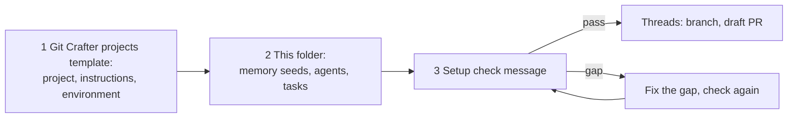

# Code Project template

Set up a Claude Code Project (a coordinating conversation plus the cloud threads it starts) so each thread ships a pull request and nothing a repo relies on is skipped. The project, instructions and environment steps live in Git Crafter [`templates/projects`](https://github.com/SoulCraft-Org/git-crafter/tree/main/templates/projects). This folder adds the Claude-only parts and links, not copies, the rest.

## Quick start

| # | Do | Who |
|---|---|---|
| 1 | Follow Git Crafter [`templates/projects/README.md`](https://github.com/SoulCraft-Org/git-crafter/blob/main/templates/projects/README.md) steps 1 to 4 | Claude, then owner for keys |
| 2 | Copy `agents/` to `.claude/agents/` in each attached repo. Paste the [memory seeds](#memory-seeds) into the first message. Create the [scheduled tasks](#scheduled-tasks) | Claude |
| 3 | Send the setup check from Git Crafter [`templates/projects/README.md`](https://github.com/SoulCraft-Org/git-crafter/blob/main/templates/projects/README.md#steps) | owner |

## Where a guard lives

A cloud thread skips a repo's `.claude/settings.json` permission rules, hooks and `env`, and its `.mcp.json` servers. A guard that must hold in every thread goes where the thread reads it.

| Guard | Put it in | Why |
|---|---|---|
| Never merge, never push to the default branch | Project instructions and the repo's GitHub ruleset | The instruction steers the thread. The ruleset refuses the push |
| Never print or commit a key | Project instructions, `CLAUDE.md`, secret scanning with push protection | Deny rules in `settings.json` do not run in a cloud thread |
| Tests before merge | The required CI check | A thread cannot skip a check GitHub enforces |
| Network and variables | The cloud environment | `env` in `settings.json` is not applied |
| Deny list and hooks | Keep them in `.claude/settings.json` for local threads and Remote Control sessions | They are a backstop there, not a cloud guard |

## Memory seeds

Project memory is files that every cloud thread reads at start, kept on in claude.ai settings. Ask Claude once to save each seed as its own short note.

| Note | Says |
|---|---|
| Run location | Where long runs go: this computer, GitHub, or the cloud, and when |
| Billing decisions | What is bought, what is free, and the rule for new spend. Names only, no account ids |
| Repo map | Which repos are attached, which are added when needed, and any dot-named repo worked in a Remote Control session |
| Tracking | A bug, quick fix or error is an issue. A feature or improvement is a card. Both are recorded, finished or open ([tracking](https://github.com/SoulCraft-Org/git-crafter/blob/main/templates/projects/tracking.md)) |

## Subagents

Cloud threads load a repo's `.claude/agents/`. Both files read and report, so side work stays out of the thread's context.

| File | Model | Does |
|---|---|---|
| [`agents/explorer.md`](agents/explorer.md) | Haiku | Finds files and answers where a thing is defined, read only |
| [`agents/reviewer.md`](agents/reviewer.md) | Sonnet | Reads a diff for bugs and rule breaks, read only, no edits |

## Scheduled tasks

A cloud scheduled task runs without a conversation. Remove connectors a task does not need.

| Task | When | Does |
|---|---|---|
| Dependency and CI digest | Weekly | Lists open Dependabot PRs and failing checks, one table |
| Quality read | Weekly | Reads each Quality page, lists the three biggest misses |
| Pin check | Monthly | Runs `bump-pins`, opens a PR if a pin moved |

## Pages

Each tab and feature of a Project has a Quality, Speed and Consumption tab in this pack, named `cp-<name>`, with three metrics. Each reads local files, so a metric with no collector reads not measured and the public page leaves it out. The 19 tabs form 14 pages, each with one process map ([`pages.json`](pages.json), [maps/README.md](../../../maps/README.md#page-maps-one-per-page)).

| Page | Tabs | Map |
|---|---|---|
| 🛰️ Overview and threads | Conversation, Threads | `project` |
| 📎 Context | Context | `context` |
| ⚙️ General and Advanced | General | `decide` |
| 🧠 Memory | Memory | `guard` |
| 🌩️ Environment | Environment, Network access, Network secrets, Setup script | `setup-check` |
| 📊 Usage | Usage | `spend` (Compute Crafter) |
| ⏰ Scheduled tasks | Scheduled tasks | `scheduled-task` |
| 💻 Threads on your computer | Work locally | `local-thread` |
| 🔀 Pull requests and auto-fix | Pull request auto fix | `pr-flow` |
| 🔌 Connectors | Connectors | `connectors` |
| 🧩 Plugins | Plugins, Extensions | `plugins` |
| 📚 Skills | Skills | `skills` |
| 🤖 Subagents | Subagents | `subagents` |
| 🪝 Hooks | Hooks | `hooks` |

To add a page, copy the [page kit](page/README.md): three files, a checklist and the rule for what 100 means.

## Limits

| Limit | Value | Do |
|---|---|---|
| Plans | Pro, Max or Ultra. Not Team or Enterprise | Check **Projects** shows in the sidebar |
| New threads | 500 a day | One thread per task |
| Cache | One hour | A fresh thread for new work |
| Models | Opus at medium effort by default | Ask for a smaller model on docs and lint |
| PR watching | An idle thread wakes on CI and reviews and spends usage | Stop watching once the PR merges |
| Usage credits | Bill past the plan | Keep off, or set a spend limit first |
| Repository settings | A cloud thread's writes to rulesets, code scanning setup and merge settings returned HTTP 403 (observed 2026-11-25). | File each as an issue. Apply it from a Remote Control session on your computer |
| Local thread memory | A thread on your computer starts with the project's instructions, not its memory files. Connecting the folder through Remote Control needs Claude Code v2.1.280 or later ([Projects](https://code.claude.com/docs/en/claude-projects), read 2026-11-25). | Put the rules it needs in `CLAUDE.md` or `AGENTS.md` |
| Attached repo access | An attached repo can still return HTTP 403 from a cloud thread (observed 2026-11-25). | Read a file and push a branch in each repo first. Record a failing repo as untested, and work it from a local thread |
| Repo named with a dot | Such a repo, `.github` for one, makes the thread skip every repo's skills, agents and commands ([Projects](https://code.claude.com/docs/en/claude-projects), read 2026-11-25). | Run that thread as a Remote Control session, or enable the skills for your claude.ai account |
| Check only a local run posts | A cloud thread cannot run it, so its pull request cannot turn that check green (observed 2026-11-25, a macOS test status). | Open a draft pull request and note the run as pending in the body. Run it in a local thread before the merge |
| Merge by REST | A merge returned 5xx, then 405 `Merge already in progress` for about 8 minutes, then 200 (observed 2026-11-25). | Retry once a minute. The [merge skill](../../../plugin/skills/merge/SKILL.md#in-a-cloud-thread) lists each REST form |

## Sources

Read 2026-11-25: [Projects](https://code.claude.com/docs/en/claude-projects) for what a thread loads, memory, the 500 thread limit, the one hour cache and plan availability. [Cloud environments](https://code.claude.com/docs/en/cloud-environments) for variables and network secrets. [Sub-agents](https://code.claude.com/docs/en/sub-agents) for agent files.
