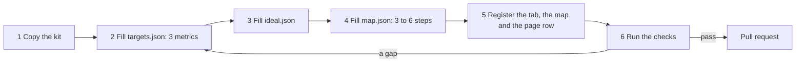

# Page kit: add a Code Project page

A page is one tab or feature scored on Quality, Speed and Consumption, with one process map. Copy these three files, fill each `<placeholder>`, and the page and its map build with the rest of the pack. The 14 pages the pack ships are listed in [`../pages.json`](../pages.json).

## Steps

| # | Do | Where it goes |
|---|---|---|
| 1 | Pick a name in lowercase letters and dashes, such as `usage`. The tab id is `cp-<name>`, the metric ids `cp_<name>.<metric>` | |
| 2 | Fill `targets.json`: one Quality, one Speed and one Consumption metric. Say where the number is read, and keep `needs: local-files` until a collector reads it | `targets/code-project-tabs.json` or `code-project-features.json` |
| 3 | Fill `ideal.json`: an ideal of 25 words at most, with dated sources you read | `ideals/cp-<name>.json` |
| 4 | Fill `map.json`: each step names one metric, and the map scores all three kinds. Six steps at most, rules of 20 words at most | `maps/<map>.json` |
| 5 | Add `["cp-<name>", "Name"]` to `pack.json` and `quality/config.json`, `{ "use": "<map>" }` to `quality/process/config.json`, and a row to [`pages.json`](../pages.json) | |
| 6 | Run `node --test tests/pages.test.mjs`, then the engine tests in `AGENTS.md` | |

## What 100 means

| Rule | Detail |
|---|---|
| Measured | Every metric of the page is read, never guessed. One that cannot be read shows not measured and keeps the page under 100 |
| At goal | Every metric sits at its goal. Fix the cause, never the goal |
| Cited | Each goal names its source and the date it was read |
| Mapped | Each step of the map holds one metric of the page, and the map scores Quality, Speed and Consumption |
| Private numbers stay private | A page file holds definitions only. A real usage figure, account name or spend stays on the machine that read it |
