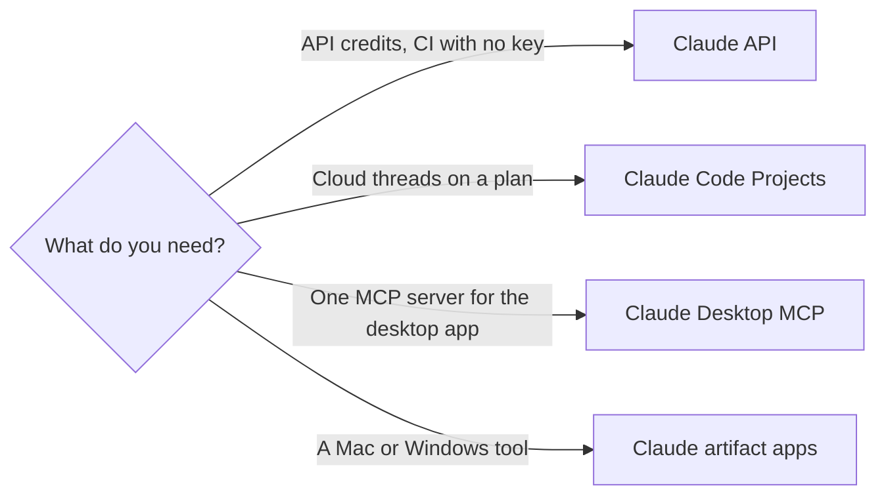

# Claude guides

**Outcome:** Claudius sets up the Claude desktop app as an autonomous, agentic system: you give the objective and the vision, and Claude plans, builds, reviews and merges on its own, asking you only about vision, billing, a one-way change or a step the platform forces.

Four guides for the Claude side of a repo: API credits and keyless CI, Code Projects, one MCP server for the Claude desktop app, and a desktop tool built as an installable artifact. Each opens with a diagram, then one table.

| Guide | Covers |
| --- | --- |
| [Claude API](claude-api.md) | Plan credits, workload identity federation, the keyless workflow in [ci/](ci/claude-keyless.yml) |
| [Claude Code Projects](claude-projects.md) | Cloud threads on a Claude plan. Setup is in the [Code Project template](../code-project/README.md) |
| [Claude artifact apps](claude-artifact-apps.md) | An installable artifact instead of a native app, with a [starter page](artifact-app/starter.html) and a finished [Claudius app](artifact-app/claudius.html) |
| [Claude Desktop MCP](claude-desktop-mcp.md) | A custom connector or a desktop extension, with the [loopback bridge](loopback-bridge/manifest.json) and a [skills server](skills-server/README.md) |

Every vendor claim cites the vendor's page and the date it was read. No key value appears anywhere: CLI logins and OAuth first, variable names only. The pages change, so read the cited page again before you rely on a figure.
