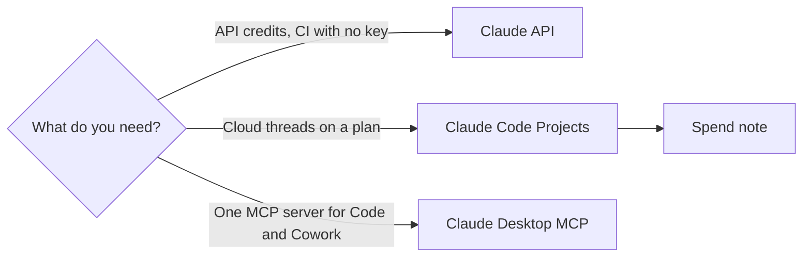

# Claude guides

Three guides and a spend note for the Claude side of a repo: API credits and keyless CI, Code Projects, and one MCP server for the Claude Desktop App. Each opens with a diagram, then one table.

| Guide | Covers |
| --- | --- |
| [Claude API](claude-api.md) | Plan credits, workload identity federation, the keyless workflow in [ci/](ci/claude-keyless.yml) |
| [Claude Code Projects](claude-projects.md) | Cloud threads on a Claude plan, with the [spend note](claude-code-projects-spend.md) |
| [Claude Desktop MCP](claude-desktop-mcp.md) | A custom connector or a desktop extension, with the [loopback bridge](loopback-bridge/manifest.json) |

Every figure cites the vendor's page and the date it was read. No key value appears anywhere: CLI logins and OAuth first, variable names only.
