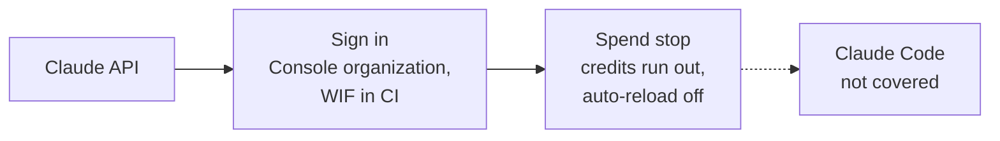

# Claude API

Max, Ultra and Team plans include monthly Claude API credits. GitHub Actions can call the API with no stored key through workload identity federation (WIF). The credits do not cover Claude Code.

| Account | Credits | Login or key | Guard |
| --- | --- | --- | --- |
| A Claude Console organization linked to a Max, Ultra or Team plan ([API credits](https://platform.claude.com/docs/en/about-claude/api-credits-for-subscribers), read 2026-11-26). | Per the credits page, Max gets $100 USD a month, Ultra $200, and Team $20 per Standard seat and $100 per Premium seat, pooled and capped at $500. | CI: federation, no key. Otherwise a key in `ANTHROPIC_API_KEY` ([Authentication](https://platform.claude.com/docs/en/manage-claude/authentication), read 2026-11-26). | With no credits left, API requests stop until the next monthly credits arrive, and usage is never charged to the plan. Buying credits or turning on auto-reload removes the stop, so leave auto-reload off ([API credits](https://platform.claude.com/docs/en/about-claude/api-credits-for-subscribers), read 2026-11-26). |

## What the credits cover

| Item | Detail | Source |
| --- | --- | --- |
| Covered | Claude API, Managed Agents, the Agent SDK and the Playground | [API credits](https://platform.claude.com/docs/en/about-claude/api-credits-for-subscribers), read 2026-11-26 |
| Not covered | Claude Code, extra usage in the Claude apps, cloud platforms | same page, read 2026-11-26 |
| Expiry | End of each billing cycle, no rollover | same page, read 2026-11-26 |
| Order | Included credits first, then purchased ones. Auto-reload counts only the purchased balance | same page, read 2026-11-26 |
| Eligibility | Free, Pro and Enterprise are not eligible. New subscribers can claim after 7 days on an eligible plan | same page, read 2026-11-26 |

The Console's [Billing page](https://platform.claude.com/settings/billing) lists **Promotional credits** with amounts and expiry dates. Read it before a long run.

Keyless CI: [Claude API CI](detail/claude-api-ci.md). Traps and sources: [Claude API traps and sources](detail/claude-api-traps.md).
