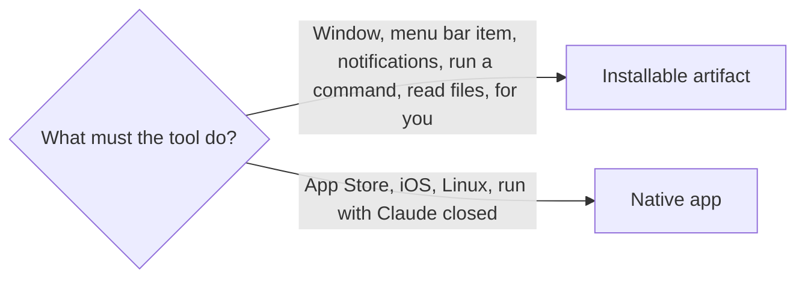

# Claude artifact apps: a Mac or Windows tool without a native app

This guide picks between an installable artifact and a native app.

| Need | Use | Why |
| --- | --- | --- |
| A status view, a menu bar counter, a notification, a small tool that runs `gh` or `git` | An installable artifact | It gets its own window and icon, and can show notifications, add a menu bar item, run programs and read files, each behind a permission prompt ([Install an artifact as an app](https://support.claude.com/en/articles/18516354-install-an-artifact-as-an-app), read 2026-11-26) |
| A dashboard to read | A plain artifact | It needs no window of its own. An artifact made from a template type, such as Docs, Slides or Sheets, cannot be installed (same article) |
| An App Store listing, iOS, Linux, a tool that runs with Claude closed | A native app | Apps are available on Mac and Windows only, and open only with Claude for Mac or Windows signed in and online (same article). Others can install a shared artifact too, but full access is usually refused when someone outside your organization wrote part of the app (same article) |

## Build one

1. Ask Claude for the app in a chat: "Make a Pomodoro timer that lives in my menu bar" is the article's own example ([article](https://support.claude.com/en/articles/18516354-install-an-artifact-as-an-app), read 2026-11-26). Claude builds the page as an ordinary artifact. When you publish it with the Artifact tool, declare `capabilities: {desktop: {}}` and list the permissions it uses in a `claude-artifacts-manifest` JSON tag, as in the [starter page](artifact-app/starter.html) (the Artifact tool's own `desktop` capability notes, which have no public page, runtime contract 0.2.99, read 2026-11-26).
2. Open the artifact in the Claude desktop app, open its title menu, select Install as app, then Install. A page can also draw its own install button ([article](https://support.claude.com/en/articles/18516354-install-an-artifact-as-an-app), read 2026-11-26). See the [starter page](artifact-app/starter.html).
3. Answer each permission request with Allow or Don't allow. An Allow covers one version of the app, so every edit asks again ([article](https://support.claude.com/en/articles/18516354-install-an-artifact-as-an-app), read 2026-11-26).

## Traps

| Trap | What to do |
| --- | --- |
| Full access lets the app run any program and change or delete files ([article](https://support.claude.com/en/articles/18516354-install-an-artifact-as-an-app), read 2026-11-26) | Ask for it only when the tool needs it, and name the files and commands in the page |
| The feature is off by default on Enterprise, and full access is off by default on Team | An owner or admin turns it on in the organization's Artifacts settings ([article](https://support.claude.com/en/articles/18516354-install-an-artifact-as-an-app), read 2026-11-26) |
| An app needs Claude Desktop signed in and online to open ([article](https://support.claude.com/en/articles/18516354-install-an-artifact-as-an-app), read 2026-11-26) | For a job that must run with Claude closed, use a scheduled task or an operating system job instead |
| Anthropic does not review apps ([article](https://support.claude.com/en/articles/18516354-install-an-artifact-as-an-app), read 2026-11-26) | Share the artifact only with people who trust everyone who wrote it. Keep the page private when it holds private repository names |
| Apps are not available in a browser, on the web or on mobile ([article](https://support.claude.com/en/articles/18516354-install-an-artifact-as-an-app), read 2026-11-26) | The same page also opens there, so test for the module you need (`desktop?.tray`) and show an install button or one line when it is missing |
| Computer use can see an installed app on macOS but cannot click or type in it ([article](https://support.claude.com/en/articles/18516354-install-an-artifact-as-an-app), read 2026-11-26) | Test the page's logic in a browser with the desktop API mocked |

## A worked example: the Claudius app

[`artifact-app/claudius.html`](artifact-app/claudius.html) is a finished installable app that reads your repos through `gh` and the public Quality page, with the Claudius gnome as its Dock, window and menu bar icon. Ask Claude to publish the file as an artifact with the `desktop` capability, then install it as above.

| View | Shows | Read with |
| --- | --- | --- |
| Today | What to look at first: failing CI, quiet pull requests, green pull requests that need a review, repos missing a setup piece, Quality tabs under 70 | all sources |
| Builds | Open pull requests per repo with CI state, age and branch | `gh api repos/{repo}/pulls` and `commits/{sha}/check-runs` |
| Quality | Master, Quality, Speed and Consumption scores, every tab lowest first | the public Quality page, trimmed with `curl` and `grep -o` |
| Repos | Eight setup checks per repo: AGENTS.md, CLAUDE.md, README, SECURITY.md, a CI workflow, rules on main, squash only, deletes merged branches | `gh api repos/{repo}`, `contents`, `contents/.github`, `rules/branches/main` |

Change what it watches in the page's Settings, or edit the `claudius-config` JSON block at the top of the file. It cannot read Project threads, plan limits or credit use, because they sit behind the Claude app and the Console rather than behind `gh`, and it says so on the page instead of guessing. It was checked in headless Chromium with the desktop API mocked. The real install, the permission prompts and Mac notifications are not checked here.

The feature is in beta and its permissions change, so read the cited article again before you rely on a limit.
