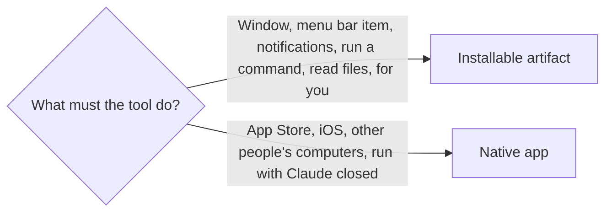

# Claude artifact apps: a Mac or Windows tool without a native app

This guide picks between an installable artifact and a native app.

| Need | Use | Why |
| --- | --- | --- |
| A status view, a menu bar counter, a notification, a small tool that runs `gh` or `git` | An installable artifact | It gets its own window and icon, and can show notifications, add a menu bar item, run programs and read files, each behind a permission prompt ([Install an artifact as an app](https://support.claude.com/en/articles/18516354-install-an-artifact-as-an-app), read 2026-11-26) |
| A dashboard to read | A plain artifact | It needs no window of its own. An artifact made from a template type, such as Docs, Slides or Sheets, cannot be installed (same article) |
| An App Store listing, iOS, Linux, a tool for other people's computers | A native app | Apps are available on Mac and Windows only, and only with Claude for Mac or Windows signed in and online (same article) |

## Build one

1. Ask Claude for the app in a chat: "Make a Pomodoro timer that lives in my menu bar" is the article's own example. Claude builds an ordinary artifact on the `desktop` capability.
2. Open the artifact in the Claude desktop app, open its title menu, select Install as app, then Install. A page can also draw its own install button ([article](https://support.claude.com/en/articles/18516354-install-an-artifact-as-an-app), read 2026-11-26). See the [starter page](artifact-app/starter.html).
3. Answer each permission request with Allow or Don't allow. An Allow covers one version of the app, so every edit asks again.

## Traps

| Trap | What to do |
| --- | --- |
| Full access lets the app run any program and change or delete files | Ask for it only when the tool needs it. List each permission in the page's manifest tag, and name the files and commands in the page |
| The feature is off by default on Enterprise, and full access is off by default on Team | An owner or admin turns it on in the organization's Artifacts settings ([article](https://support.claude.com/en/articles/18516354-install-an-artifact-as-an-app), read 2026-11-26) |
| An app needs Claude Desktop signed in and online to open | For a job that must run with Claude closed, use a scheduled task or an operating system job instead |
| Anthropic does not review apps | Share the artifact only with people who trust everyone who wrote it. Keep the page private when it holds private repository names |
| Apps are not available in a browser, on the web or on mobile ([article](https://support.claude.com/en/articles/18516354-install-an-artifact-as-an-app), read 2026-11-26) | The same page also opens there, so test for the module you need (`desktop?.tray`) and show an install button or one line when it is missing |
| Computer use can see an installed app on macOS but cannot click or type in it | Test the page's logic in a browser with the desktop API mocked |

The feature is in beta and its permissions change, so read the cited article again before you rely on a limit.
