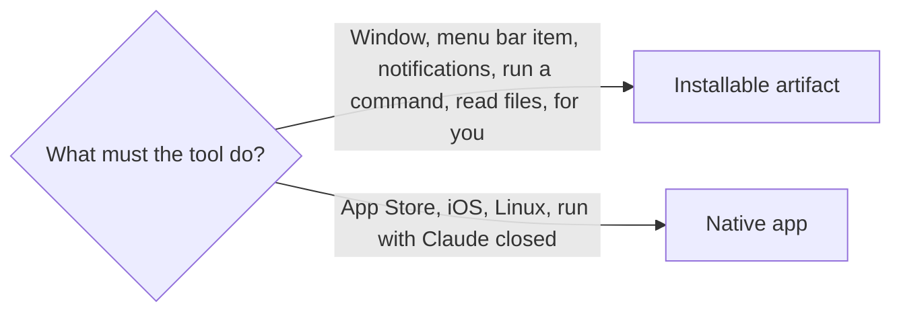

# Claude artifact apps: a Mac or Windows tool without a native app

This guide picks between an installable artifact and a native app.

| Need | Use | Why |
| --- | --- | --- |
| A status view, a menu bar counter, a notification, a small tool that runs `gh` or `git` | An installable artifact | It gets its own window and icon, and can show notifications, add a menu bar item, run programs and read files, each behind a permission prompt ([Install an artifact as an app](https://support.claude.com/en/articles/18516354-install-an-artifact-as-an-app), read 2026-11-26) |
| A dashboard to read | A plain artifact | It needs no window of its own. An artifact made from a template type, such as Docs, Slides or Sheets, cannot be installed (same article) |
| An App Store listing, iOS, Linux, a tool that runs with Claude closed | A native app | Apps are available on Mac and Windows only, and open only with Claude for Mac or Windows signed in and online (same article). Others can install a shared artifact too, but full access is usually refused when someone outside your organization wrote part of the app (same article) |

## Build one

1. Ask Claude for the app in a chat: "Make a Pomodoro timer that lives in my menu bar" is the article's own example ([article](https://support.claude.com/en/articles/18516354-install-an-artifact-as-an-app), read 2026-11-26). Claude builds the page as an ordinary artifact. When you publish it with the Artifact tool, declare `capabilities: {desktop: {}}` and list the permissions it uses in a `claude-artifacts-manifest` JSON tag, as in the [starter page](artifact-app/starter.html) (the Artifact tool's own `desktop` capability notes, which have no public page, runtime contract 0.2.99, read 2026-11-26).
2. Open the artifact in the Claude desktop app, open its title menu, select Install as app, then Install. A page can also draw its own install button ([article](https://support.claude.com/en/articles/18516354-install-an-artifact-as-an-app), read 2026-11-26). See the [starter page](artifact-app/starter.html).
3. Answer each permission request with Allow or Don't allow. An Allow covers one version of the app, so every edit asks again ([article](https://support.claude.com/en/articles/18516354-install-an-artifact-as-an-app), read 2026-11-26).

## Traps

| Trap | What to do |
| --- | --- |
| Full access lets the app run any program and change or delete files ([article](https://support.claude.com/en/articles/18516354-install-an-artifact-as-an-app), read 2026-11-26) | Ask for it only when the tool needs it, and name the files and commands in the page |
| The feature is off by default on Enterprise, and full access is off by default on Team | An owner or admin turns it on in the organization's Artifacts settings ([article](https://support.claude.com/en/articles/18516354-install-an-artifact-as-an-app), read 2026-11-26) |
| An app needs Claude Desktop signed in and online to open ([article](https://support.claude.com/en/articles/18516354-install-an-artifact-as-an-app), read 2026-11-26) | For a job that must run with Claude closed, use a scheduled task or an operating system job instead |
| Anthropic does not review apps ([article](https://support.claude.com/en/articles/18516354-install-an-artifact-as-an-app), read 2026-11-26) | Share the artifact only with people who trust everyone who wrote it. Keep the page private when it holds private repository names |
| Apps are not available in a browser, on the web or on mobile ([article](https://support.claude.com/en/articles/18516354-install-an-artifact-as-an-app), read 2026-11-26) | The same page also opens there, so test for the module you need (`desktop?.tray`) and show an install button or one line when it is missing |
| Computer use can see an installed app on macOS but cannot click or type in it ([article](https://support.claude.com/en/articles/18516354-install-an-artifact-as-an-app), read 2026-11-26) | Test the page's logic in a browser with the desktop API mocked |

## A worked example: the Claudius app

[`artifact-app/claudius.html`](artifact-app/claudius.html) is a finished installable app that reads your repos through `gh` and the public Quality page, and draws them as an original fantasy command center. Each repo is a keep that grows as pull requests merge, each open pull request is a quest, and a guide gnome speaks for the realm. Ask Claude to publish the file as an artifact with the `desktop` capability. Then install it as above.

| View | Shows | Read with |
| --- | --- | --- |
| Realm | The keeps on one road under a dusk or daybreak sky. A keep is a Camp, Outpost, Hamlet, Keep or Citadel at 0, 5, 25, 80 or 200 merged pull requests, with a building for each setup check that passes and a dashed plot for each that is missing. Bunting shows the Quality band for a keep whose own Pages address is that Quality page. The gnome walks to a keep you click | `gh api search/issues` with `is:pr is:merged` for the count, and the Repos reads below |
| Needs you | A gold quest marker over the keep and a glowing button for open issues and pull requests labeled `needs-owner`, longest waiting first. A thread adds the label when only you can do the step, such as an install, a passkey, typed words or billing. The menu bar shows the count, and a notification fires when a new one appears | `gh api repos/{repo}/issues?labels=needs-owner` |
| Quests | Open pull requests with a progress bar of finished checks over all checks, and one agent sprite per quest that hammers while checks run, cheers on green, kneels on red and reads while a draft | `gh api repos/{repo}/pulls` and `commits/{sha}/check-runs` |
| Stats | A character sheet from the Quality page: Renown (master), Craft (quality), Swiftness (speed) and Thrift (consumption), a radar, every tab lowest first, a level and title from merged pull requests, and eight trophies from plain facts | the public Quality page, trimmed with `curl` and `grep -o` |
| Keeps | Eight setup checks per repo: AGENTS.md, CLAUDE.md, README, SECURITY.md, a CI workflow, rules on the default branch, squash only, deletes merged branches | `gh api repos/{repo}`, `contents`, `contents/.github`, `contents/.github/workflows`, `rules/branches/{default branch}` |

Keys 1 to 5 switch views, and the address bar follows `#realm`, `#needs`, `#quests`, `#stats` and `#keeps`. A merge shows coins and a level-up card only for a merge the app saw after its first complete read of that repo. Sound is off until you turn it on. Under `prefers-reduced-motion` all animation and particles stop.

Change what it watches in the page's Settings, or edit the `claudius-config` JSON block near the top of the file. It cannot read Project threads, plan limits or credit use. They sit behind the Claude app and the Console rather than behind `gh`. The page says so instead of guessing.

The page's logic was run in headless Chromium with the desktop API mocked, in light and dark, at 400 px, with reduced motion, with the keyboard, with gh signed out, with an empty realm, with a failed first read, and through a merge and a level-up. No test in this repo covers it. The real install, the permission prompts, Mac notifications, the menu bar item and the web fonts were not run.

The feature is in beta and its permissions change, so read the cited article again before you rely on a limit.
