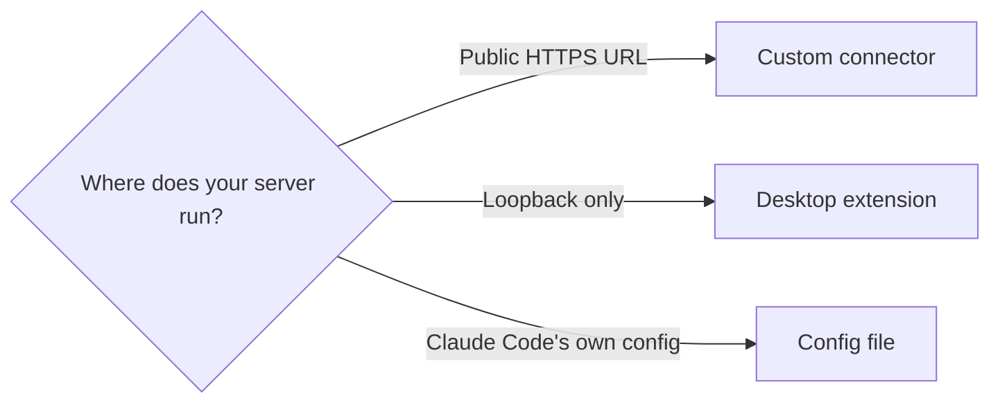

# Claude Desktop: one MCP server

This guide picks the route for an MCP server by where the server runs.

| Your server | Use | Who adds it |
| --- | --- | --- |
| A public HTTPS URL on port 443 | A custom connector. It works across claude.ai, Claude Desktop, Cowork and the mobile apps ([Connectors](https://support.claude.com/en/articles/11175166-get-started-with-custom-connectors-using-remote-mcp), read 2026-11-26) | You, at Customize > Connectors. On Team or Enterprise an Owner adds it first, then members select Connect |
| An app on this computer only | A desktop extension (`.mcpb`), such as one made from the [loopback bridge](claude-desktop-mcp/loopback.md) ([Add unlisted](https://claude.com/docs/connectors/custom/add-unlisted), read 2026-11-26) | You, on each computer |
| A server in Claude Code's own config | `~/.claude.json` or the project's `.mcp.json`, written by `claude mcp add` ([Claude Code MCP](https://code.claude.com/docs/en/mcp), read 2026-11-26) | You, in the file |
| A server in `claude_desktop_config.json` | A local server for Claude Desktop. It is not available in claude.ai or in Cowork sessions that run in the cloud ([Connectors](https://support.claude.com/en/articles/11175166-get-started-with-custom-connectors-using-remote-mcp), read 2026-11-26) | You |

## Set up a remote server

1. On Free, Pro, Max or Ultra, go to Customize > Connectors, select Add, then Add custom connector. On Team or Enterprise, an Owner goes to Organization settings > Connectors and selects Add, then Custom ([Add unlisted](https://claude.com/docs/connectors/custom/add-unlisted), read 2026-11-26).
2. Enter a name and the server URL, path included. Keep any option marked Detected unless the server's documentation says otherwise, then select Add.
3. On Team or Enterprise, each member opens their connectors, finds the one labeled custom and selects Connect.
4. Select Always allow only for servers you trust. A tool can also be set to Blocked under its connector's Tool permissions.

Where the Code tab and Cowork take their connectors from: Cowork takes them from your claude.ai account, not from the CLI's `~/.claude` directory ([Desktop docs](https://code.claude.com/docs/en/desktop), read 2026-11-26).

For an app on this computer only, see [the loopback bridge](claude-desktop-mcp/loopback.md). Traps and sources: [Claude Desktop MCP traps and sources](claude-desktop-mcp/traps.md).
