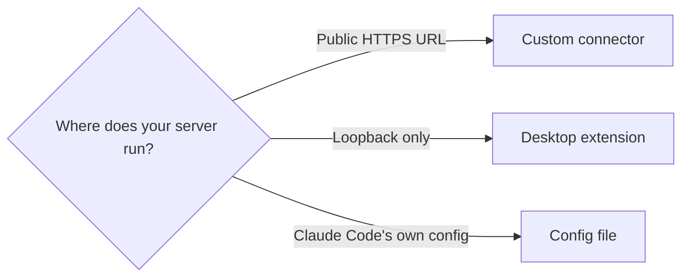

# Claude Desktop: one MCP server

This guide picks the route for an MCP server by where the server runs.

| Your server | Use | Who adds it |
| --- | --- | --- |
| A public HTTPS URL on port 443 | A custom connector. It works across claude.ai, Claude Desktop, Cowork and the mobile apps ([Connectors](https://support.claude.com/en/articles/11175166-get-started-with-custom-connectors-using-remote-mcp), read 2026-11-26) | You, at Customize > Connectors. On Team or Enterprise an Owner adds it first, then members select Connect |
| An app on this computer only | A desktop extension (`.mcpb`), such as one made from the [loopback bridge](claude-desktop-mcp/loopback.md) ([Add unlisted](https://claude.com/docs/connectors/custom/add-unlisted), read 2026-11-26) | You, on each computer |
| A server in Claude Code's own config | `~/.claude.json` or the project's `.mcp.json`, written by `claude mcp add` ([Claude Code MCP](https://code.claude.com/docs/en/mcp), read 2026-11-26) | You, in the file |
| A server in `claude_desktop_config.json` | A local server for Claude Desktop. It is not available in claude.ai or in Cowork sessions that run in the cloud ([Connectors](https://support.claude.com/en/articles/11175166-get-started-with-custom-connectors-using-remote-mcp), read 2026-11-26) | You |

## Set up a remote server

1. On Free, Pro, Max or Ultra, go to Customize > Connectors, select Add, then Add custom connector. On Team or Enterprise, an Owner goes to Organization settings > Connectors and selects Add, then Custom ([Add unlisted](https://claude.com/docs/connectors/custom/add-unlisted), read 2026-11-26).
2. Enter a name and the server URL, path included. Keep any option marked Detected unless the server's documentation says otherwise, then select Add.
3. On Team or Enterprise, each member opens their connectors, finds the one labeled custom and selects Connect.
4. Select Always allow only for servers you trust. A session ignores a tool it does not need; none is turned off app-wide ([All on, app-wide](../README.md#all-on-app-wide)).

Where the Code tab and Cowork take their connectors from: Cowork takes them from your claude.ai account, not from the CLI's `~/.claude` directory ([Desktop docs](https://code.claude.com/docs/en/desktop), read 2026-11-26).

## What a server can add to its tools

Four features, all optional. Skills and Tasks are extensions that a server declares. Elicitation is a core feature that the client declares. File Uploads is experimental. A client uses an extension only when both sides declare it ([Extensions](https://modelcontextprotocol.io/extensions/overview), read 2026-11-26).

| Feature | What the server gets | Status in Claude (announced 2026-11-24) | Do |
| --- | --- | --- | --- |
| [Skills over MCP](https://modelcontextprotocol.io/extensions/skills/overview) | Publishes skills beside its tools. Claude loads one only when needed, and it updates with the server ([announcement](https://claude.com/resources/articles/skills-over-mcp-tasks-and-more), read 2026-11-26) | Public beta in Claude and Claude Code. On by default for Pro, Max and Ultra. Team once an admin enables it. Enterprise coming | Serve `skills/list`, `skills/get` and each file over `resources/read`, and declare `resources` and `io.modelcontextprotocol/skills`. Keep a skill to at most 512 files and 16 MiB ([Skills](https://modelcontextprotocol.io/extensions/skills/overview), read 2026-11-26). A [starter server](skills-server/README.md) does this |
| [Tasks](https://modelcontextprotocol.io/extensions/tasks/overview) | Returns a task handle for work that takes time. Claude keeps working and polls `tasks/get` | Generally available for Pro, Max and Ultra. Rolling out to Team and Enterprise | Return a task for a tool that runs longer than a few seconds, so no connection stays open. Return one only to a client that declared `io.modelcontextprotocol/tasks` ([Tasks](https://modelcontextprotocol.io/extensions/tasks/overview), read 2026-11-26) |
| [Elicitation](https://modelcontextprotocol.io/specification/2026-07-28/client/elicitation) | Asks the user for input through a form or a link, then continues | Same as Tasks | Ask before spend or a destructive step, as the [announcement](https://claude.com/resources/articles/skills-over-mcp-tasks-and-more) shows (read 2026-11-26). Use a link, never a form, for a credential ([Elicitation](https://modelcontextprotocol.io/specification/2026-07-28/client/elicitation), read 2026-11-26). A thread nobody watches waits for a person, so the question joins the owner's queue ([Decide](https://github.com/Colorado-Startups/claudius/blob/main/maps/README.md#decide-a-question-or-blocker-to-claudes-call-or-the-owners-queue)) |
| [File Uploads](https://github.com/modelcontextprotocol/experimental-ext-file-uploads) | Receives PDFs, spreadsheets and images without passing them through the context window | Rolling out soon. The extension is experimental and not part of the MCP specification | Wait for a release before building on it ([repository](https://github.com/modelcontextprotocol/experimental-ext-file-uploads), read 2026-11-26) |

The status column comes from the [announcement](https://claude.com/resources/articles/skills-over-mcp-tasks-and-more), read 2026-11-26, except the File Uploads note, which comes from its repository. The announcement does not say where a server's skills appear, so check your session's skill listing. The [All on, app-wide](../README.md#all-on-app-wide) rule holds either way: an admin who has not enabled Skills over MCP is a step for the [`equip` skill](https://github.com/Colorado-Startups/claudius/blob/main/plugin/skills/equip/SKILL.md) to name, never a reason to turn a connector off.

## Ship skills, server and tasks as one plugin

A plugin can carry a server beside its skills. Claude Code loads `.mcp.json` from the plugin root, or `mcpServers` inline in `plugin.json`, when the plugin is on. You add or remove that server by installing or removing the plugin ([Plugin MCP servers](https://code.claude.com/docs/en/mcp#plugin-provided-mcp-servers), read 2026-11-26).

| Part | Where it lives | What to know ([Claude Code MCP docs](https://code.claude.com/docs/en/mcp), read 2026-11-26) |
| --- | --- | --- |
| Skills | `skills/` in the plugin, plus any a server serves over MCP | A skill from a server you add is `<server>:<skill>`. A plugin server adds a prefix, as in `plugin_my-plugin_docs:pdf`, and a connector too, as in `claude_ai_Docs:pdf`. It needs Claude Code v2.1.331 or later. With a Team or Enterprise login it stays off until the organization turns it on ([Skills from MCP servers](https://code.claude.com/docs/en/mcp#use-skills-from-mcp-servers)) |
| Server | `.mcp.json` at the plugin root | A connector and a plugin server that share an endpoint count as one server, and Claude Code connects the one with higher precedence |
| Tasks | The server returns a task handle | A cloud session gets no tasks from a `.mcp.json` or plugin server, so a tool that works only as a task returns the server's error. Add that server as a connector instead, or run the tool from a terminal session on a paid plan ([Tasks](https://code.claude.com/docs/en/mcp#mcp-tasks-that-run-on-the-server)) |
| Elicitation | The server asks, the person answers | In `claude -p` and Agent SDK runs the task is cancelled, and no `Elicitation` hook runs. An interactive terminal session shows a dialog. VS Code and the desktop app show none, so only a hook can answer there ([Elicitation hook](https://code.claude.com/docs/en/hooks#elicitation)) |
| Approvals | Permission rules | `Skill(mcp__<server>__*)` rules cover a server's skills. An `allow` rule does not apply to plugin servers or connectors, and a connector set to Restrict to Ask prompts every time ([Approvals for MCP skills](https://code.claude.com/docs/en/mcp#approvals-for-mcp-skills)) |
| Scan | Anthropic | A custom connector's skills load only after the scan passes, where the organization keeps scanning on. Servers added with `claude mcp add` are not scanned. Serve only skills you would publish ([Security scanning](https://code.claude.com/docs/en/mcp#security-scanning-for-mcp-skills)) |

Do not serve the same skills twice to one session. A plugin that already has `skills/` gains nothing from a server entry that serves them again, and the two copies drift. Use the plugin's own `skills/` for Claude Code. Use the [starter server](skills-server/README.md) as a connector for the surfaces a plugin does not reach.

An entry in the public pack never carries a private host. Keep a team's own server URL in the team's private plugin or in a user's own settings.

Through the [loopback bridge](claude-desktop-mcp/loopback.md), a server on an older revision keeps its declared extensions as sent when the app is open as the session starts, but the sources do not show that Claude Desktop uses them. The limits are in [Bridge behavior](claude-desktop-mcp/loopback.md#bridge-behavior) and [the traps](claude-desktop-mcp/traps.md).

For an app on this computer only, see [the loopback bridge](claude-desktop-mcp/loopback.md). Traps and sources: [Claude Desktop MCP traps and sources](claude-desktop-mcp/traps.md).
