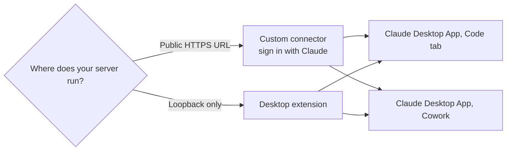

# Claude Desktop: one MCP server for the Code tab and Cowork

The Code tab and Cowork both use MCP tools. This guide picks the route that gives one server to both.

| Your server | Use | Reaches | Who adds it |
| --- | --- | --- | --- |
| A public HTTPS URL | A custom connector ([Connectors](https://support.claude.com/en/articles/11175166-get-started-with-custom-connectors-using-remote-mcp), read 2026-11-24). | Desktop chat, Cowork and the Code tab, claude.ai and mobile ([Claude Code MCP](https://code.claude.com/docs/en/mcp#how-connectors-reach-claude-code), read 2026-11-20). | You, at Customize > Connectors ([Connectors](https://support.claude.com/en/articles/11175166-get-started-with-custom-connectors-using-remote-mcp), read 2026-11-24). A Team or Enterprise Owner adds it first. |
| An app on `127.0.0.1` only | A desktop extension (`.mcpb`) from [loopback-bridge/](loopback-bridge/) ([MCPB page](https://claude.com/docs/connectors/building/mcpb), read 2026-11-20). | Cowork and the Code tab's local sessions on that computer (a test, 2026-11-20). | You, on each computer. |
| A server in Claude Code's own config (`~/.claude.json`, `.mcp.json`; `claude mcp add` writes there) | That file. | The Code tab only. Cowork takes connectors from your Claude account ([Desktop docs](https://code.claude.com/docs/en/desktop), read 2026-11-24). | You, in the file. |
| A server in `claude_desktop_config.json` | Desktop's local config. | A Cowork session on this computer, not claude.ai or cloud Cowork ([Connectors](https://support.claude.com/en/articles/11175166-get-started-with-custom-connectors-using-remote-mcp), read 2026-11-24). | You. |

## Wiring

| Host | Plugs in as | Source, read 2026-11-24 |
| --- | --- | --- |
| Claude Desktop App, Code tab | A custom connector, added at Customize > Connectors. Open a new session after adding (seen in a test, 2026-11-20). | [Connectors](https://support.claude.com/en/articles/11175166-get-started-with-custom-connectors-using-remote-mcp), [Desktop docs](https://code.claude.com/docs/en/desktop) |
| Claude Desktop App, Cowork | The same connector. Cowork takes connectors from your claude.ai account. | [Desktop docs](https://code.claude.com/docs/en/desktop) |

## Set up a remote server

1. On Free, Pro, Max or Ultra, go to Customize > Connectors, select Add, then Add custom connector. On Team or Enterprise, an Owner goes to Organization settings > Connectors first ([Connectors](https://support.claude.com/en/articles/11175166-get-started-with-custom-connectors-using-remote-mcp), read 2026-11-24).
2. Enter a name and the server URL as the provider documents it, path included. Keep the Detected authentication option, then select Add.
3. On Team or Enterprise, each member selects Connect on the Custom connector.
4. For a read-only docs connector, set its read-only tools to Always allow under Tool permissions. Leave write tools at Needs approval.
5. Start a new Code tab session. An open session did not list a new connector (a test, 2026-11-20).

For an app on this computer only, see [the loopback bridge](claude-desktop-mcp/loopback.md). Traps and sources: [Claude Desktop MCP traps and sources](claude-desktop-mcp/traps.md).
