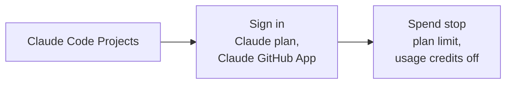

# Claude Code Projects

A Project is one Claude conversation that starts cloud threads, each usually a cloud session on its own branch. Setup is in the [Code Project template](../code-project/README.md).

| Question | Answer | Source, read 2026-11-26 |
| --- | --- | --- |
| Which plans | Pro, Max and Ultra, in public beta and rolling out gradually. Not Team or Enterprise yet | [Projects](https://code.claude.com/docs/en/claude-projects) |
| Where | claude.ai/code and the Code tab of the desktop app | [Projects](https://code.claude.com/docs/en/claude-projects) |
| GitHub | The Claude GitHub App installed on each repository the project works on | [Projects](https://code.claude.com/docs/en/claude-projects) |
| What a cloud thread loads | Each repository's `CLAUDE.md`, and the connectors on your claude.ai account. Not a repository's `.mcp.json` servers or `.claude/settings.json` hooks, permission rules and `env` | [Projects](https://code.claude.com/docs/en/claude-projects) |
| At the plan limit | A thread waits and by default continues when the limit resets. A project setting turns that off | [Projects](https://code.claude.com/docs/en/claude-projects) |
| Past the limit | Only with usage credits turned on for the account | [Projects](https://code.claude.com/docs/en/claude-projects) |
| Thread cap | 500 new threads a day across your projects | [Projects](https://code.claude.com/docs/en/claude-projects) |
| Your own computer | A thread can run there through Remote Control | [Projects](https://code.claude.com/docs/en/claude-projects) |

Where a guard must live, since a cloud thread skips the repo's settings file: [Code Project template](../code-project/README.md#where-a-guard-lives).
