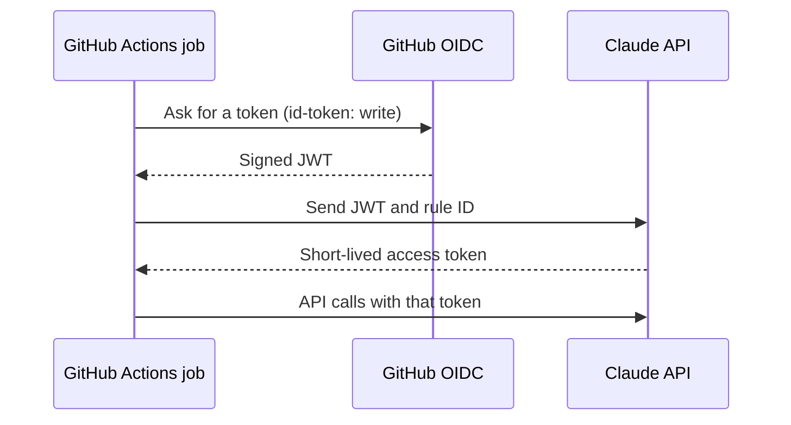

# Claude API: keyless CI

How GitHub Actions calls the Claude API with no stored key. The credits and guard are in [Claude API](../claude-api.md). Traps and sources: [Claude API traps and sources](claude-api-traps.md).

## Set up

1. As an organization admin, open [Workload identity](https://platform.claude.com/settings/workload-identity-federation) and select **Connect workload**, then the GitHub Actions tile. The wizard creates the issuer, a service account and a federation rule, then listens for a test exchange for 15 minutes ([WIF](https://platform.claude.com/docs/en/manage-claude/workload-identity-federation), read 2026-11-26).
2. Give the job `id-token: write` and pass the IDs the wizard shows. The action's setup page calls them identifiers, not credentials ([Setup](https://github.com/anthropics/claude-code-action/blob/main/docs/setup.md), read 2026-11-26).
3. Copy the [keyless workflow](../ci/claude-keyless.yml) to `.github/workflows/` and replace its three `<...>` values.
4. Set no API key beside it. A leftover `ANTHROPIC_API_KEY` silently overrides federation, and `ant auth status` reports which source won ([WIF](https://platform.claude.com/docs/en/manage-claude/workload-identity-federation), read 2026-11-26).
5. Use a key only when the client cannot exchange a token. Create a service account key for one workspace and pick a short expiry. Presets run from 3 hours to 30 days, and the expiry cannot change afterward ([Authentication](https://platform.claude.com/docs/en/manage-claude/authentication), read 2026-11-26). Store it as a CI secret.

Plan credits do not cover Claude Code ([API credits](https://platform.claude.com/docs/en/about-claude/api-credits-for-subscribers), read 2026-11-26), and the action runs Claude Code. The action's setup page does not say whether federation works with plan credits alone. The Agent SDK is covered by the credits, so a script that calls it with the same IDs is the covered route.

## Hard cap

| Cap | Where | Value |
| --- | --- | --- |
| Run length | `timeout-minutes` in the workflow | 10 minutes in the file |
| Turns | `--max-turns` in `claude_args` | 8 in the file. The CLI reference limits turns in print mode only ([CLI reference](https://code.claude.com/docs/en/cli-reference), read 2026-11-26) |
| Workspace spend | Claude Console, workspace spend limit | Give a project its own workspace and limit ([API credits](https://platform.claude.com/docs/en/about-claude/api-credits-for-subscribers), read 2026-11-26) |
| Auto-reload | Claude Console billing | Off, so requests stop at zero credit |
