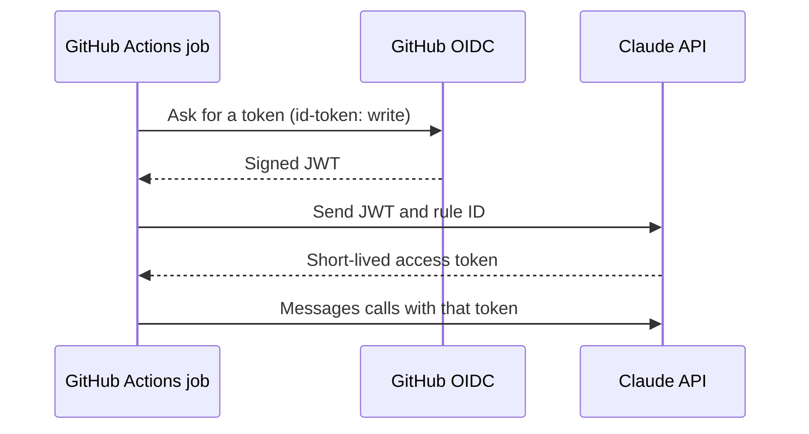

# Claude API: keyless CI

How GitHub Actions calls the Claude API with no stored key. The guard is in [Claude API detail](claude-api.md). Traps and sources: [Claude API traps and sources](claude-api-traps.md).



## Set up

1. As an organization admin, open [Workload identity](https://platform.claude.com/settings/workload-identity-federation), choose **Connect workload**, then the GitHub Actions tile. It creates the issuer, a service account and a rule, and tests the exchange ([WIF](https://platform.claude.com/docs/en/manage-claude/workload-identity-federation), read 2026-11-24).
2. Give the job `id-token: write` and pass the three IDs the wizard shows. They are identifiers, not secrets ([Setup](https://github.com/anthropics/claude-code-action/blob/main/docs/setup.md), read 2026-11-24).

```yaml
permissions:
  id-token: write
steps:
  - uses: anthropics/claude-code-action@v1
    with:
      anthropic_federation_rule_id: <fdrl_ id>
      anthropic_organization_id: <organization id>
      anthropic_service_account_id: <svac_ id>
```

3. Plan credits cannot pay for `claude-code-action`. On them, run the Agent SDK with these IDs, as the re-read agent in [Colorado-Compute/compute-credits](https://github.com/Colorado-Compute/compute-credits/blob/main/tools/reread_agent.py) does.
4. Set no API key next to it: a static key wins over federation. `ant auth status` shows which source won ([WIF](https://platform.claude.com/docs/en/manage-claude/workload-identity-federation), read 2026-11-24).
5. Use a key only when the client cannot exchange a token. A federated token goes in `Authorization: Bearer`, so a client that sends only `x-api-key` needs a key ([Authentication](https://platform.claude.com/docs/en/manage-claude/authentication), read 2026-11-24).
6. Make a service account key for one workspace, pick an expiry of 3 hours to 30 days, and name it for its one job. Store it as a CI secret ([Authentication](https://platform.claude.com/docs/en/manage-claude/authentication), read 2026-11-24).

## Hard cap

Copy the [keyless workflow](../ci/claude-keyless.yml) to `.github/workflows/` and paste the three IDs over its `<...>` values. It sets a job timeout, a turn cap and cancel-on-push.

| Cap | Where | Value |
| --- | --- | --- |
| Run length | `timeout-minutes`, `--max-turns` | In the file |
| Workspace spend | Claude Console, workspace limit | Caps prepaid credit at or under the monthly credit |
| Auto-reload | Claude Console billing | Off, so requests stop at zero credit |

A flat subscription is fine. With auto-reload off, nothing bills beyond the prepaid credit, so overage has a $0 goal.
