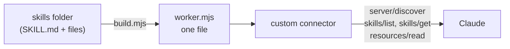

# Skills server

A dependency-free MCP server that serves a folder of Agent Skills ([Skills over MCP](https://modelcontextprotocol.io/extensions/skills/overview), MCP revision 2026-07-28). It keeps no session and no storage, so it runs on a free Cloudflare Worker, Deno Deploy or any Node 18+ host.



| File | Job |
| --- | --- |
| [`worker.mjs`](worker.mjs) | The handler. `createHandler(catalog)` returns `fetch(request, env)` |
| [`build.mjs`](build.mjs) | Reads the folder, hashes every file (sha256) and writes `catalog.json` plus one deployable `worker.mjs` |
| [`tests/skills-server.test.mjs`](https://github.com/Colorado-Startups/claudius/blob/main/tests/skills-server.test.mjs) | Builds this repo's own `plugin/skills` and calls every method |

## Use it

```bash
node build.mjs path/to/skills dist my-skills   # skills folder, output folder, server name
```

`dist/worker.mjs` is the whole server. On Cloudflare, `wrangler deploy dist/worker.mjs --name my-skills --compatibility-date 2026-11-01` uploads it. Then add the URL as a custom connector (Customize > Connectors). Where Claude lists the skills a connector brings is not stated in the [announcement](https://claude.com/resources/articles/skills-over-mcp-tasks-and-more), so check your session's skill list.

## What it answers

| Call | Reply |
| --- | --- |
| `server/discover` | Version `2026-07-28`, capabilities `resources` and `io.modelcontextprotocol/skills`, server name |
| `skills/list`, `skills/get` | One entry per skill: `uri`, verbatim `frontmatter`, and every file with its `sha256` digest and size |
| `resources/read`, `resources/list` | The file text, or base64 for a binary file |
| `ping` | `{}` |
| `initialize` | A shim for a client on an older revision. It sets no session id |
| anything else | 404 with `-32601` |

The handler checks what the transport page requires: `MCP-Protocol-Version` equal to the version in `_meta`, `Mcp-Method` equal to the method, and `Mcp-Name` equal to `params.uri` on `resources/read` (`-32020` on a mismatch, `-32022` for another version). It refuses a browser `Origin` unless it is `https://claude.ai`, `https://claude.com` or in the `ALLOWED_ORIGINS` variable (comma separated).

## Limits

| Limit | Why |
| --- | --- |
| Public and read-only | There is no sign-in. Serve only skills you would publish, such as the ones in a public repo |
| One skill is at most 512 files and 16 MiB | The extension's limit. `build.mjs` fails above it |
| Frontmatter is flat `key: value` | `build.mjs` fails on a folded or nested value instead of reading it half right |
| Tested offline only | The test calls the handler directly. No Claude client has been run against it, and the `initialize` shim is unverified against one |

Rebuild and redeploy when a skill changes: the catalog is baked into `worker.mjs`, so the digests always match the files it serves.
